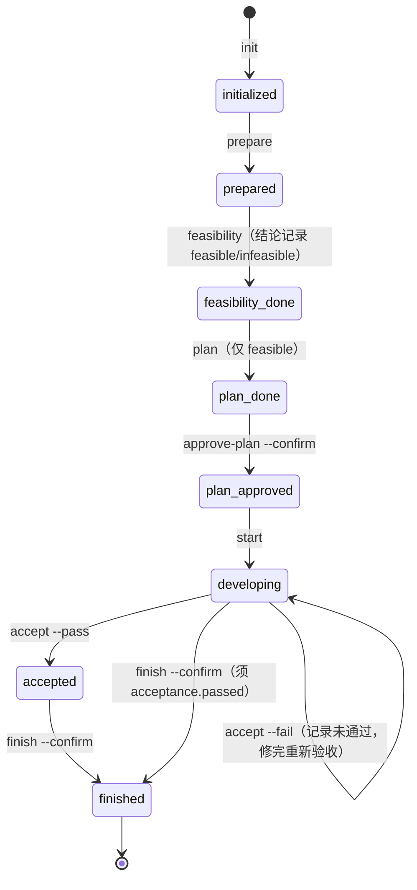

# 禅道研发任务执行与收尾（接入 / 前置任务 / 可行性 / 计划审批 / 开发 / 验收 / 收尾）

本 skill 管理**已存在的禅道研发任务**的完整执行生命周期：接入任务（`init`）→ 判断并创建前置任务（`prereq`）→ 收集研发环境与 Git 仓库（`prepare`）→ 可行性分析（`feasibility`）→ 开发计划与用户审批（`plan` / `approve-plan`）→ 执行开发（`start`）→ 用户验收（`accept`）→ 收尾（`finish`）。收尾时把设计/计划等过程文档打包成 zip 挂到任务附件、把开发过程总结作为任务备注、把任务状态改为完成，并自动指派回需求创建人（找不到则任务创建人）。

**边界一句话**：只写禅道数据（前置任务、附件、备注、开始/完成、指派人），Git 只做只读查询；不生成需求或设计包、不删除/关闭任务、不做评审、不做任何 Git 写操作；编码由 agent 按用户批准的计划执行。

**API 方案**：统一使用禅道 **v2 API**（`/api.php/v2`，请求头 `Token: <token>`），登录用 v2 `users/login`；v1 仅作为用户列表查询的兜底。本 skill 全程通过 API 操作，不依赖页面会话。

## 0. 快速开始（最小闭环）

```text
init（接入任务）→ 判断前置条件（缺则 prereq）→ prepare（环境/Git）
→ agent 写 feasibility.md → feasibility
→ agent 写 dev-plan.md → plan → 展示给用户审核 → 用户确认 → approve-plan --confirm
→ start → agent 按计划编码/自测（进展写入 summary.md）→ accept --pass
→ finish --dry-run → 用户确认 → finish --confirm
```

本 skill 需要本机 **Python 3.11+**（脚本只用标准库）与可用的 `git`；脚本位置 `<skill目录>/scripts/zentao_dev_task.py`，接口细节见 `references/zentao-task-ops-api.md`。

## 1. 定位与边界

**做什么：**

- 管理**已存在**的禅道研发任务：读任务/需求、收集环境与仓库、可行性分析、开发计划审批、执行开发、用户验收、研发完成收尾。
- 缺前置条件时，在**当前执行**下创建前置任务，指派给用户指定的协同人员，并在前置任务描述中写明被阻塞任务。
- 研发完成后收尾：过程文档 zip 附件、开发总结备注、任务完成、指派回需求创建人（需求创建人缺失时任务创建人兜底）。
- 统一使用禅道 v2 API 完成上述读写。

**不做什么：**

| 不做 | 归属 / 说明 |
| --- | --- |
| 生成或修改 REQ/AC | `generate-requirement-docs` |
| 生成研发任务设计包 | `generate-dev-task`（本 skill 只执行已存在的任务） |
| 删除/关闭/取消禅道任务、需求评审、需求变更 | 不做；状态只允许推进到「完成」 |
| Git 写操作（add/commit/push/tag/checkout/merge/rebase/force-push） | 不做；仅只读查询状态/远端/分支/提交 |
| 代码生成 | 脚本不生成代码；编码由 agent 按**用户已批准**的开发计划执行 |
| 自动填写用户未提供的环境/仓库/工时/验收事实 | 缺失必须询问，不猜 |

## 2. 硬约束

1. **只管理用户指定的已存在任务**：必须有明确的禅道任务 id；不得猜测任务 id、项目/执行 id 或账号。
2. **阶段不可跳步**：状态机 `initialized → prepared → feasibility_done → plan_done → plan_approved → developing → accepted → finished`；每个命令校验前置状态，不允许跳过可行性/计划/验收直接收尾。`status` 可随时查看当前阶段。
3. **用户确认门槛**：所有禅道写操作必须 **dry-run 计划 → 向用户展示 → 用户明确同意 → 加 `--confirm`**；无 `--confirm` 不得写禅道，未 `--dry-run` 且未 `--confirm` 时脚本退出 2。
4. **计划审批门槛**：开发计划必须完整展示给用户审核，用户明确同意后才能 `approve-plan --confirm`；这是「自动执行开发」的唯一前置门槛。
5. **验收门槛**：只有用户验收通过（`accept --pass`，`acceptance.passed=true`）才允许 `finish`；验收未通过不得收尾，`--force` 不得绕过。
6. **收尾硬门槛**：`summary.md` 必须存在且非空（agent 必须先写开发过程总结）；任务回读状态不得是 `done/closed/cancel`（否则退出 7）。
7. **收尾指派规则**：默认指派回**需求创建人**；需求创建人缺失/不可用时用**任务创建人**兜底；两者都缺失 → 退出 2，要求用户显式 `--assign-back <账号>`；finish 后必须回读校验实际指派人。
8. **附件与备注规则**：zip 内容与收尾顺序按第 7.8 节；附件通过 v2 `POST /files` 上传、独立备注通过 v2 `POST /actions/comment` 提交。**附件上传失败（非 `--no-attach`）严格停止并报告阶段（退出 5）**；独立备注失败降级为「summary 并入 finish 的 comment」并记录 degraded；`--no-attach` 表示**用户明确同意跳过附件上传、自行手动上传**，必须在报告中标注。
9. **凭据规则**：用户名/密码只能由用户提供；密码只允许 `--password-stdin` 或环境变量 `ZENTAO_PASSWORD`（不提供 `--password`）；密码/token 不得出现在命令行、日志、报告、`context.json`、zip、备注或仓库文件中。复用已保存值前必须向用户确认（`--reuse`）；换禅道地址禁止复用账号密码。
10. **不删除、不改他人数据**：不删除禅道任务/附件/评论；除本次创建的前置任务、本次 finish 的指派人外，不修改他人任务。
11. **失败如实报告**：任一阶段失败立即停止并报告**已完成/未完成**（zip 已生成/附件已传/备注已加/finish 未执行等），不得声称已完成；重跑前先回读禅道状态，避免重复写。
12. **不虚构事实**：仓库、分支、构建/测试命令、运行环境、工时、验收证据必须来自用户或实测；缺失询问，不填「看起来对」的值。

## 3. 前置条件与能力

| 项 | 要求 |
| --- | --- |
| Python | 3.11+，脚本只用标准库 |
| Git | 本机可用；`prepare` 校验仓库、记录 remote/branch/HEAD/clean，仅只读 |
| 禅道 | 22.6；默认地址 `http://192.168.110.25:30783`；任务对登录账号可见 |
| API | 统一 v2 API（`/api.php/v2`，`Token` 头）；v1 仅用户列表兜底 |
| 账号权限 | 任务可见、可开始/完成任务、可在当前执行下创建任务；用户列表权限可选 |

命令统一形式：`python <skill目录>/scripts/zentao_dev_task.py <子命令> [参数]`。脚本每个命令独立以 v2 API 登录一次（v2 `users/login`；仅当 v2 login 返回 404/不可用时用 v1 `tokens` 兜底），不能跨命令复用进程内会话；可复用保存的密码，但必须遵守第 10 节复用确认规则。

## 4. 总流程与状态机

| 阶段 | 命令 | 产物 / 动作 | 用户参与 |
| --- | --- | --- | --- |
| 0 接入 | `init --task-id <id>` | `context.json`、任务/需求/创建人快照、capabilities | 提供任务 id |
| 1 前置检查 | `prereq`（按需） | 前置任务（当前执行下）+ context.prerequisites | **agent 主动提示**、用户确认创建并提供协同人员 |
| 2 环境与仓库 | `prepare` | context.prepare（仓库/分支/HEAD/clean/构建测试命令/工具链） | **用户补充**研发环境与 Git 仓库信息 |
| 3 可行性 | `feasibility` | `feasibility.md`、结论与 blockers | agent 分析；不可行时用户决定创建前置任务或停止 |
| 4 计划审批 | `plan` → `approve-plan --confirm` | `dev-plan.md`、plan_approved | **用户审核计划并明确同意** |
| 5 执行开发 | `start` | 任务开始（wait→doing）、`developing`；agent 编码/自测 | 开工须知确认 |
| 6 用户验收 | `accept --pass/--fail` | `acceptance.md`、验收结论 | **用户验收** |
| 7 收尾 | `finish` | zip 附件、备注、任务完成、指派回需求创建人 | **agent 主动提示**、用户确认收尾计划 |



- 可行性结论为 `infeasible` 时**不得进入** `plan`：提示用户创建前置任务（7.2）或停止（状态停在 `feasibility_done`）。
- 任务状态冲突（已完成/已关闭/已取消、`start` 时非 `wait/doing`、`accept` 时非 `developing` 等）一律退出 7，并给出下一步建议。
- 状态与阶段以 `context.json` + `status` 命令为准；**禁止手工编辑 `context.json` 绕过门槛**。

**与原需求对应**：需求 1 → 阶段 7（研发完成收尾）；需求 2 → 阶段 1（前置任务）；需求 3 → 阶段 2~6（环境/Git → 可行性 → 计划审批 → 开发 → 用户验收）。

## 5. 工作区、上下文与产物

默认工作区 `.zentao-dev-task/<taskId>/`（`--workspace` 可改）：

```text
.zentao-dev-task/<taskId>/
├── context.json        # 状态机、输入快照、记录（不含密码/token）
├── feasibility.md      # 可行性分析（agent 写）
├── dev-plan.md         # 开发计划（agent 写）
├── summary.md          # 开发过程总结（agent 写，收尾用）
├── acceptance.md       # 用户验收记录（--pass 时脚本写入或引用 --evidence-file）
├── documents/          # 设计/计划等过程文档（用户/agent 放入，收尾打包）
└── attachments/        # 收尾生成的 zip
```

- `context.json` 记录任务/需求快照、创建人解析结果（需求创建人/任务创建人）、各阶段时间戳、prepare 事实、prerequisites、可行性结论、计划审批、验收结论、delivery（zip/附件/备注/指派明细）与 warnings。
- 写入为原子写；**不得写入密码/token**。
- 除 `init` 外，本地状态命令按 `--task-id` 或 `--workspace` 二选一定位工作区；两者都缺省时取当前目录下**唯一**的 `.zentao-dev-task/*` 工作区；多候选或找不到时退出 2，提示先 `init`。

## 6. agent 主动提示与用户确认点

| 时机 | agent 主动提示（示例） | 用户动作 | 对应命令 |
| --- | --- | --- | --- |
| 任务接入后 | 「已接入任务 `<id> <名称>`（状态 `<status>`）。收尾时将默认指派回 `<需求创建人/任务创建人>`。请补充研发环境与 Git 仓库信息。」 | 提供仓库路径/分支/构建测试命令/运行环境 | `init` → `prepare` |
| 发现缺前置条件 | 「当前任务缺少前置条件：`<代码/数据/环境/依赖/权限/设计澄清>`。是否在当前执行下创建前置任务，指派给 `<协同人员账号>` 处理？」 | 明确同意、提供协同人员账号 | `prereq --dry-run` → `--confirm` |
| 可行性结论不可行 | 「可行性分析结论为不可行，阻塞项：`<blockers>`。建议创建前置任务或暂停；是否创建前置任务？」 | 决定创建前置任务或停止 | `feasibility` → `prereq` |
| 计划生成后 | 「开发计划已生成：`<路径>`，摘要 `<步骤数/风险>`。请审核；确认后我将开始执行开发。」 | **审核并明确同意**（可要求修改） | `plan` → 用户确认 → `approve-plan --confirm` |
| 研发完成（编码+自测完成） | 「研发已完成：`<改动摘要>`，自测结果 `<...>`。开发完成请验收；验收通过后收尾禅道任务。」 | 验收 | `accept --pass/--fail` |
| 收尾前 | 「是否收尾禅道任务？将：过程文档打包 zip 挂到任务附件、开发总结作为任务备注、任务状态改为完成、指派回 `<需求创建人>`。」 | **明确同意收尾计划** | `finish --dry-run` → `--confirm` |
| 附件上传失败 | 「附件上传失败（`<错误>`），收尾已停止（任务尚未完成）。请检查网络/权限后重试；或同意手动上传 zip 后加 `--no-attach` 重跑。」 | 决定重试或同意手动上传 | `finish`（严格停止，退出 5） |
| 独立备注失败 | 「独立备注提交失败，是否接受把开发总结并入完成备注（degraded）后继续收尾？」 | **明确同意降级** | `finish`（记录 degraded） |

**agent 不得替用户做这些决定**：是否创建前置任务、协同人员是谁、计划是否通过、验收是否通过、是否接受备注降级、是否跳过附件上传（`--no-attach`）。

## 7. 分阶段执行

### 7.1 阶段 0：接入任务（`init`）

触发：用户给出禅道研发任务 id（如「开始禅道任务 1234」「接入这个任务」）。

```powershell
$SCRIPT = "<skill目录>/scripts/zentao_dev_task.py"
python $SCRIPT init --task-id <任务ID>
```

- 以 v2 API 登录（v2 login 失败→退出 5，不自动重试；仅 v2 login 404 时用 v1 tokens 兜底），探测并报告 capabilities。
- 读取任务详情（v2 `GET /tasks/{id}`，响应含 `task` 与 `actions`）；任务状态必须是 `wait/doing/pause`，否则退出 7。
- 若任务关联需求且需求可见、未删除：读取需求创建人（v2 `GET /stories/{id}` 的 `story.openedBy`）；否则记为空。任务创建人 = 任务 `openedBy`；收尾指派建议 = 需求创建人 → 任务创建人。
- 创建/更新工作区与 `context.json`（已存在则保留历史、刷新任务快照；`--force` 重置状态机必须配合 `--confirm`）。
- 输出任务名/状态/需求/创建人/建议收尾指派/capabilities/当前状态；`--json` 输出结构化结果。

失败：登录/接口失败 5（网络 6）；任务不可见/无权限 5；状态非法 7。

### 7.2 阶段 1：前置检查与创建前置任务（`prereq`）

**何时判断**：`init` 之后、`prepare`/可行性分析过程中，agent 发现缺少**前置条件**（代码、数据、环境、依赖、权限、设计澄清等）。

**主动提示用户**（见第 6 节），用户明确同意后才创建。协同人员账号由用户提供（一般为姓名拼音；不确定时让用户在禅道确认，脚本会用户列表校验；用户列表无权限时降级为告警、由用户确认账号）。

```powershell
# 1) 先 dry-run：展示完整创建计划（零写）
python $SCRIPT prereq --assignee <协同人员账号> `
  --name "[前置] <当前任务名>" --dry-run

# 2) 用户确认后创建
python $SCRIPT prereq --assignee <协同人员账号> `
  --name "[前置] <当前任务名>" --confirm
```

- 通过 v2 `POST /tasks` 在当前执行下创建（body 含 `name,executionID,type,assignedTo,estStarted,deadline,pri,estimate,desc,story,module`）。
- 默认：名称 `[前置] <当前任务名>`；类型 `devel`；优先级 `P2`；预计起止沿用当前任务起止（缺失时用今天/今天+30 天并告警）；`--story/--module` 沿用当前任务；`--notify` 默认尝试在当前任务下用 v2 comment 留言前置任务链接（失败降级告警，不阻塞创建）。
- 前置任务描述必须写明：被阻塞任务 id/名称/链接、所需前置条件、期望交付物、时限。
- 创建成功后更新 `context.prerequisites` 并输出前置任务 id/链接；**不自动开始前置任务、不把它指派给当前人**。
- 未 `--dry-run` 且未 `--confirm` → 退出 2。创建失败按 5/6 处理；指派人不存在退出 2。

### 7.3 阶段 2：环境与仓库信息（`prepare`）

**主动提示用户补充**：本地 Git 仓库路径（必填）、（可选）仓库地址/分支、构建命令、测试命令、运行环境（如「JDK 21 + Maven 3.9 + MySQL 8」）、环境备注、过程文档目录。

```powershell
python $SCRIPT prepare --repo-path <本地Git仓库路径> `
  --branch <分支> --repo-url <仓库地址> `
  --build-cmd "<构建命令>" --test-cmd "<测试命令>" `
  --runtime "JDK 21 + Maven 3.9 + MySQL 8" `
  --env-note "<环境备注>" --docs-dir <过程文档目录>
```

- 校验 `--repo-path` 存在且是 Git 仓库；记录 remote/branch/HEAD/clean（Git **只读**）。工作区 dirty 时告警，除非用户明确 `--allow-dirty`（脚本记录该确认）。
- `--detect-tools`（默认开启，可用 `--no-detect-tools` 关闭）探测本机 python/node/java/mvn/gradle/dotnet/docker/git 版本；缺失/超时只记录、不失败。
- 状态必须为 `initialized`（允许重跑覆盖并告警）。输出 facts JSON（task/story/repo/toolchain/docs 清单）**供 agent 做可行性分析**。
- 不写禅道。
- 失败：仓库路径不存在/不是 Git 仓库 → 退出 3；状态不是 `initialized` → 退出 3；dirty 但用户未确认 `--allow-dirty` 只告警、不阻塞。

### 7.4 阶段 3：可行性分析（`feasibility`）

agent 基于 `prepare` 的 facts 做可行性分析，写 `feasibility.md`（必须包含），再由脚本记录：

```powershell
python $SCRIPT feasibility `
  --report-file ".zentao-dev-task/<任务ID>/feasibility.md" `
  --conclusion feasible   # 或 infeasible
  # 不可行时：--blocker "<阻塞项>"（可重复）
```

- `feasibility.md` 内容要求：结论（feasible/infeasible）、依据（代码/依赖/环境事实）、风险与不确定项、缺失前置条件、需用户确认的依赖项、不可行时的最小解锁条件。
- 校验状态为 `prepared`、报告文件存在且非空；记录结论与 blockers，状态 → `feasibility_done`。
- **结论为 `infeasible` 时不得继续 `plan`**：按第 6 节提示用户创建前置任务（7.2）或停止（状态停在 `feasibility_done`）。
- 失败：状态不是 `prepared`、报告文件缺失/为空 → 退出 3；`--conclusion` 非法 → 退出 2。

### 7.5 阶段 4：开发计划与用户审批（`plan` / `approve-plan`）

**开发计划 `dev-plan.md` 必须包含：**

| 章节 | 内容要求 |
| --- | --- |
| 目标 | 可验收的结果，与任务/需求对齐 |
| 范围 | 本次做与明确不做（不做项写归属或后续） |
| 技术方案 | 落点、关键设计、复用组件、数据/接口变更 |
| 改动文件 | 逐项列出新增/修改文件与写作用域 |
| 实施步骤 | 编号步骤，每步可执行、有完成条件 |
| 测试与验证 | 可复制的构建/测试/自测命令与预期结果 |
| 风险与回滚 | 风险、影响面、回滚方式 |
| 预计工时 | 人时估计与依据 |

```powershell
python $SCRIPT plan --plan-file ".zentao-dev-task/<任务ID>/dev-plan.md"
```

- 校验状态为 `feasibility_done` 且可行性结论为 `feasible`；计划文件非空；记录计划摘要（步骤数/风险），状态 → `plan_done`。
- **把计划完整展示给用户审核**（见第 6 节提示语）；用户要求修改时，先修改 `dev-plan.md` 再重新运行 `plan` 刷新记录，**不得手工改 `context.json`**。
- 用户明确审核通过后：

```powershell
python $SCRIPT approve-plan --confirm
```

- 校验状态为 `plan_done`；记录批准时间，状态 → `plan_approved`；**未 `--confirm` 退出 2**。这是「自动执行开发」的唯一门槛，计划未批准不得 `start`。
- 失败：`plan` 前置状态不是 `feasibility_done`、可行性结论非 `feasible`、计划文件缺失/为空 → 退出 3；`approve-plan` 未带 `--confirm` 或状态不是 `plan_done` → 退出 2/3。

### 7.6 阶段 5：开始任务与执行开发（`start`）

```powershell
python $SCRIPT start
# 用户明确要求只记录不改变禅道状态时：
python $SCRIPT start --no-sync-status
```

- 校验状态为 `plan_approved`，回读任务状态：
  - `wait` → 调用 v2 开始任务（`PUT /tasks/{id}/start`，body 含实际开始时间、剩余工时、备注「已确认开发计划，开始开发（计划：dev-plan.md）」）→ 记录 startedAt/baseCommit/branch → 状态 `developing`；
  - `doing` → 记录「已在开发中」，不重复开始 → 状态 `developing`；
  - 其它状态 → 退出 7。
- 剩余工时取 `task.left > 0 ? task.left : (estimate > 0 ? estimate : 1)`。
- `--no-sync-status`：只记录开始时间、不改禅道任务状态（用户明确要求时使用），仍要求任务状态在 `wait/doing`。
- 输出开发须知：仓库路径/分支/计划路径/验证命令。
- **agent 按已批准计划执行开发**：编码、自测、按计划写作用域改动文件；把进展、关键决策、验证结果持续写入 `summary.md`（收尾要用）。发现范围变化/计划外改动/阻塞时停止，向用户报告（必要时回到计划审批或 `prereq`）。不得做 Git 写操作（提交/推送由用户另行安排）。
- 失败：任务状态不是 `wait/doing` → 退出 7；登录/接口失败 5（网络 6）；`--no-sync-status` 只在用户明确要求时使用。

### 7.7 阶段 6：用户验收（`accept`）

研发完成、自测通过后，agent 展示改动摘要与验证结果，**提醒用户验收**（第 6 节），然后：

```powershell
# 通过：证据文件记录验收依据（必需）
python $SCRIPT accept --pass --evidence-file ".zentao-dev-task/<任务ID>/acceptance.md" --notes "<验收说明>"

# 不通过：记录原因，状态保持 developing，修完重新验收
python $SCRIPT accept --fail --reason "<未通过原因与需修复项>"
```

- 校验状态为 `developing`；`--pass` **必须提供验收证据文件** `--evidence-file`（存在且非空，记录摘要）；通过后状态 → `accepted`、`acceptance.passed=true`。
- `--fail` 记录原因并置 `acceptance.passed=false`，状态保持 `developing`（可重做），**不自动回退状态**；修复后重新 `accept --pass`。
- **只有验收通过才能 `finish`**；未验收/未通过不得收尾。
- 失败：状态不是 `developing`（未开始/已验收）→ 退出 3；`--pass` 缺少证据文件或文件不存在 → 退出 2（按提示补齐）；用户未表态不视为验收通过。

### 7.8 阶段 7：研发完成收尾（`finish`，对应需求 1）

**主动提示用户收尾**（编码/自测完成、验收通过后）：说明将打包过程文档为 zip 附件、总结报告作为备注、任务状态改为完成、指派回需求创建人（缺失时任务创建人）。用户同意后先 `--dry-run`，展示计划并取得明确同意，再加 `--confirm`。

前置门槛（硬性，禁止跳过）：

1. 状态 ∈ {`accepted`, `developing`} 且 `acceptance.passed == true`；
2. `summary.md` 存在且非空（agent 必须先写开发过程总结）；
3. 回读任务状态不是 `done/closed/cancel`（否则退出 7）。

```powershell
# 1) 先看收尾计划（零写：不建 zip、不上传、不加备注、不改状态、不写配置/context）
python $SCRIPT finish --dry-run

# 2) 用户明确同意后执行收尾
python $SCRIPT finish --confirm

# 3) 用户明确同意跳过附件上传、自行手动上传时
python $SCRIPT finish --no-attach --confirm
```

**收尾计划（dry-run 输出）**：zip 文件清单与大小、上传目标、备注摘要（标题/字数/前几行）、finish payload（消耗工时/实际开始/完成时间/指派人/备注）、降级说明。

**`--confirm` 执行顺序（严格）：**

1. **构建 zip**：`workspace/attachments/<taskId>-delivery-<timestamp>.zip`，内容：

   | 内容 | 说明 |
   | --- | --- |
   | `manifest.json` | taskId/任务名/需求/仓库/分支/HEAD/生成时间/文件清单+sha256 |
   | `summary.md` | 开发过程总结（必需） |
   | `feasibility.md`、`dev-plan.md`、`acceptance.md` | 过程文档（存在则打包） |
   | `documents/` 全部文件 | 设计/计划等过程文档 |
   | `--extra-file` 指定的文件 | 用户补充材料 |
   | `git-facts.txt` | remote/branch/HEAD/status/diffstat/log -5（只读 Git 事实） |

   排除 `context.json` 与任何凭据（密码/token）。

2. **上传附件（v2）**：未 `--no-attach` 时，通过 v2 `POST /files` 以 multipart 上传 zip（文件字段 `file`，表单字段 `objectType=task`、`objectID=<taskID>`），成功后回读任务 `files` 校验该附件并记录 attachmentFileId/url。
   - **上传失败且未 `--no-attach` → 严格停止（退出 5）并如实报告阶段**（zip 已生成、附件未上传、任务未完成），提示用户检查网络/权限后重试；或取得用户明确同意后手动上传 zip 并用 `--no-attach` 重跑（同名 zip 已存在则幂等复用，不重复上传）。
3. **独立备注（v2）**：通过 v2 `POST /actions/comment?objectType=task&objectID=<taskID>` 提交 `summary.md` 转 HTML 的备注，记录 action id 并回读任务 `actions` 校验；**失败则降级**：把 summary 放入 finish 的 comment（写入 `context.degraded`），继续收尾，不停止。
4. **完成任务（v2）**：调用 v2 完成任务 `PUT /tasks/{id}/finish`，body 含 `currentConsumed`、`realStarted`、`finishedDate`、`assignedTo=<指派回账号>`、`comment`；HTTP 200 后**回读任务**校验：`status == done`、`assignedTo == 指派回账号`、上传成功时 `files` 含附件、`actions` 含本次完成动作 `finished`（独立备注成功时还须含 `commented`）。
5. **更新 context**：`status=finished`、delivery 明细（zip/附件/备注/指派人/hash）、degraded/warnings。
6. **输出完成报告**：任务链接 `{baseUrl}/task-view-{taskID}.html`、附件名/大小/文件 id、备注 action id、指派回账号与来源（需求创建人/任务创建人）、消耗工时、起止时间、降级与告警。`--no-attach` 时必须标注「附件未自动上传（用户已同意，需手动上传）」。

**收尾参数默认值与规则：**

| 参数 | 默认 | 说明 |
| --- | --- | --- |
| `--consumed <小时>` | 任务 estimate>0 则用 estimate，否则 1.0 并告警 | 实际消耗工时（`currentConsumed`） |
| `--real-started <时间>` | context.startedAt → 任务 realStarted → now | 实际开始时间（服务器本地时间） |
| `--finished-date <时间>` | now | 完成时间（服务器本地时间） |
| `--assign-back <账号>` | context.creator.resolvedAssignee（需求创建人优先，任务创建人兜底） | 完成后指派人；仍为空退出 2 要求用户指定 |
| `--doc-dir <目录>`（可重复） | 无（workspace/documents 默认纳入） | 附加文档目录 |
| `--extra-file <文件>`（可重复） | 无 | 额外打包文件 |
| `--zip-name <名称>` | `<taskId>-delivery-<timestamp>.zip` | zip 文件名 |
| `--no-attach` | 否 | **用户明确同意跳过附件上传（自行手动上传）**；报告中必须标注 |
| `--dry-run` / `--confirm` | 无 | 互斥；未确认不得写 |

**部分失败**：任一步失败立即停止，如实报告已完成阶段（zip 已生成/附件已传/备注已加/finish 未执行），**不得声称完成**；重跑前先回读任务状态，避免重复上传/重复备注。

## 8. 命令与参数

通用形式：`python <skill目录>/scripts/zentao_dev_task.py <子命令> [参数]`；全局 `--version`；`--json` 时 stdout 只输出一个 JSON 对象（人读信息走 stderr）。统一使用 v2 API（`/api.php/v2`，`Token` 头）。

| 子命令 | 作用 | 关键参数 |
| --- | --- | --- |
| `init` | 接入任务、建工作区与 context、探测能力 | `--task-id`（必填）、`--workspace`、`--force`（须配合 `--confirm`） |
| `prepare` | 收集并校验环境/Git 事实 | `--repo-path`（必填）、`--repo-url`、`--branch`、`--build-cmd`、`--test-cmd`、`--runtime`、`--env-note`（可重复）、`--docs-dir`（可重复）、`--allow-dirty`、`--detect-tools`/`--no-detect-tools` |
| `prereq` | 在当前执行下创建前置任务 | `--assignee`（必填）、`--name`、`--desc-file`、`--type`、`--priority`、`--estimate`、`--est-started`、`--deadline`、`--story`、`--module`、`--notify`/`--no-notify`、`--dry-run`/`--confirm` |
| `feasibility` | 记录可行性结论 | `--report-file`、`--conclusion`（feasible/infeasible）、`--blocker`（可重复） |
| `plan` | 记录开发计划 | `--plan-file` |
| `approve-plan` | 用户批准计划（唯一执行门槛） | `--confirm` |
| `start` | 开始任务/记录开工 | `--no-sync-status` |
| `accept` | 记录用户验收 | `--pass` / `--fail`、`--evidence-file`、`--notes`、`--reason` |
| `finish` | 收尾（附件/备注/完成/指派回） | `--consumed`、`--real-started`、`--finished-date`、`--assign-back`、`--doc-dir`（可重复）、`--extra-file`（可重复）、`--zip-name`、`--no-attach`、`--dry-run`/`--confirm` |
| `status` | 查看阶段、任务状态与下一步建议（只读） | 工作区定位参数 |
| `config-show` | 查看已保存配置（密码不回显） | `--config` |
| `config-forget` | 清除已保存配置 | `--yes` |

- **凭据参数**（除 `config-*` 外全部子命令共用）：`--config`、`--base-url`、`--username`、`--password-stdin`、`--reuse`、`--timeout`、`--skillenv`、`--json`；`--no-remember` 仅用于会写入配置的命令（`init`/`prereq`/`start`/`finish`）。
- **工作区定位**：`init` 用 `--task-id`（必填）；其余命令用 `--task-id` 或 `--workspace` 二选一，两者都缺省时取当前目录下唯一的 `.zentao-dev-task/*` 工作区（多候选/无 → 退出 2，提示先 `init`）。
- **环境变量**：`ZENTAO_BASE_URL`、`ZENTAO_USERNAME`、`ZENTAO_PASSWORD`、`ZENTAO_DEV_TASK_CONFIG`（配置文件路径；默认 `%USERPROFILE%\.dev-skills\zentao-dev-task-flow\zentao.json`）。
- **默认值**：禅道地址 `http://192.168.110.25:30783`；工作区 `.zentao-dev-task/<taskId>/`。

示例（`$SCRIPT` 按本 skill 实际安装位置调整；任务 id、账号、路径为占位）：

```powershell
$SCRIPT = "<skill目录>/scripts/zentao_dev_task.py"

# 接入任务（首次需显式账号，密码从 stdin 读取）
python $SCRIPT init --task-id <任务ID> --username <账号> --password-stdin

# 只读状态与下一步
python $SCRIPT status

# 前置任务：dry-run → 用户确认 → --confirm
python $SCRIPT prereq --assignee <姓名拼音> --dry-run
python $SCRIPT prereq --assignee <姓名拼音> --confirm

# 环境与仓库
python $SCRIPT prepare --repo-path "D:\work\<仓库>" --branch main `
  --build-cmd "mvn -q -DskipTests package" --test-cmd "mvn -q test"

# 可行性与计划（agent 先写 md 文件，再记录；用户审核后 approve）
python $SCRIPT feasibility --report-file ".zentao-dev-task/<任务ID>/feasibility.md" --conclusion feasible
python $SCRIPT plan --plan-file ".zentao-dev-task/<任务ID>/dev-plan.md"
python $SCRIPT approve-plan --confirm
python $SCRIPT start

# 用户验收
python $SCRIPT accept --pass --evidence-file ".zentao-dev-task/<任务ID>/acceptance.md"

# 收尾：dry-run → 用户确认 → --confirm（复用保存配置时加 --reuse）
python $SCRIPT finish --dry-run
python $SCRIPT finish --confirm
```

## 9. 退出码与错误处理

| 码 | 含义 | agent 处理 |
| --- | --- | --- |
| 0 | 成功（含 dry-run/无操作） | 复述结果；本地写入类命令确认文件已更新 |
| 1 | 未预期异常（`ZENTAO_DEV_TASK_DEBUG=1` 显示堆栈） | 报告异常，不声称已完成；附脱敏信息 |
| 2 | 参数/配置/凭据/用户确认门槛缺失或非法 | 只向用户追问缺失项（任务 id、账号、协同人员、`--confirm` 等），不猜值、不匿名执行 |
| 3 | 本地工作区/状态机/文件门槛未通过 | 展示当前阶段与缺失项；先 `init`/补文件/按阶段推进，禁止跳步 |
| 5 | 禅道登录/接口失败（含附件上传失败、v2 业务 status:fail） | **不自动重试（防锁号）**；核对地址、账号权限、任务可见性；附件失败按严格停止处理 |
| 6 | 网络失败 | 检查地址、内网连通性、代理/防火墙；不改用其它地址 |
| 7 | 禅道任务状态冲突（已完成/已关闭/状态不允许等） | 回读任务状态，向用户报告冲突与建议（不强行改状态） |

- v2 业务失败常见为 **HTTP 200 + `{"status":"fail","message":...}`**，脚本按失败处理（返回 5）；解析 `message` 兼容 string/object/array。
- dry-run 声明「零写」时：不写禅道、不写配置、不生成 zip、不改 `context.json`（仅输出计划）。
- 未 `--dry-run` 且未 `--confirm` 的写命令一律退出 2。

## 10. 凭据、复用与安全

- **首次使用**：向用户收集禅道地址（默认 `http://192.168.110.25:30783`，可改）、用户名、密码；密码只经 `--password-stdin`（用户终端输入或 stdin 管道）或当次进程环境变量 `ZENTAO_PASSWORD`，**不提供 `--password`**。
- **登录**：v2 `users/login` 为首选；登录失败（账号密码错误/锁定）退出 5 且**不自动重试**；仅当 v2 login 404/不可用时用 v1 `tokens` 兜底。
- **记住**：脚本默认记住非敏感输入（地址/用户名/上次任务 id/工作区）；密码在 Windows 用 DPAPI 加密保存，非 Windows 0600 明文并在输出中提示风险；`--no-remember` 本次不记住（仅 init/prereq/start/finish 等写配置的命令）。
- **复用前确认**：只要本次命令将复用**任何**保存值（地址、账号密码、上次 taskId/工作区等），脚本就要求 `--reuse` 并逐项列出；agent 必须先运行 `config-show` 复述并取得用户明确同意，再加 `--reuse`。换禅道地址禁止复用旧账号密码。
- **安全**：密码/token 不回显、不写日志、不写报告、不写 `context.json`、不进 zip、不进备注、不进 Git；zip/备注内容不得包含凭据；任务详情与报告输出脱敏。
- **最小权限**：账号需任务可见、可在当前执行创建任务、可开始/完成任务；用户列表权限缺失只降级告警（由用户确认指派账号）。

## 11. 失败处理

| 情况 | 处理 |
| --- | --- |
| v2 登录失败（账号密码错误/锁定） | 退出 5，**不自动重试**；仅 v2 login 404/不可用时用 v1 tokens 兜底；否则让用户确认账号密码 |
| v2 业务失败（HTTP 200 status:fail） | 按接口失败处理（退出 5），把 `message`（string/object/array 转文本）展示给用户 |
| 账号无权限/任务不可见 | 如实报错（退出 5），不猜任务 id、不换账号重试 |
| 任务状态冲突 | 退出 7：已完成/已关闭/已取消不可再收尾；`start` 仅 `wait/doing`；`accept` 仅 `developing`；给用户下一步建议 |
| 计划/可行性文件缺失或为空 | 退出 3：先补齐 `feasibility.md`/`dev-plan.md` 再重跑 |
| 未审核计划就尝试开发 | 退出 3：`start` 要求 `plan_approved`；必须用户 `approve-plan --confirm` |
| 验收未通过尝试收尾 | 退出 2：`finish` 要求 `acceptance.passed=true`；先修复并重新验收 |
| `summary.md` 缺失 | 退出 3：agent 先写开发过程总结再收尾 |
| 附件上传失败（未 `--no-attach`） | **严格停止（退出 5）**，报告已完成阶段；检查网络/权限后重试，或用户明确同意手动上传后 `--no-attach` 重跑（同名附件幂等） |
| 独立备注失败 | 降级为 finish 完成备注（记录 degraded，继续收尾）；报告中注明 |
| 收尾回读不一致（状态/指派/附件/完成动作 `finished`/独立备注 `commented`） | 如实报错，不回退状态、不重复写；提示用户在禅道页面核对 |
| 网络失败/接口 5xx | 退出 6/5，不自动重试；重跑前回读状态避免重复写 |
| 用户拒绝/未回应确认 | 停止当前写操作，不产生禅道写副作用；不反复追问 |

## 12. 自检清单

**每阶段推进前：**

- [ ] 当前阶段与命令前置状态一致（`status` 输出），未跳步。
- [ ] 计划/报告/总结等本地文件存在且非空。
- [ ] 所有禅道写操作都先 `--dry-run` 并向用户展示，取得明确同意后才 `--confirm`。

**收尾前（`finish`）：**

- [ ] 用户验收已通过（`acceptance.passed=true`）。
- [ ] `summary.md` 存在且非空，内容为开发过程总结（目标/改动/验证结果/风险）。
- [ ] 任务状态可收尾（回读不是 `done/closed/cancel`）。
- [ ] 指派回账号已确认：需求创建人优先 → 任务创建人兜底；为空则已向用户索取 `--assign-back`。
- [ ] dry-run 计划已展示（zip 清单/大小、备注摘要、finish payload、降级说明），用户明确同意。
- [ ] `--no-attach`（跳过附件上传）已取得用户明确同意，或已确认附件上传路径可用。

**收尾后核对：**

- [ ] 完成报告含任务链接、附件名/大小/文件 id、备注 action id、指派人及来源、工时、起止时间。
- [ ] 报告中如实列出 warnings/degraded（含 `--no-attach`、备注降级标注）。
- [ ] 密码/token 未出现在任何输出、文件或 zip 中。

## 13. 边界

- 本 skill 只管理已存在的禅道研发任务执行生命周期；不生成 REQ/AC、不生成研发任务设计包。
- 只写禅道数据：当前执行下创建前置任务、任务附件、任务备注、开始/完成任务、更新指派人；**不删除、不关闭、不评审、不改他人任务**。
- Git 只读：`prepare`/`finish` 只读查询仓库/分支/HEAD/status；**不做 add/commit/push/tag/checkout/merge/rebase/force-push**。
- 编码由 agent 按用户已批准的计划执行；脚本不生成代码、不做代码评审结论。
- 不做任务依赖关系接口（22.6 无任务依赖 REST API）；前置关系通过前置任务描述与可选留言表达。
- 环境/仓库/工时/验收结论等事实以用户提供或实测为准；缺失询问，不虚构。

## 14. 目录结构

```text
zentao-dev-task-flow/
├── SKILL.md
├── scripts/zentao_dev_task.py          # 流程编排 + 禅道 v2 API 读写 + zip/附件（Python 3.11+ 标准库）
└── references/
    └── zentao-task-ops-api.md          # v2 接口细节、认证/错误语义、风险与验证清单
```
