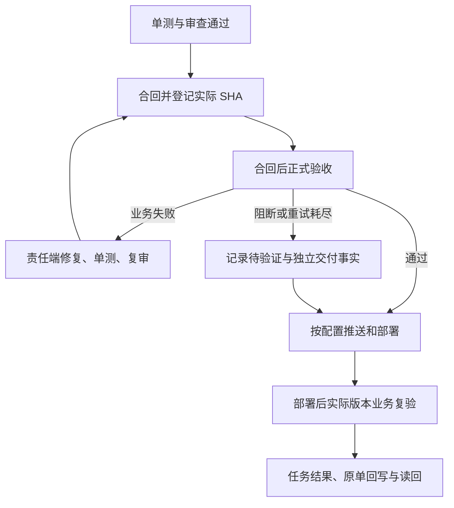
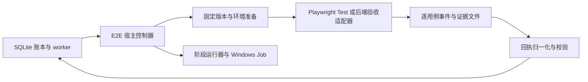

# 禅道需求与 Bug 全流程 E2E 设计

状态：待用户审核。日期：2026-11-27，北京时间。

本设计将正式浏览器验收接入 Playwright Test，保留禅道账本、受控 Git、部署和回写体系。**所有新正式验收必须针对实际合回版本运行；用户审核本设计和实施计划后，才允许修改实现、配置和运行流程。** 本次只新增设计和计划文档。

配套计划：[实施计划](E:/RealtimeMonitoringandMultiwarehouseCollaboration/docs/superpowers/plans/2026-11-27-zentao-playwright-e2e-plan.md)。

## 1. 审核要点与范围

需要用户审核的决定如下，批准文档不等于批准自动重启历史工单。

| 决定 | 设计结论 |
| --- | --- |
| 正式浏览器执行器 | 使用锁定版本的 Playwright Test；AgentLimb保留已有会话诊断能力，不作为失败后的自动换工具通道。 |
| 正式验收顺序 | 前端 integration → e2e；后端 integration → acceptance。合回前的单测和审查照常执行。 |
| 主工作区存在改动 | 已暂存、未暂存改动都允许申请合回；处理实际冲突，保留用户原有改动与暂存层次。 |
| 受验代码 | 固定实际合回 SHA，使用本次拥有的隔离副本，禁止把用户 WIP 混入正式结果。 |
| 失败后的交付 | 验收、推送、部署分别记账；按现有有效授权继续可独立执行的推送或部署，整单仍保留未验证项。 |
| 部署后验收 | 启用部署的端增加显式部署后业务复验阶段；未部署的端不宣称已完成该项。 |
| 历史兼容 | 保存原回执；旧候选通过不能替代合回后正式验收；旧工单迁移必须有事件、停止证据和重新排程。 |
| 本次操作边界 | 只交付文档，不修改业务代码、执行器、配置、账本和禅道，不启动实际测试、部署或工单。 |

范围包含纯前端、纯后端、跨端 Story 与 Bug；覆盖接单、验收条件、合回、固定版本测试、推送部署、部署复验及禅道读回。此次不恢复旧分支中的整套并行开发机制，不重写需求拆分、知识库接入或通知系统。

## 2. 已核对的当前基线

文档编写时，工作区为 `main@ed73174ce5602907eacf770256cf61a930029ea2`。前面已验证过部分交付保障的历史分支为 `codex/zentao-post-merge-e2e@346c2c1fe320b5f362c0dc4eee7dd2b3249c6c9b`。实施时重新核对 HEAD 与工作树，不假设这两份代码已经合并。

| 当前事实 | 对实现的影响 |
| --- | --- |
| `delivery_scope.route_stages` 当前安排前端 e2e 在 integration 前，后端 acceptance 也在 integration 前。 | 新合同必须调整两端正式验收顺序，并同步合回前置检查，避免相互等待。 |
| `agentlimb_e2e.acceptance_setup` 读取 coding 候选版本。 | 新合同必须改读成功的 integration 回执，明确 `version_basis=merged`。 |
| `route_evidence.agentlimb_receipt_error` 固定校验 `runner=agentlimb` 及 `agentlimb_receipt`。 | 增加引擎无关的回执协议和校验入口。 |
| `worker.run_e2e_preflight` 固定调用 AgentLimb；正式子进程内部使用 `timeout=None`。 | 预检和正式入口都需要统一调度；正式执行增加预算传递。已有外层控制不应被误称为完全没有超时。 |
| `stage_runner` 已有 Windows Job Object、绝对截止时间和停止证据。 | 优先复用；先做故障验证，再决定是否需要修改内部机制。 |
| 当前工作树有其他开发中的脚本、测试和文档修改。 | 实施前逐项合并评审；禁止 reset、清理或覆盖这些改动。 |
| 前端装有 `@playwright/test 1.60.0`，Node 为 `24.11.1`；默认 Chromium 文件未找到，系统 Chrome `158.0.8127.88` 存在。 | 仅证明接入条件部分具备；尚未启动浏览器验证兼容性。正式工具包和浏览器单独锁定。 |
| 当前入口只接受 loopback origin。 | 部署复验另按配置允许的环境 origin 校验，不能直接放开任意 URL。 |

历史核对：`a76d288` 于 11 月 22 日引入 Playwright 库入口；`90299f6` 于 11 月 25 日 22:28 切换 AgentLimb；`d27ab4a` 于 11 月 26 日加入合回后验收及 Performance/Server-Timing 资源证明。旧 125 行 Playwright 脚本没有使用完整 Playwright Test、认证状态复用、网络采集或 Trace。

Bug11 已确认最后结果为 `blocked/candidate-resource/tet-smart-log`。已复现性能记录缓冲满造成的错误阻断，但历史回执没有实测摘要，不能将该机制认定为当时的唯一原因。

## 3. 方案比较

| 方案 | 收益 | 成本与限制 | 选择 |
| --- | --- | --- | --- |
| 修补 AgentLimb 当前入口 | 延用已登录浏览器，迁移量较小。 | 仍需自行维护测试生命周期、断言、完整取证和报告。 | 保留用于诊断。 |
| 新建 Playwright Test 适配器，复用宿主和账本 | 使用标准测试、fixture、Reporter、网络响应与失败取证；迁移边界可控。 | 需要独立认证、统一回执以及浏览器版本管理。 | 本设计采用。 |
| 回退旧 Playwright 提交或重写全工作流 | 可以复用部分旧登录定位逻辑。 | 旧入口缺少新证据协议，整段回退会丢失交付保障；全量重写范围过大。 | 不采用。 |

## 4. 不可放宽的验收约束

1. 正式成功必须同时具备合回版本、实际环境、必需用例结果和受控宿主回执。退出码为零、浏览器打开、单测通过或 Pod Ready 均不足以判定成功。
2. 先完成合回，再运行该端正式验收。所有前端正式回执读取 `frontend.integration.merged_versions`；后端读取 `backend.integration.merged_versions`。
3. 合回操作不能仅因存在已跟踪或暂存的改动而拒绝。合回冲突在同一阶段解决；无法安全解决时保留冲突及原始改动证据，不覆盖用户内容。
4. 修复必须产生新的候选和实际合回版本，再重跑受影响的正式用例。旧版本下游结果失效，历史记录保留。
5. 测试环境、浏览器和临时数据有明确所有者。仅停止和清理本次资源，不清理用户服务或日常 Chrome。
6. 登录、数据、版本、测试执行器问题与业务断言失败分别记录；只有版本和前置条件有效的业务失败才触发研发返工。
7. 重试有唯一计数者和绝对截止时间；不因换进程、换引擎、换聊天而重置次数或延长原尝试。
8. 第一次失败就留证，逐用例落盘。版本复查或清理错误不能覆盖已得到的业务结果。
9. 必需用例未执行、被跳过、缺少结果，均不能汇总为通过。
10. 新旧执行器不自动相互兜底。诊断结果不能写入正式通过记录。
11. 主动停跑记录持续有效；本设计和后续引擎上线均不自动恢复旧工单。
12. 测试后的代码推送、部署、禅道回写使用原有效授权范围；本设计不新增业务环境写权限。

## 5. 各类工单的正式路线

### 5.1 Story 与 Bug 接入

Story 保留材料核对、任务拆分、任务与仓库映射。每条 AC 对应至少一条正式用例，测试 Agent在编码前确认用例意图、数据和预期。Bug 使用原单复现详情，形成稳定验收编号，记录原始版本、实际与预期；可以复现时证明旧版失败、新版通过，无法复现时记录限制。

简化 Bug 接单可以继续省略独立拆分、设计和计划阶段，不能省略正式用例、版本证明、独立审查和合回后验收。

### 5.2 新合同的执行顺序

| 工单范围 | 顺序 |
| --- | --- |
| 纯前端 | 接单/计划 → branch_check → coding → unit_test → code_review → **frontend.integration → frontend.e2e** → 已启用的 frontend.push → frontend.deploy → frontend.deployed_e2e → 收尾。 |
| 纯后端 | 接单/计划 → branch_check → coding → unit_test → code_review → **backend.integration → backend.acceptance** → 已启用的 backend.push → backend.deploy → backend.deployed_e2e → 收尾。 |
| 跨端 | 后端按上述路线完成合回、验收及已配置的部署复验 → handoff 固定后台版本/网关 → 前端正常开发 → frontend.integration → frontend.e2e 联合验证 → 已配置的推送、部署及部署后联合复验 → 收尾。 |

这里明确改变新合同下后端 `backend.acceptance` 的位置：正式 API 验收也在合回后。合回前仍可保留开发过程中的接口预检查，但不占用正式验收结论。**该调整属于本次需审核的范围。**

新合同的 integration 只依赖该端有效的 coding、unit_test、code_review 和仓库/权限核验，不再要求尚未发生的正式验收通过。合回结果与验收结果分开记账。

`e2e.enabled`保留前端浏览器测试总开关语义：false时同时不生成frontend.e2e和frontend.deployed_e2e，记录页面未验收；必需页面AC保持pending，不能因禁用而取得通过证据。该开关不影响backend.acceptance或后台部署复验。部署未启用时不生成该端deployed_e2e；部署失败时复验记录未执行原因，前一阶段结果保留。

| 范围与配置 | 合回后页面测试 | 部署后页面测试 | 后台正式/部署复验 |
| --- | --- | --- | --- |
| 含前端，e2e.enabled=true，前端未部署 | 运行 | 不生成 | 按是否含后台及后台部署配置。 |
| 含前端，e2e.enabled=true，前端部署启用 | 运行 | 运行或记录部署前置阻断 | 同上。 |
| 含前端，e2e.enabled=false，任意前端部署配置 | 不生成，页面AC未验收 | 不生成，页面AC未验收 | 不受该开关影响。 |
| 纯后端，任意e2e.enabled值 | 不适用 | 不适用 | acceptance在合回后，deployed_e2e按后台部署配置。 |

### 5.3 返工和部分交付

失败后是否还能推送某仓或部署某端，继续由有效配置、已合回版本及现有部分交付约束决定，不能仅凭阶段顺序绕过。未通过的任务不能关闭；独立已通过任务可按逐任务证据继续。联合测试发现已完成后台任务有缺陷时，重开对应原任务，并使依赖该后台版本的前端结果失效。

部署复验发现缺陷时走相同返工闭环，不能只改 Pod、运行容器或未提交源码。重新合回、复验、推送部署均形成新版本事实。

新合同的修复分段必须按下表展开，`verify` 表示重跑原失败的正式阶段，不能跳过表内步骤；未启用的 push/deploy 项按路线省略。当前 `v2_repair` 的旧序列不能直接复用。

| 失败位置 | 修复序列 |
| --- | --- |
| frontend.e2e / backend.acceptance，同端缺陷 | 责任端 coding → unit_test → code_review → integration → verify，verify读取新的合回 SHA。 |
| frontend/backend.deployed_e2e，同端缺陷 | 责任端 coding → unit_test → code_review → integration → 该端合回后正式验收 → 已配置 push → deploy → verify，verify读取新部署摘要。 |
| frontend.e2e，后台缺陷 | backend coding → unit_test → code_review → integration → acceptance → 已配置 push/deploy/deployed_e2e → handoff；前端需变更时再 frontend coding → unit_test → code_review → integration；随后 verify联合验收。前端未变更时复核原合回版本和新后台交接。 |
| frontend.deployed_e2e，后台缺陷 | 后台按上一行修复及重新交接；前端需变更时重新 coding/单测/审查/integration；先完成 frontend.e2e 的新后台联合验收，再按需 push/deploy 前端，最后 verify实际已部署组合。前端字节未变时允许核验后复用原前端部署，但不能复用旧联合结果。 |
| integration 提交冲突或 WIP 重放冲突 | 优先在原 integration 阶段完成冲突解决和内容复核；需要修改候选时按 coding → unit_test → code_review → verify(integration)。正式验收仍在成功合回之后，不作为解决合回的前置依赖。 |

所有新增 `deployed_e2e` 阶段都要注册测试角色、时限、允许返工、宿主派发、恢复定位与任务完成条件。新 coding 使相关端内结果失效；新后台合回或部署使旧交接及依赖它的前端联合结果失效；新前端合回使旧页面验收、推送部署及部署复验失效。无关任务历史可以保留，但不得套用到新受验组合。

## 6. 组件与调用边界

| 组件 | 输入 | 输出与责任 |
| --- | --- | --- |
| 账本/worker | 当前有效工单、轮次、尝试、快照、deadline | 发起固定请求；统一计算重试；消费宿主回执；保留原聊天。 |
| 宿主控制器 | 活动尝试及 JSON 请求 | 核对身份/请求哈希/权限/租约，准备环境，启动受控进程；停止确认后收尾。 |
| 环境准备器 | 合回 SHA、依赖、启动命令及允许 origin | 生成运行清单、资源清单、所属进程/端口及健康证据。 |
| Playwright fixtures | 运行清单和场景数据 | 独立浏览器、认证、工区、frame、网络证据、用例状态。 |
| 后端验收适配器 | 合回源码或部署摘要、验收命令/接口配置 | 真实 API/任务/事件断言与回读证据，不依赖浏览器。 |
| Reporter/汇总器 | 逐用例事件、环境与版本事实、宿主终态 | 完整回执、HTML/JSON 结果、附件索引；不决定禅道状态。 |
| 禅道同步器 | 已核验账本结果 | 幂等写入与读回；不接受测试代码直接创建的“成功备注”。 |

主聊天只提交当前尝试允许的固定请求；开发 Agent不能手写一个 passed JSON 代替执行器结果。所有正式回执必须与宿主登记的运行清单、尝试及证据目录一致。

## 7. 版本与环境准备

### 7.1 合回版本及用户改动

合回前记录 HEAD、目标分支、暂存区与工作区改动的校验信息；按现有受控 Git 机制处理层次和冲突。结果必须证明用户内容保留、暂存层次符合预期、未误提交无关改动，并记录各仓实际合回 SHA。

不冲突的无关文件按原始字节与index blob核验。冲突文件先保存原始版本，再按有记录的逐层解决结果核验；不能要求冲突文件同时保持原字节且包含新修改，也不能把“保留用户改动”解释成直接丢弃候选修复。

正式测试不使用存在 WIP 的主工作区运行文件。按登记 SHA 生成本次隔离副本，使用短路径、`core.longpaths=true`、独立短 Git 元数据和所有权标识。不得假设只有 `.git` 深路径修复或只设置 clone 后的 longpaths 就足够。

依赖使用与锁文件匹配的受控缓存，记录锁文件摘要、工具链版本和实际解析结果；不在用户工作区临时安装或自动修复依赖。首次准备可以建立专属缓存，后续按锁文件摘要复用；无法证明依赖一致时记录环境阻断。

### 7.2 两种有版本证明的运行模式

| 模式 | 预期摘要的可信来源 | 约束 |
| --- | --- | --- |
| `committed-dev`，首期兼容现有启动命令 | 固定合回副本、固定配置和依赖的**本次受控服务**，在浏览器导航前生成目标模块响应清单。 | 服务 PID/端口/启动根目录属于本次；目标源码在测试前后保持一致；诊断用的新请求不能替代浏览器实际响应。 |
| `committed-build`，有可复用构建产物时采用 | 同一合回版本及配置生成的静态产物清单。 | 清单绑定提交、配置、依赖和构建命令；部署环境使用对应部署产物清单。 |

首期不强制将整个 17 应用基座改造成静态测试服务器，不改变所有应用的构建方式。沿用经过核验的启动拓扑；只有经过依赖与实际用例验证后，才裁减无关应用。部署版本与本地开发响应的字节可以不同，必须分别核对各自可信清单及共同源版本，不能复用错误摘要。

受控服务启动后先核对监听所有者、必要端口、入口、后台和基础页面。端口被非本次服务占用时阻断或使用已配置的隔离端口，不按端口号杀死未知用户进程。

### 7.3 浏览器实际版本证明

在创建 page 和导航前安装 context/page 级网络监听，覆盖子 frame 和新页面；对场景声明的关键资源读取响应体并计算 SHA-256。为每次响应记录原始 URL、资源逻辑标识、frame、状态码、缓存/Service Worker 来源、摘要、完成时间及失败原因，持续落盘。

预期清单来自第 7.2 节的受控环境或构建。实际证据只能来自当前浏览器收到的响应，不能用后续 `fetch` 的内容代替。

资源识别保留 origin、路径和具有语义的查询参数。允许清单声明 Vite 时间戳等无语义参数的规范化规则，但实际响应摘要仍须匹配；不能对所有查询参数直接删除。同一关键模块观察到不同摘要时判为版本不稳定并保留所有观测。

网络异步取证任务在版本检查前按剩余预算等待完成；未完成、正文不可取得、frame 不可核对、关键资源未加载、摘要不符分别给出原因。无需对所有资源正文无限缓存，只保存目标模块正文/摘要和必要网络元数据。

每个业务用例在相关页面和懒加载模块就绪后、正式业务断言前核对版本；用例结束后复核。无需相关模块的登录/环境检查不等待懒加载模块，避免前置关卡阻止场景触发模块加载。

Performance 与 Server-Timing 只能作为辅助诊断，不再构成唯一正式版本证明。[网络事件](https://playwright.dev/docs/network) · [实际响应体](https://playwright.dev/docs/api/class-response#response-body)。

### 7.4 后端运行对象与无部署交接

当前配置中的 health、Swagger、version等 `acceptance_command` 只能作为运行就绪检查，不能替代业务 E2E。后台正式用例另外声明稳定 case/AC/Task、请求或任务输入、预期业务状态、查询回读与恢复条件。

本地后端验收从登记的合回 SHA 和依赖锁构建，记录产物摘要、构建配置与启动配方。宿主把该产物启动在本次 Job中，记录 PID/进程树、监听端口、产物路径及版本接口；业务请求必须命中这些已核验的服务。无法启动或证明运行身份时阻断，不拿旧共享服务的健康检查当作当前合回版本验收。

部署后后端证明使用实际服务目标、镜像 digest、接流量实例与请求版本信息，不要求浏览器 frame。受控本地源/产物证明和部署证明分别记录，均与相同合回 SHA 关联。

跨端有部署时，handoff传递经核验的网关、后台版本和部署证明；共享交付占用防止本单验收期间另单改写相同目标。跨端无后端部署时，后台验收结束后其本次进程按规则停止；handoff传递的是固定 SHA、产物/依赖摘要、启动配方、配置引用和测试数据准备/恢复说明，不能传递已停止 PID作为可用服务。前端宿主在自己的 Job中按该配方重启同一后台版本，再执行本地联合用例，结束时统一清理。

无部署后台的前端发布后联合场景，只有发布环境确实能够访问并证明所需后台版本时才可执行；否则登记依赖版本或入口阻断，不能用已停止的本地服务或未知后台宣称部署后联合通过。

## 8. 用例、认证与业务断言

### 8.1 场景计划

场景计划包括 `case_id`、`task_ids`、`ac_ids`、`module_key`、参数、测试数据稳定 ID、前置状态、结果预期、读写类型、恢复方式及 `required_phases`。计划在运行前冻结并计算摘要。通用操作使用固定模块，复杂交汇图、图表或工作流使用经审查的业务 spec；不根据页面当前结果自动生成“预期”。

`required_phases` 可为 `merged-local`、`deployed` 或两者。仅部署后可完成的业务条件放在 deployed 阶段，不把它伪装成本地已通过。需要两个阶段的用例，必须两个阶段均通过。未在本阶段要求的用例记为不适用，不计为 passed。

Story 的 AC、Task、仓库与用例建立映射；同一用例可以验证多个明确 AC。Bug 记录根因和影响范围，并包含缺陷直接断言及相邻操作回归。数据缺失明确为 blocked，不使用任意真实记录做覆盖测试。

### 8.2 认证与隔离

使用专用测试账号、独立浏览器 context 和专用认证状态文件。先验证状态是否有效；过期时通过项目配置的受控凭据引用和认证流程刷新一次。密码不通过命令参数或报告传递，状态文件不进入 Git 或附件。

配置必须明确所用 origin、账号身份和刷新策略。若系统使用 sessionStorage，按实际登录机制额外恢复，不能误以为 storageState 已包含它。若登录需要无法自动完成的扫码/验证码且没有有效授权路径，按认证阻断及时结束，不长期等待人工输入。

场景使用稳定账号角色、工区/井/数据集 ID，确认初始状态后才进行写入。写入数据按运行隔离，有幂等恢复；恢复失败不抹去业务结果，并阻止复用污染的数据。[认证状态机制](https://playwright.dev/docs/auth)。

### 8.3 Bug11 首个业务样例

1. 在固定工区、井和数据集打开曲线校验详情。
2. 等待四个图表的数据及组件就绪，确认版本证明覆盖本次变更模块。
3. 对四个图表分别验证多余刷新/恢复图标不显示。
4. 对需求要求保留的规则恢复及相关操作验证可用性。
5. 重新打开详情、切换数据、刷新页面后重复检查。

Canvas 内部图标不能用“存在四个 Canvas”代替断言。使用真实页面交互、目标图表实例的只读可观测配置与经过核对的截图共同验证。若目前缺少稳定图表实例访问点，实施业务用例时增加最小只读测试适配点，并纳入业务仓代码审查，不允许测试脚本修改图表配置使结果通过。

在同一数据与场景下验证可复现的旧提交失败、修复合回提交通过。旧版本不能复现时保留该事实，不能人为注入缺陷伪造旧版失败。

旧/新版本必须使用兼容的相同观测方式；若新增只读适配点，需对两版使用同一不改变业务行为的外部观测层，或改用共同可用的图表观测方式。旧版缺少适配点、认证失败、数据缺失或版本证明失败不能计作 Bug11 复现成功；有效红灯必须落在目标图标/业务行为断言上。

## 9. 预算、锁与故障恢复

### 9.1 初始预算

下表为首期试点参数，实施时由冷启动和业务样例校准后写入配置；不是已验证性能保证。

| 参数 | 初始值 |
| --- | --- |
| workers / Playwright retries | `1` / `0` |
| expect / action / navigation timeout | 10 秒 / 15 秒 / 30 秒 |
| 单用例 timeout | 120 秒；重计算用例显式配置 |
| Playwright globalTimeout 上限 | 20 分钟 |
| 宿主总预算上限 | 30 分钟，含环境准备和收尾 |
| 同一正式验收分段的普通重试总预算 | 30 分钟，跨普通重试共享截止时间 |
| 清理预留 | 2 分钟，包含在宿主预算内 |

**账本先固化有效截止，宿主再消费同一个值。** 新合同在 `attempt_start` 或返工进入正式 verify分段时，计算 `min(原阶段允许截止, 该分段首次开始+总预算)`，直接写入 `trial.deadline_at`，并持久化预算标识。普通重试、worker重启或重复请求沿用该分段首次截止，不能重新起算30分钟。受控新代码修复形成新合回版本时才可建立下一验收分段，并继续受原返工次数上限约束。

预算表 `e2e_budgets` 以工单、轮次、正式阶段、受控修复分段及受验版本摘要唯一定位，保存首次开始、deadline和关联尝试。写入与 attempt变更同事务完成；没有新修复分段的同版本重试不得换键绕过。

宿主、浏览器和清理均消费此有效截止。Playwright可用时间不超过剩余预算扣除清理预留；预算不足时不启动新用例。内部导航、浏览器globalTimeout或启动子预算在账本有效截止前耗尽时，登记 `failed` 外层结果及明确的 blocked/error预算原因，不能提前登记账本 `timed_out`。只有到达有效 `trial.deadline_at` 且停止/隔离证据成立时，才使用 `timed_out`。

若紧急停止无法获得完整 Trace，以事件日志及宿主停止证据报告，不能保证被强杀进程一定产出完整 Trace。

Playwright 默认不提供整轮全局超时，必须显式设置。[超时文档](https://playwright.dev/docs/test-timeouts)。

### 9.2 共享资源与停止

区分**持久交付占用**与**单阶段执行锁**。新增或等价复用 `delivery_occupancies`，在首次 integration之前按仓库+目标分支、部署目标、基座/后台端口等资源键原子获取，记录工单/轮次/所属聊天、状态与停止/隔离证据。多个资源按稳定顺序一次事务获取，冲突则等待，不先占一部分再相互等待。

持久占用覆盖合回到本单依赖该版本的验收、推送及部署复验，不随某个 E2E Job退出而释放。当前 `execution` 在 frontend.e2e结束时的释放和 deploy_control阶段结束释放，必须对新合同区分锁类型：仅释放阶段锁，整单占用到本地交付收尾且全部自有进程停止、无后续共享目标动作时才释放。待回写的网络重试不需要继续持有代码/端口占用。

新旧引擎共用兼容阶段锁；进程锁只能阻止重复启动，不能替代持久占用。恢复不能仅根据租约过期释放占用，先核对原执行停止或有效隔离。在已有调度容量允许范围内，不共享资源的其他工单可以继续。

**所有合同的共享目标写入口都遵守同一占用。** 合同1的integration/push/deploy也必须在首次共享写入前取得兼容持久占用，并在后续入口核对所有者；不能只让合同2检查。旧合同占用保持到其既有本地交付收尾，不改变其业务路线含义。已加载旧代码而无法遵守此机制的进程，必须先按原截止排空相关资源并核对停止，再启用合同2正式派发，避免跨合同插入改写。

进程均属于本次 Windows Job。先通知停止并按预留收尾，再按阶段运行器强制结束仍存活的自有进程。停止确认需证明自有活动进程为零或已有明确隔离证据；停止不明时隔离受影响资源，不强行释放共享占用，其他不共享资源的工单继续。

临时源码和 Git 元数据分别做所有权与规范路径检查，支持独立重试清理。不能仅凭 PID、目录名称或存在 owner 文件就删除路径。

### 9.3 重试与恢复

账本拥有唯一重试计数；Playwright 首期不额外自动重跑整条用例。网络短暂故障可以在明确恢复证据和剩余预算内重试；持久认证失败、错误版本、数据缺失或同因不变，不盲目重复整轮。

宿主中断后先核对原 Job、回执与事件日志。不能确认停止时不启动重复执行；能够确认停止时，沿原工单、原聊天按账本新尝试续接，保留原次数。主动停跑项不会因恢复扫描自动启动。

## 10. 请求、结果与证据协议

### 10.1 版本化合同

新配置使用 `e2e.contract_version:2`、`e2e.engine:"playwright-test"`、`e2e.after_integration:true`。这里 `e2e.engine` 选择浏览器执行器；前端页面阶段使用 `playwright-test`，后端 acceptance/deployed_e2e由宿主根据阶段选择固定 `backend-api` 适配器。合同2不允许把 after_integration改成false；旧配置解析为合同1，只能按第13节兼容处理。请求引擎由快照和阶段共同推导，不接受场景自行选择。

新合同统一证据字段为 `evidence.e2e_receipt`；旧 `agentlimb_receipt` 只用于对应历史合同。不能仅把允许的 runner 名称扩大，就接受不属于本尝试的回执。

配置字段的实施约定如下；现有workspace、启动命令、端口和部署授权继续从项目配置读取，不在浏览器spec里另存一套。

| 配置键 | 默认值或规则 |
| --- | --- |
| `e2e.contract_version` | 新正式路线为2；缺省仅解释为历史合同1。 |
| `e2e.engine` / `e2e.after_integration` | 合同2为playwright-test / true，不能静默退为合回前正式验收。 |
| `e2e.formal_dispatch_enabled` | 灰度前为false；暂停派发保留必需验收与待验证状态，不等价于e2e.enabled=false。 |
| `e2e.budgets.segment_total_ms` | 首期1,800,000；同一受控正式分段普通重试共用。 |
| `e2e.budgets.browser_max_ms` / `cleanup_reserve_ms` | 首期1,200,000 / 120,000；必须为正数且清理预留小于总预算。 |
| `e2e.playwright_test` | 精确工具版本、浏览器缓存/版本、workers、retries及各级超时；不能指向latest。 |
| `e2e.auth_profile` | 明确专用账号身份、凭据引用、认证状态位置、允许origin和一次刷新策略；不存密码。 |
| `e2e.environment_profiles` | 固定允许origin、阶段和来源、后台启动/部署身份及数据恢复配置；不得接受工单正文任意扩展origin。 |
| 部署复验策略 | 合同2对应端启用部署时必需；前端仍受明确的页面总开关控制，禁用不形成通过证据。 |

### 10.2 正式请求字段

| 字段 | 规则 |
| --- | --- |
| `schema_version`, `marker`, `run_round`, `attempt_id` | 与活动尝试完全匹配。 |
| `mode` | `formal`、`preflight`、`diagnostic`；只有 formal 可以生成正式验收事实。 |
| `phase`, `engine`, `version_basis` | 本次合同允许的阶段和执行器；正式必须 `merged`。 |
| `deadline_at` | 不得晚于账本原截止；宿主自行核对。 |
| `plan_path`, `plan_sha256` | 当前证据目录中的只读计划，路径和内容均校验。 |
| `environment_key`, `versions`, `backend_versions` | 从账本及有效交接构造；部署阶段包含目标和镜像摘要。 |

宿主补全 `runtime_manifest`、`resource_manifest` 和请求摘要；请求重复到达只恢复同一次执行，不重复拉起进程。

### 10.3 回执字段与判定

| 字段组 | 必需内容 |
| --- | --- |
| 身份 | schema、mode、engine/version、工单、轮次、尝试、请求/计划摘要。 |
| 受验版本 | `version_basis:"merged"`、各仓版本、后台版本、实际配置/环境；部署阶段目标及镜像摘要。 |
| 分阶段版本证明 | 前端提供实际资源标识/摘要、frame和来源；后端提供受控产物/进程或部署实例证明；覆盖该阶段本单全部改动组件，并分别记录失败原因。 |
| 用例 | 完整计划列表，每项 AC/任务映射、阶段、起止时间、状态、预期/实际、证据路径。 |
| 故障 | `failure_kind`、原始首个失败、后续异常数组、是否具备重试依据。 |
| 宿主 | 绝对截止、进程终态、stop_confirmed、stop_evidence、清理结果。 |

用例状态为 `passed`、`failed`、`blocked`、`error`、`not-run`、`skipped`。skipped 仅允许有明确条件的非必需用例，不替代必需项。

业务结果与执行结果分别保存：例如业务 failed 且 cleanup error，二者同时存在。只有当前阶段必需用例全部passed、版本完整有效，且stop_confirmed为true并证明自有活动进程为零，阶段才登记success。有效隔离只允许不冲突的后续工作继续，不能把停止不明的原尝试升级为通过。Playwright的全跳过、无匹配测试或单纯exit0均不足以通过。

错误分类按发生阶段与前置证据判断：认证/数据/环境/版本问题为 blocked；已证明版本且前置成立的业务断言失败为 failed；脚本错误、采集器失效或报告损坏为 error。不能用“所有 TimeoutError 都是环境问题”或“所有 expect 失败都是业务缺陷”简化分类。

版本证明是按阶段区分的联合类型：`frontend-http` 必须提供计划覆盖的前端应用、实际响应摘要与frame信息；`backend-local` 必须提供合回SHA、构建产物、运行PID/端口和请求目标；`backend-deployed` 必须提供合回SHA、部署目标、digest及接流量实例/请求版本。不能对后端强制要求浏览器字段，也不能让前端用一次后台健康证明替代资源证明。

### 10.4 持久化

每个 case 开始/结束即追加事件日志，更新可原子替换的结果快照。环境和资源证据独立保存。自定义 Reporter在测试结束生成完整回执，宿主在进程退出后核对并补充控制事实。

硬超时可能导致 Reporter最终回调未运行，宿主按第9.1节的有效截止规则生成外层结果，并根据冻结计划与事件恢复用例：已有case-end的保留原结果；已有case-start但没有结束的记 `error/execution-timeout` 或 `error/interrupted`；没有开始事件的才记not-run。不得把实际执行中的用例说成未执行，也不得依赖最后一行stdout作为唯一报告。

证据放在 `.local/zentao-delivery/items/<marker>/round-<round>/e2e/<attempt>/<phase>/`。只上传用例结果和脱敏证据索引，认证状态与凭据留在本机。逐阶段运行者的耗时只记录实际区间，不能把包含准备/等待的时间称为纯模型耗时。[Reporter机制](https://playwright.dev/docs/test-reporters#custom-reporters)。

## 11. 部署后业务复验与禅道回写

新增frontend.deployed_e2e和backend.deployed_e2e阶段。前者要求有前端范围、前端部署启用且e2e.enabled=true；后者要求有后台范围且后台部署启用，不受前端页面开关影响。具体组合见5.2表。正式访问使用配置中的允许origin，不使用任意工单文本提供的地址。

先核对原 Deployment/服务目标、镜像摘要、实际 Ready 实例和应用版本，再从真实发布入口执行本阶段业务用例。多副本服务需要核对所有实际接流量实例属于允许版本，或对运行请求提供可验证版本证据；单次健康请求不能掩盖混合版本。

后台 API 不仅判断 HTTP 200；验证业务字段、状态变化、任务/事件完成及重新查询的结果。页面写入场景包括刷新或重开回读。缺少对应入口、测试数据或版本接口时记录实际阻断。

每个 Task 只有在其仓库合回、必需阶段用例以及已配置推送部署/复验都满足时才可完成。原需求/Bug 的状态改变沿用现有授权规则；测试代码不直接关闭原单。

备注与附件由账本写回队列处理，使用稳定操作标识、一次性发送凭证和真实读回。响应不明时先核对原单历史与附件关联；附件读回还验证下载摘要，不能因 HTTP 成功就认定关联正确。

给用户的摘要保持为“Agent｜耗时｜成功/失败｜失败原因”，附必需用例通过/失败/未执行数量及证据入口。流程走完但必需用例未通过时明确为待验证。

## 12. 代码边界与文件责任

下列新文件名是实施目标，并非当前已经存在。

| 责任 | 文件 |
| --- | --- |
| 路由与阶段名 | [delivery_scope.py](E:/RealtimeMonitoringandMultiwarehouseCollaboration/.agents/skills/zentao-autodelivery/scripts/delivery_scope.py)、[ledger.py](E:/RealtimeMonitoringandMultiwarehouseCollaboration/.agents/skills/zentao-autodelivery/scripts/ledger.py) |
| 宿主派发 | [worker.py](E:/RealtimeMonitoringandMultiwarehouseCollaboration/.agents/skills/zentao-autodelivery/scripts/worker.py)；新增 `scripts/frontend_e2e_runner.py` 与 `scripts/e2e_host.py`，分别负责账本交接和执行控制。 |
| 请求、回执与预算合同 | 新增 `scripts/e2e_contract.py`、`scripts/e2e_results.py`、`scripts/e2e_budget.py`，ledger增加持久预算表；修改 [route_evidence.py](E:/RealtimeMonitoringandMultiwarehouseCollaboration/.agents/skills/zentao-autodelivery/scripts/route_evidence.py)。 |
| 固定版本与资源清单 | 新增 `scripts/merged_e2e_sources.py`、`scripts/e2e_environment.py`；按职责复用历史已验证实现。 |
| 状态与任务结果 | [execution.py](E:/RealtimeMonitoringandMultiwarehouseCollaboration/.agents/skills/zentao-autodelivery/scripts/execution.py)、[route_execution.py](E:/RealtimeMonitoringandMultiwarehouseCollaboration/.agents/skills/zentao-autodelivery/scripts/route_execution.py)、[task_evidence.py](E:/RealtimeMonitoringandMultiwarehouseCollaboration/.agents/skills/zentao-autodelivery/scripts/task_evidence.py)、[task_sync.py](E:/RealtimeMonitoringandMultiwarehouseCollaboration/.agents/skills/zentao-autodelivery/scripts/task_sync.py)。 |
| 合回约束与修复 | [development_git.py](E:/RealtimeMonitoringandMultiwarehouseCollaboration/.agents/skills/zentao-autodelivery/scripts/development_git.py)、[development_git_effects.py](E:/RealtimeMonitoringandMultiwarehouseCollaboration/.agents/skills/zentao-autodelivery/scripts/development_git_effects.py)、[development_git_runner.py](E:/RealtimeMonitoringandMultiwarehouseCollaboration/.agents/skills/zentao-autodelivery/scripts/development_git_runner.py)。 |
| 浏览器测试包 | 新增 `.agents/skills/zentao-autodelivery/e2e/`，包含独立 package/lock、配置、fixtures、spec、Reporter和本地故障夹具。 |
| 进程控制 | 复用 [stage_runner.py](E:/RealtimeMonitoringandMultiwarehouseCollaboration/.agents/skills/zentao-autodelivery/scripts/stage_runner.py)；有故障证据才增加内部修改。 |
| 跨阶段交付占用 | 新增 `scripts/e2e_delivery.py`，ledger增加持久占用表；调整execution及deploy_control的释放点，区分阶段锁与整单占用。 |
| 后台验收 | 新增 `scripts/backend_e2e_runner.py`、`scripts/backend_e2e_cases.py`，区分就绪命令与业务case，输出backend-api合同；不引入第二套账本。 |
| 配置与指引 | [zentao-project.json](E:/RealtimeMonitoringandMultiwarehouseCollaboration/.agents/zentao-project.json)、autodelivery 的 SKILL、E2E/阶段/worker 指引、前端操作手册。 |

## 13. 兼容、灰度与回退

1. 先部署能读取历史合同与新合同的校验代码，再启用新合同派发。当前进行中的旧尝试不被热切换，沿原截止收尾并封存历史。
2. 新接工单保存合同 2 快照，强制合回后正式验收。旧快照不会通过把 `playwright` 配置改名而静默改用新引擎。
3. 历史结果保持原含义。旧候选验收通过只能作为候选检查历史，不能替代新合同的合回版本验收。
4. 需要续接的旧工单须经过明确迁移事件：核对原执行停止/主动停跑规则 → 保留原单/原聊天 → 按有效历史重算路由 → 先完成合回 → 新正式尝试。现有历史完成项不自动重开。
5. 先运行独立诊断模式和本地夹具，再用专用测试 Story/Bug 接入账本。Bug11 用作独立已知版本样例，不借此自动恢复原工单或向原 Bug 写测试备注。
6. 灰度以配置明确选择新引擎，不能由失败自动切换。AgentLimb结果只用于诊断。启用新正式派发前，完成跨合同共享目标占用接入，并排空不能遵守新占用的旧代码进程。
7. 回退保留新合同读能力和合回后路由，暂停新正式 E2E 派发，将相关项保持待验证；不能设置 `e2e.enabled=false` 来伪造迁移成功，也不能恢复合回前正式验收。已合回、推送、部署的事实不自动撤销。

## 14. 验证矩阵与切换条件

| 编号 | 必须验证的情形 | 预期 |
| --- | --- | --- |
| V01 | Story/Bug、纯前端/纯后端/跨端路由及5.2开关真值表 | 新正式验收位于合回后；前端总开关同时控制本地/部署后页面阶段，后台独立；禁用不取得通过；无阶段依赖死锁。 |
| V02 | 主区仅 unstaged、仅 staged、同时存在两层改动 | 均可申请合回；原内容和暂存层次保留；无关改动不进入提交。 |
| V03 | 已包含、快进、分叉、提交冲突、WIP 重放冲突 | 实际合并/冲突解决正确，失败可恢复，不覆盖用户内容。 |
| V04 | Windows 长路径、完整配置基座、依赖缓存异常 | 完整装配可运行；错误分类和源码/Git 元数据清理正确。 |
| V05 | 正确/错误 SHA、目标分支移动、懒加载、iframe、Shadow DOM | 只接受当前相关模块的真实版本；版本变化使受影响结果失效。 |
| V06 | 251/1000 以上资源、时间戳/语义参数、缓存/304/Service Worker | 不依赖性能缓存容量；不会将不明或旧响应当作新版本。 |
| V07 | 登录有效/过期/账号错误/需人工认证、缺数据 | 分类为认证或数据问题，不伪造业务失败或长期等待。 |
| V08 | 业务失败后再发生版本或清理异常 | 保留业务首因及后续异常，逐用例结果完整。 |
| V09 | 无匹配测试、全 skipped、缺少计划 case、错误尝试/回执路径 | 不能登记正式 success 或触发无依据返工。 |
| V10 | 浏览器卡死、宿主重启、Reporter未结束、提前子预算结束、账本截止、首例完成/次例执行中/第三例未开始时终止 | 截止协议一致；三类case准确恢复，核实停止/隔离，不重复启动。 |
| V11 | 新后台 SHA、跨端联合返工、部署目标或 digest 不符 | 新版本重新交接复验；错误环境不形成业务通过。 |
| V12 | Pod Ready但业务错误、多副本版本混合、刷新回读不符 | 部署复验失败或阻断，任务不关闭。 |
| V13 | 禅道写入后响应丢失、附件关联错误、重试 | 先读回；同一操作不重复写；附件对象与摘要准确。 |
| V14 | 旧合同活动/完成/主动停跑项，迁移和回退 | 不热切换、不自动恢复；旧通过不能替代新正式验收。 |
| V15 | Bug11 直接断言与相邻回归 | 可复现的旧版本失败，修复合回版本通过，四个图表均被实际验证。 |
| V16 | A合同2合回/验收后尚未push或部署复验时，B合同1/2请求同目标integration/push/deploy；A停止不明或本地交付已收尾 | 所有合同写入口遵守持久占用；阶段结束不释放；仅在停止且收尾/有效隔离后取得资源；上线前排空旧代码进程。 |

切换新工单默认执行器前，V01–V16 必需范围通过，认证可无人值守续期或明确受阻退出，首次失败可定位，预算及清理在真实 Windows 上验证。单测通过数量不替代以上条件。

## 15. 交付与批准边界

实施计划按合同、宿主、测试执行器、业务样例、部署回写五个依赖阶段推进。任何一阶段未达到退出条件，不扩展正式灰度；保留可复审的中文变更说明和实际命令结果。

用户审核这两份文档后，才开始代码、配置、测试包安装、测试运行与流程变更。文档审核通过也不自动授权恢复历史主动停跑工单、向真实禅道建测试单或扩大部署目标；相关验证优先使用本地夹具和专用测试环境，正式外部操作沿项目既有授权执行。

本设计不承诺工具切换后所有 E2E 都通过。交付目标是：业务缺陷能够被发现，正确版本能够被验证，阻断有明确原因，执行和恢复有边界。
