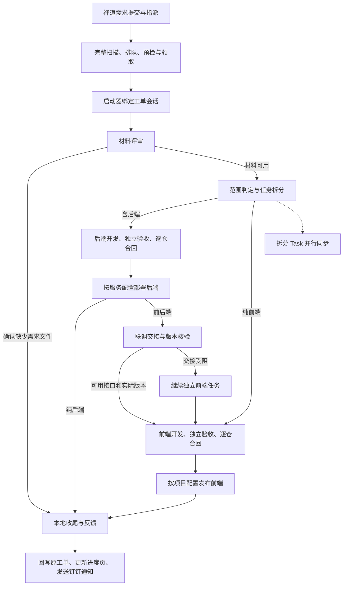

# 海能发地质工程一体化项目禅道无人值守研发设计与实现

更新于 2026 年 11 月 23 日。本文依据当前工作区的项目配置、工作流代码和本机账本整理，代码基线为 `23957ef`。文中的「当前配置」适用于新领取的工单，实际运行结果以工单的配置快照和回执为准。

## 一、项目如何处理一张工单

禅道负责登记原需求和接收反馈，需求仓库保存 `intent.md` 和验收材料。Codex 项目监测会话发现工单并安排队列，Windows 工单启动器为每张单绑定专属会话。工单主会话组织材料评审、任务拆分、分端开发和独立验证，负责联调交接、逐仓合回和最终收尾。启用发布的项目由独立执行器打包、推送 Harbor 并更新 Rancher。SQLite 账本记录每一步的输入、版本和结果，也维护禅道待同步操作。

## 二、当前项目配置

| 项目 | 当前值与含义 |
| --- | --- |
| 接收范围 | 「海能发地质工程一体化」项目中，指派给 `DOt-hwc`、状态为 `reviewing`（评审中）或 `active`（激活）的 Story。Bug 接收状态为空，当前监测跳过 Bug。 |
| 定时与并发 | `monitor.enabled=true`，项目配置的期望间隔为 **60 分钟**，实际唤醒以 Codex 桌面定时任务为准。同时最多执行 **1 张工单**，各阶段首次执行后最多重试 **3 次**。 |
| 研发路线 | 同时允许 `frontend_only`、`backend_only`、`fullstack`。拆分阶段为每单选择一条路线。 |
| 代码工作区 | 需求 `req-demo/`，前端 `aggregation-platform-4/`，后端 `srv-workspace/`。配置路径相对于 `.agents/` 解析。前端登记 17 个应用，后端登记 5 个业务服务，配置目标分支均为 `AI-development`。 |
| 上游依赖 | Smart-Geo 的 `datapool` 指向 `tet-datapool/`，接口入口为 `DPWebApi/Controllers`。当前配置允许按需修改，使用其自身的 `AI-development` 分支、工作树及 .NET 构建、单测和验收配置。 |
| 页面验收 | `e2e.enabled=true`。适用工单领取前执行通用页面预检，正式验收从实际候选构建进入业务页面。 |
| 自动发布 | 前端启用 Harbor 构建发布和 Rancher 更新，目标工作负载为 `internalrd/cnooced-suite-web`。后端目前仅 Smart-Geo 配置了自动部署目标 `internalrd-test`，对应 `internalrd/smart-geo-new`。 |
| 同步与通知 | `runtime.split_task_sync=true`，新 Story 的拆分项同步为禅道 Task。钉钉通知已启用，工单实际开始和本地收尾时登记通知。 |

监测每轮读取当前配置，领取时把研发路线、分支、验收和阶段时限等配置保存到该单快照。旧工单沿用原阶段及原快照。写入上游依赖、授予 Git 元数据权限及执行发布时，还会校验当前授权。各业务仓库须在执行机器上按配置就位。
[项目配置](../.agents/zentao-project.json) · [启动器与权限](../.agents/skills/zentao-autodelivery/references/worker.md)

## 三、从提交到领取

1. 需求方在 `req-demo/requirements/<目录>/intent.md` 写明问题、预期行为和验收条件，相关规格、截图和数据要求放在同一目录。在禅道原需求描述中登记材料目录，再按项目配置指派。业务标题用来理解需求，工单身份由禅道实例、实际项目 ID、类型和工单 ID 确定。
2. 监测会话先对账已有工单、旧派发、活动尝试和待同步操作，再按接收类型分页读取。首次完整扫描登记历史基线，后续发现的新单按优先级排队，同级按发现顺序。分页、权限或项目归属核对不完整时登记部分扫描并保留已有队列。
3. 有空闲名额时，适用工单先走页面预检。当前预检用独立 Playwright 浏览器检查登录、工区及 `data-overview` 的「地图」「井列表」控件。已有服务可复用，端口空闲时按配置启动，结束后回收本次启动的浏览器和服务。预检失败或繁忙时保留排队状态。预检通过表明公共入口可用，正式验收仍按本单场景和候选版本执行。
4. 监测会话在接单前复核队首工单的项目、状态和指派人，账本事务确认队首并预占名额。`worker.py prepare` 创建就绪会话，核对实际会话 ID 和桌面项目后绑定。`worker.py run` 从同一会话取得执行权，后续轮次继续使用该会话。正式轮次核验无人值守权限，CLI 审批策略设为 `never`，回执不明时先对账原派发和进程。

[监测与工单入口](../.agents/skills/zentao-autodelivery/SKILL.md) · [扫描和领取实现](../.agents/skills/zentao-autodelivery/scripts/claim.py) · [页面预检指引](../.agents/skills/zentao-autodelivery/references/e2e.md)

## 四、任务拆分、开发与验收

评审 Agent 核对材料实际路径，账本读取 `intent.md` 正文并记录 SHA-256 和范围标记。确认文件缺失时直接以「待补材料」收尾。仓库暂不可读或权限不足时，按实际错误登记。拆分 Agent 先应用项目的单端限制。项目允许两端时，可在 `intent.md` 正文用独立一行填写 `研发范围：纯前端`、`研发范围：纯后端` 或 `研发范围：前后端`。缺标记时依据代码、接口和验收条件研判，标记非法或相互矛盾时记录歧义。

拆分结果写入 `split.md`，每项有稳定编号、描述、验收条件和 `depends_on` 依赖。后端任务排在前端之前，依赖须可满足且无环。后端任务若还需要页面联合验收，标记 `joint_acceptance: true`。设计和计划按端归档，计划通过 `task_repositories` 把任务编号对应到涉及的全部仓库。

| 路线 | 开发与独立验证 | 后续推进 |
| --- | --- | --- |
| 纯前端 | 前端开发 Agent 完成设计、计划、编码和单测。前端测试 Agent 独立审查候选提交并执行浏览器测试，记录逐项场景及实际版本。 | 主会话逐仓合回，前端发布执行器处理启用的发布目标。 |
| 纯后端 | 后端开发 Agent 完成设计、计划、编码、构建和单测。后端测试 Agent 独立审查，并从实际服务入口执行验收，记录请求与结果和受验 SHA。 | 主会话逐仓合回，按实际涉及的服务配置部署。涉及无部署目标的服务时记录跳过原因。 |
| 前后端 | 先按后端路线完成独立验收、合回及适用的部署，再以 `handoff.md` 交接任务、接口、测试数据、成功请求、环境和后端版本。前端从该入口按任务执行联合验收。 | 启用后端部署时，交接携带发布回执和联调网关。前端重新核对实际后端版本，再开展联合验收、合回和发布。 |

每端实施前由主会话核对实际 Git 仓库、目标分支和基线提交，为本单创建或续接独立工作树。编码、单测和审查关联候选 SHA，测试 Agent 核对实际受验构建或服务。合回逐仓读回实际提交，合回后的内容有变化时复验受影响任务。出现部分合回时保留已成功的仓库和 SHA，续跑先读回当前 Git 状态。

后端 Agent 先沿业务服务的 Controller、Service 和客户端调用定位实现。任务确需改上游时，才把可写依赖列入后端计划。当前配置与领取快照均允许写入同一依赖路径时，才可准备该依赖的工作树。Windows MXC 下，普通业务仓库的 Git 元数据也按 `runtime.worker_git_write_repositories` 单独授权，当前显式登记 `backend:smart-geo` 和 `frontend:tet-smart-log`。

局部失败通过 `task_blockers` 记录任务和原因。账本沿依赖链排除受阻项，继续派发 `task_scope.active` 中可独立完成的任务。跨端交接受阻时，依赖联调的任务保留待办，独立前端任务仍可验收、合回和按配置发布。合回候选含受阻改动时，须先隔离可交付内容并复验。联合验收发现后端缺陷时，返工按责任端重新修复、单测、审查和验收，必要时重新合回、部署和交接，再复验受影响场景。

[阶段与证据](../.agents/skills/zentao-autodelivery/references/stages.md) · [多仓工作树](../.agents/skills/zentao-autodelivery/references/branches.md) · [服务验收与联调](../.agents/skills/zentao-autodelivery/references/backend.md) · [任务依赖实现](../.agents/skills/zentao-autodelivery/scripts/route_execution.py)

## 五、前后端自动发布

主会话到达 `backend.deploy` 或 `frontend.deploy` 时结束当轮，把执行权交还 Windows 启动器。发布执行器从账本认领尝试，核对当前授权与配置快照，提交实际回执后，由启动器续接原会话。后端返工中的重新部署也使用同一路径。

| 发布阶段 | 执行内容与完成条件 |
| --- | --- |
| 后端 `backend.deploy` | 依据实际合回的服务和 SHA 选部署目标。Smart-Geo 构建使用配置固定的 `tet-common-java` 提交。构建并推送后，从 Harbor 读回镜像摘要，通过 Rancher MCP 更新目标 Deployment，核对模板、新 Ready Pod 和服务健康。跨端交接同时读回已部署版本和实际联调入口。 |
| 前端 `frontend.deploy` | 逐仓确认 `origin` 读写目标一致，必要时普通推送并确认远端包含实际合回 SHA。核对本地发布所需端口已释放，在隔离检出中用 `customized-release/bundle-build.cjs` 和 `zentao-ai-development` 配置构建。以目标当前 Harbor 镜像摘要为底图替换本次应用，推送并读回镜像摘要，再通过 Rancher MCP 更新和核验模板、新 Ready Pod。 |

发布记录分别保留 Git 版本、Harbor 摘要和集群回执。恢复时核对外部实际状态，复用已确认的镜像或远端操作。部署冲突、目标漂移或滚动未就绪时保留已确认结果和失败原因。后端部署失败时，本地已合回记录仍可追溯，部署及依赖该版本的联合验收保留为待验证。前端发布失败时同样保留已合回及已确认的远端和镜像结果。

[后端部署](../.agents/skills/zentao-autodelivery/references/backend.md#后端自动部署) · [前端镜像发布](../.agents/skills/zentao-autodelivery/references/frontend-release.md) · [Rancher MCP 实施与验证记录](superpowers/plans/2026-11-22-Rancher-MCP-自动发布实施计划.md)

## 六、Task 同步、收尾与反馈

- **拆分 Task 与研发并行。** 同步器按稳定拆分编号创建 Task，关联原 Story 所在项目和迭代，初始指派给建单时原需求的指派账号。迭代待定时保留待建单，研发继续。监测轮次补办未确认的操作，也覆盖已本地收尾的工单。
- **逐项核验和关闭。** 相关候选版本具备本单要求的验收证据，且实际涉及的仓库全部合回后，才安排关闭该 Task。启用后端部署的相关任务还须有部署核验，要求联合验收的任务须有匹配前后端版本的逐项结果。项目关闭前端页面验收时，前端任务按候选单测、代码审查和实际合回证据核验，并记录页面验收跳过。返工影响原验收条件时按原 Task ID 重开，复验后再关闭。
- **原单反馈。** 每阶段登记实际起止时间、结论、重试或跳过原因。最终备注逐项汇总结果，有阻断时保存 `blockers.md` 并安排附件上传和读回。备注和附件采用稳定操作标识及一次性发送凭证。请求结果不明确时先读回，确认旧请求结束且未写入后再补发。当前实例已验证 Story 备注和附件，Bug 回写仍待真实 Bug 验证。
- **本地收尾。** 工单按实际情况记录「已交付」「待补材料」「待验证」或「阻断」；用户主动停跑时记录停跑结果。确认执行资源已停止或有效隔离后释放名额，禅道补写、Task 补办和通知由各自状态继续对账。工单开始和收尾的钉钉通知由账本登记，发送状态单独保存。

[Task 逐项交付判定](../.agents/skills/zentao-autodelivery/scripts/task_evidence.py) · [Task 同步实现](../.agents/skills/zentao-autodelivery/scripts/task_sync.py) · [原单回写实现](../.agents/skills/zentao-autodelivery/scripts/writeback.py) · [钉钉通知实现](../.agents/skills/zentao-autodelivery/scripts/dingtalk_notify.py)

## 七、超时、重试与恢复

每次尝试都有独立编号和绝对截止时间。当前单次上限为材料评审 10 分钟，分支核验 15 分钟，编码 120 分钟，后端服务验收和前端 E2E 各 90 分钟，后端部署 60 分钟，前端发布按默认 60 分钟。范围拆分沿用计划时限，联调交接沿用合回时限，设计、计划、单测、审查和合回各 45 分钟。

Windows 阶段运行器用 Job Object 管理本次尝试拥有的进程。到期后核对 Agent 停止与进程退出，两者或有效隔离的证据用于判断能否重试或释放名额。重启时沿用账本中的原尝试、截止时间和重试计数。审查或验收的一轮返工包含修复和受影响项的复验，计作该阶段的一次重试。超时结果与迟到回执都关联原尝试。

恢复沿原会话及原工单继续，新的材料、环境恢复或新的待验修复版本可作为恢复依据。账本按恢复标识和证据去重。新版 Story 续跑时会读回已评审的 `intent.md` 并比较 SHA-256。材料变化、暂不可读或拆分存在阻断时，回到材料评审并重新判定范围。其余情况优先从最早失败或有任务阻断的阶段继续，再按未验证阶段或原阶段恢复。任务修订沿用仍适用的稳定编号，新增独立要求使用新编号。主动停跑的工单由用户决定是否另行处理。

[阶段运行器](../.agents/skills/zentao-autodelivery/references/stage-runner.md) · [超时与恢复实现](../.agents/skills/zentao-autodelivery/scripts/execution.py) · [账本命令](../.agents/skills/zentao-autodelivery/references/workflow-cli.md)

## 八、查看进度与证据

| 要核对的内容 | 入口与判断方法 |
| --- | --- |
| 监测是否持续运行 | 在 Codex 桌面定时任务中查看项目监测会话和实际运行历史，再对照进度页的「最近一次完整扫描」。60 分钟是项目配置的期望间隔。 |
| 工单和拆分任务进度 | 在执行机器上打开 `.local/zentao-delivery/status.html`。页面每 30 秒重新加载最近生成的账本快照。展开「拆分任务」可看逐项验收、合回、禅道 Task 实际状态和最近同步结果。 |
| 需求方看到的最终反馈 | 在原禅道工单查看阶段备注、最终备注、操作历史和附件。进度页仍有待回写时，以本地结果和后续外部回执核对反馈进度。 |
| 工单交付材料 | `.local/zentao-delivery/items/<marker>/round-<n>/` 保存阶段产物，查阅 `split.md`、各端 `design.md`、`plan.md`、后端 `handoff.md` 和需要时的 `blockers.md`。前端发布证据在工单目录的 `frontend-releases/`。 |
| 会话绑定、尝试与实际回执 | 使用只读方式查 `.local/zentao-delivery/workflow.sqlite3`。`workflow.py claim`、`workflow.py record` 是调度和登记入口。 |

[进度页实现](../.agents/skills/zentao-autodelivery/scripts/status_board.py) · [账本结构](../.agents/skills/zentao-autodelivery/scripts/ledger.py)

## 九、现有运行证据

| 记录 | 实际结果 |
| --- | --- |
| 需求 #33，历史前端整链验收 | 2026 年 11 月 19 日在隔离账本和工作树验证旧前端流程。6 组候选浏览器场景通过，基座和 Shell Hub 两个仓库在本机合回，10 条禅道备注读回确认。目录读取使用测试响应。 |
| 需求 #37，单端交付与 Task 关闭 | 本机正式账本显示「已交付」，该单在当时快照下按前端单测、审查与合回完成研发，1 张拆分 Task 已读回为关闭。 |
| 需求 #40，跨端部分交付 | 后端独立验收与合回成功，后端部署 4 次尝试均失败。独立前端任务完成页面验收及合回，前端发布重试成功并有 Rancher 回执。3 张拆分 Task 已确认关闭，13 张仍待处理，整单结论为「待验证」。 |
| Rancher MCP 实机验证 | 实施记录显示，使用运行中镜像的等价摘要验证了 Smart-Geo 和前端目标的更新权限。从 Rancher 观察到新 Pod 为 Ready，镜像 ID 与 Harbor 摘要匹配，Smart-Geo 直连健康返回 `UP`。 |

#37 和 #40 的结论来自本机 SQLite 账本。本次整理对照了当前配置、阶段实现及历史回执，实机结论以上述记录的时间和覆盖范围为准。
[历史整链验收](禅道无人值守研发实施方案.md) · [Rancher 实机验证记录](superpowers/plans/2026-11-22-Rancher-MCP-自动发布实施计划.md)
