# 海能发地质工程一体化项目禅道无人值守研发设计与实现

更新于 2026 年 11 月 24 日。本文依据当前工作区的配置、阶段实现和本机账本整理，代码基线为 `cb6ce64`。文中的「当前配置」用于新领取的工单，历史工单按各自的配置快照和回执解读。

[完整流程图](#完整流程图) · [完整 Agent 分工与交接](#完整-agent-分工与交接)

[接单与开工](#二从需求提交到工单开工) · [材料与正式评审](#三材料同步与禅道正式评审) · [拆分、研发与联调](#四完整研发流程) · [推送与发布](#五git-交付与镜像发布) · [Task、回写与钉钉](#六task-同步收尾与反馈) · [异常恢复](#七返工超时与恢复) · [看板与留档](#八查看进度与证据) · [实测证据](#九运行证据与待验证项) · [项目配置](#十当前项目配置)

## 一、项目如何处理一张工单

禅道负责登记原需求、记录正式评审并接收交付反馈，需求仓库保存 `intent.md` 和验收材料。Codex 项目监测会话发现工单并安排队列，Windows 工单启动器为每张单绑定专属会话。工单主会话组织材料评审、任务拆分、分端开发和独立验证，负责联调交接、逐仓合回和最终收尾。启动器调用专用执行器处理 Git 推送及已配置的镜像部署。SQLite 账本记录各阶段的输入、版本、结果和待同步操作。

第 1–11 步从需求提交到任务拆分，第 12–32 步按研发路线选用，第 33–36 步收尾并向外反馈。Task 同步从拆分后并行，状态页全程刷新。预检、正式评审、Git 推送、页面验收及镜像发布按本单适用条件执行。

### 全流程速览

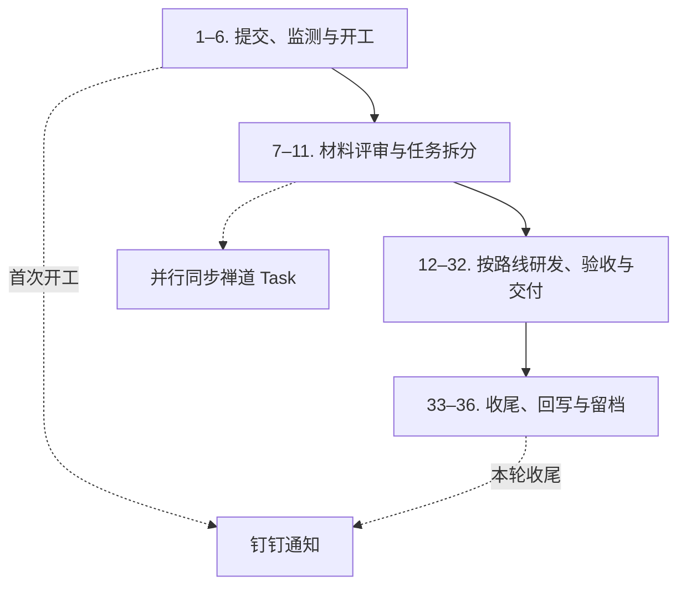

### 完整流程图

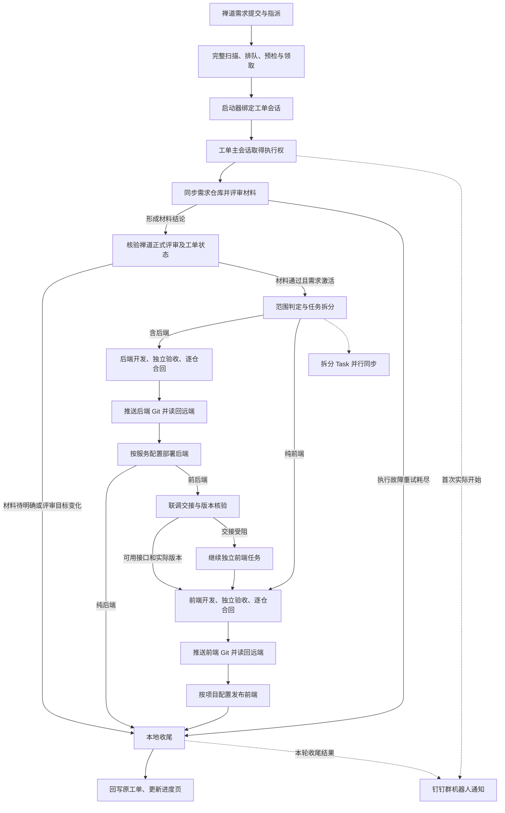

### 各角色的分工

#### 分工速览

实线表示派发或交接，虚线表示回传或并行工作。各端计划完成后，由主工单 Agent 核验工作树，再交开发 Agent 编码。

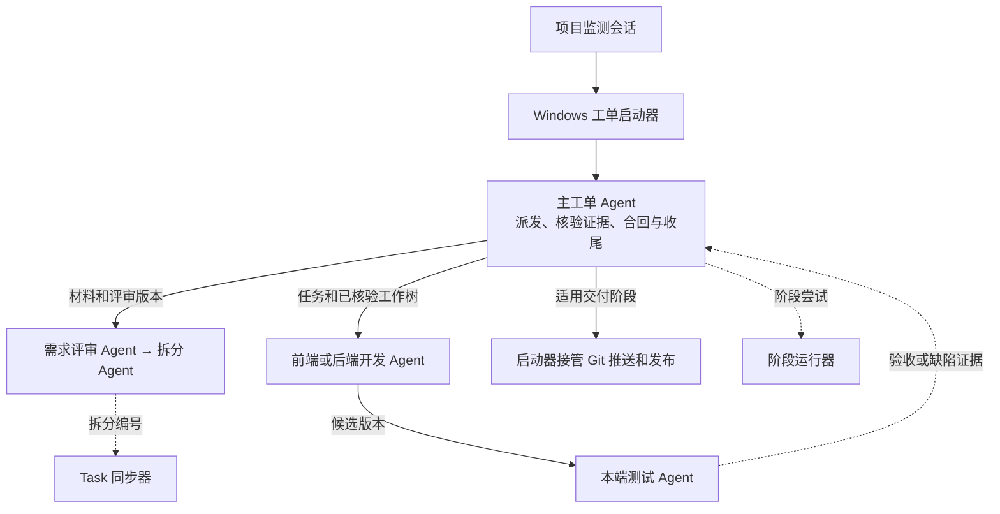

#### 完整 Agent 分工与交接

实线表示阶段交接，虚线表示受控执行、并行同步或返工。主工单 Agent 按账本派发各阶段并核对回执。

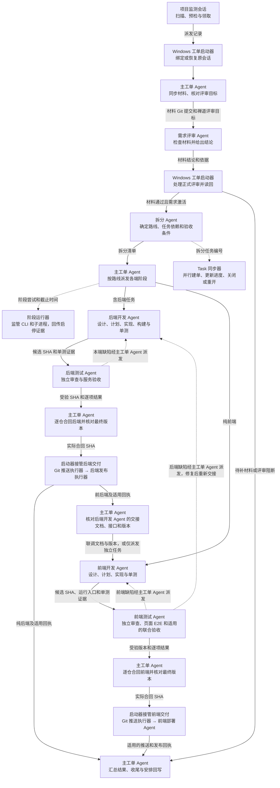

| 角色 | 负责的工作 | 把什么交给谁 |
| --- | --- | --- |
| 项目监测会话 | 扫描、排队、核对接收条件、预检和领取，按监测轮次对账已有工单。 | 把已领取工单的派发记录交给 Windows 工单启动器。评审可续接或外部回执待补时，按原记录安排处理。 |
| Windows 工单启动器 | 创建并绑定工单专属会话，启动或恢复原会话，接管正式评审、Git 推送、镜像部署和 Task 同步所需的受控执行。 | 向主工单 Agent 提供已绑定的会话及执行入口。执行器将实际回执登记到账本后，启动器再安排续接。 |
| 主工单 Agent（工单主会话） | 从账本取得当前阶段并派发，准备材料同步和评审目标，核验仓库分支和工作树，逐仓合回，核实跨端交接，汇总整单结果。 | 给阶段 Agent 提供任务范围、输入证据、允许操作的工作树和截止时间。核对产物并登记结果，按账本安排下一步。 |
| 需求评审 Agent | 检查同步后的 `intent.md` 及其材料，给出材料通过、缺文件或关键内容待明确的结论。 | 将材料路径、结论和理由交回当前评审尝试，由账本登记，启动器处理禅道正式评审及读回。 |
| 拆分 Agent | 判定研发路线，拆出前后端任务、依赖及验收条件，按需查知识库。接口或任务划分变化时修订拆分。 | 将 `split.md` 和结构化任务清单交给主工单 Agent。账本用同一批任务编号派发研发，并生成适用的 Task 同步待办。 |
| 后端开发 Agent | 负责后端设计、计划、编码、构建、单测和后端返工。跨端时编写并更新 `backend/handoff.md`。 | 将候选 SHA、构建与单测证据交给后端测试 Agent，将交接文档交给主工单 Agent 核验。 |
| 后端测试 Agent | 独立审查后端候选提交，在版本可核对的服务上执行逐任务验收。 | 将审查意见、请求响应、验收结论和受验 SHA 交给主工单 Agent。需修复时提供复现和受影响任务编号。 |
| 前端开发 Agent | 负责前端设计、计划、编码、单测和前端返工。跨端任务按已核验的接口和后端版本实现。 | 将前端候选 SHA、运行入口和单测结果交给前端测试 Agent。 |
| 前端测试 Agent | 独立审查前端候选提交，执行页面 E2E。跨端时同时核验后端版本和联合场景。 | 将逐任务结果及实际前后端版本交给主工单 Agent，发现问题时附证据并说明涉及前端还是后端。 |
| Git 推送执行器 | 按账本准入范围逐仓推送已合回的 SHA，读回远端分支。 | 登记各仓回执或失败原因，供部署、Task 交付判定和收尾使用。 |
| 后端发布执行器、前端部署 Agent | 后端按服务部署，前端按计划应用范围打包发布，分别核验 Harbor 和 Rancher。 | 将镜像摘要、部署状态和 Pod 核验登记到账本。后端另提供实际联调入口及运行版本。 |
| 阶段运行器、Task 同步器 | 阶段运行器管理 Codex CLI 和本次尝试启动的进程，保存启动和停止证据。Task 同步器办理 Task 建单、开工、阻断备注、关闭及重开。 | 将执行证据和实际禅道状态登记到账本，供主工单 Agent 和监测会话对账。 |

主工单 Agent 用 `attempt_start` 取得 `role`、`phase`、`attempt_id`、`deadline_at` 和已有拆分时的 `task_scope`。阶段 Agent 针对当前尝试工作，主工单 Agent 核验返回的结果与证据后按 `attempt_finish` 的回执推进。Git 推送和镜像部署阶段由启动器交给对应执行器登记结果。已有活动尝试时先读原证据和运行状态，沿同一次尝试继续。

[角色映射](../.agents/skills/zentao-autodelivery/scripts/route_execution.py) · [阶段与证据](../.agents/skills/zentao-autodelivery/references/stages.md) · [账本命令](../.agents/skills/zentao-autodelivery/references/workflow-cli.md)

## 二、从需求提交到工单开工

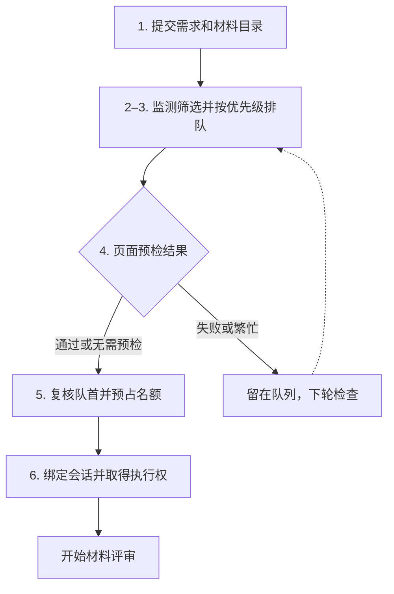

| 流程步骤 | 业务作用 | 由谁执行 | 本步建设 | 交给下一步的结果 |
| --- | --- | --- | --- | --- |
| 1. 提交需求 | 让需求方和研发以同一版本的业务目标、范围和验收条件达成共识，交付时能追到提出的需求。 | 需求方 | 建立需求仓库的材料目录和 `intent.md` 模板，规定从模块和入口追到规则、UI 和交互、接口契约、验收条件及用例。禅道描述登记材料目录，项目和指派人用于分流。 | 需求方将材料提交到需求分支上游，创建并指派 Story。后续用禅道实例、实际项目 ID、类型和工单 ID 唯一识别。 |
| 2. 定时监测及对账 | 及时发现本项目交给自动化处理的需求，也把上轮尚未落地的结果继续跟到位。 | Codex 项目监测会话 | 建立定时唤醒的监测入口。每轮先核对无人值守权限和已有工单，补办待处理的 Task、评审、原单回写及钉钉消息。再按启用的工单类型分页查询禅道，核对唯一项目、工单归属、指派账号和状态。 | 给账本提交扫描范围、观测时间和完整性。分页、权限或归属无法核对时登记部分扫描。 |
| 3. 形成队列 | 按业务优先级分配有限的研发容量，避免同一需求重复开工，让暂未接单的需求仍可追踪。 | `workflow.py claim` 与 SQLite | 首次完整扫描登记历史基线，随后按工单唯一键去重。新工单按禅道优先级入队，同级按发现顺序。部分或过期的扫描不会覆盖已有效登记的队列。 | 返回待复核队首和可用名额，没接单的工单留在队列。 |
| 4. 页面预检 | 先确认登录、工区和公共页面可用，避免因共用验收环境故障而占住研发名额。 | Windows 启动器和 Playwright 执行器 | 建立派发前的独立浏览器探针，检查本地前端、登录、工区以及 `data-overview` 的「地图」「井列表」。已有服务可复用，端口空闲时受控启动，退出时清理本次资源。 | 适用工单凭 `e2e_preflight_passed` 继续领取。预检失败或繁忙时保留队列，后续轮次重查。候选构建的业务场景在正式 E2E 验收。 |
| 5. 复核并领取 | 确认需求当前仍归本项目、当前指派人和接收范围，再占用名额，避免做错单或多人重复做同一单。 | 监测会话与 SQLite | 领取前重读禅道归属、状态和指派人。在同一事务核对队首、观测有效期和空闲名额，写入派发租约和工单配置快照。 | 返回 `request_id`、稳定工单标记 `marker` 和派发有效期。队首变化时复核新队首，已领取工单沿用自己的快照。 |
| 6. 建立会话并实际开工 | 让需求方知道工单已实际接手，并让后续参与者沿同一工单找到上下文和已完成的工作。 | Windows 工单启动器、主工单 Agent | `worker.py prepare` 创建只报就绪的会话，核对桌面项目和真实 `chat_id` 后 `record bind`。`worker.py run` 复用原会话，`record start` 校验绑定和执行权。CLI 使用 `never`，回执不明时按原派发标记核对。 | 工单进入材料评审，首次实际开始同时登记「已接单」钉钉待发项。未取得执行权的过期租约可回收，已经启动的工单先核对停止或隔离证据。 |

[需求与 E2E 编写规范](禅道自动化需求与E2E编写规范.md) · [监测与工单入口](../.agents/skills/zentao-autodelivery/SKILL.md) · [扫描和领取](../.agents/skills/zentao-autodelivery/scripts/claim.py) · [页面预检](../.agents/skills/zentao-autodelivery/references/e2e.md) · [会话启动和续接](../.agents/skills/zentao-autodelivery/references/worker.md)

## 三、材料同步与禅道正式评审

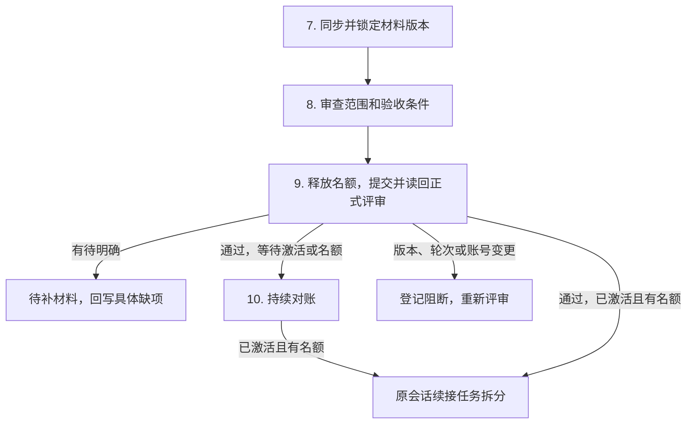

| 流程步骤 | 业务作用 | 由谁执行 | 本步建设 | 交给下一步的结果 |
| --- | --- | --- | --- | --- |
| 7. 同步需求仓库 | 让评审用上需求方提交的最新材料修订，避免按旧规则评审或遗漏刚补齐的验收场景。 | 主工单 Agent、阶段运行器和 `material_sync.py` | Story 的 `material_check` 开始后，从需求仓库当前分支已配置的远端上游抓取，采用只允许快进的更新方式。每次重试和重新评审都同步，校验 HEAD 与远端抓取提交一致。 | `material_synced` 提供分支和提交。同步、权限或超时故障在本阶段重试，失败耗尽后收尾为「阻断」。 |
| 8. 审查材料 | 在开发投入前弄清本期要解决什么、应怎样验收。需求方能据具体缺项补材料，减少猜测和返工。 | 需求评审 Agent、主工单 Agent | 启用正式评审时用 `worker.py review-target` 绑定禅道版本、轮次和账号。账本核对 `intent.md` 的实际路径、同步提交和正文，记录 SHA-256 和研发范围标记。材料缺失时在已同步版本核对路径。Bug 路线使用原单复现材料。 | 材料通过形成「通过」意见。确认缺文件或关键内容待补时形成「有待明确」并写具体缺项。暂时读取失败按执行故障登记。 |
| 9. 提交正式评审 | 把可开工依据和待补事项公开留在禅道。项目按正式激活状态安排研发，等待评审时释放名额给其他工单。 | Windows 启动器、禅道评审执行器 | 用 `story_review` 待办把材料结论与正式评审绑定在同一事务。启动器确认原轮次和受控进程停止后释放研发名额，使用禅道 22.6 正式评审表单提交，按版本、轮次和账号读回操作历史。 | 「有待明确」读回后以「待补材料」收尾。已读回「通过」的 Story 等待激活和可用名额，从原会话续接拆分。材料通过且评审前已激活时沿用已激活状态。 |
| 10. 续接或对账评审 | 让已激活需求接上原工作，评审结果不明或修订变化时确认对应轮次，避免重复评审或按过期意见开工。 | 项目监测会话与 Windows 启动器 | 增加评审等待、可续接及回执不明的账本记录。监测轮次读回评审状态，确认原请求已结束后可用 `worker.py review-reconcile --marker <marker> --prior-ended` 检查历史和本轮评审资格。 | 评审通过并激活的工单按原 `marker` 续接。版本、轮次或账号变化时登记阻断，等待重新评审。 |

[材料同步实现](../.agents/skills/zentao-autodelivery/scripts/material_sync.py) · [禅道正式评审指引](../.agents/skills/zentao-autodelivery/references/stages.md#禅道正式评审) · [正式评审读回与续接](../.agents/skills/zentao-autodelivery/scripts/story_review_sync.py)

## 四、完整研发流程

### 11. 拆分任务并生成路线 `split`

**业务作用**　把一条需求拆成可以分别安排、验收和交付的工作。项目负责人据此看清哪些任务可以独立完成，哪些必须等后端接口或前后端联合验收，避免一个依赖把整单都卡住。

拆分 Agent 接收已评审的材料版本。先应用项目的单端限制。项目允许两端时，优先读取 `intent.md` 正文中独立一行的 `研发范围：纯前端`、`研发范围：纯后端` 或 `研发范围：前后端`。没有标记时依据代码、接口和验收条件研判，标记非法或相互矛盾时记录歧义。

为拆分阶段建立了 `split.md` 和结构化回执，统一用稳定任务编号关联描述、验收条件和 `depends_on`。账本校验后端任务在前、依赖可满足且无环，并为 `joint_acceptance: true` 的任务追踪联合验收。拆分 Agent 可标注超出范围的要求和实际阻止跨端交接的条件。账本从已评审材料和配置快照生成明确阶段序列，派发时返回可执行任务和受阻任务。拆分登记后，启动器为同一批编号并行办理禅道 Task。

拆分时遇到现有能力、应用归属或跨应用依赖不清楚，可用只读 `company-knowledge` MCP 查询，在 `split.md` 记录条目、`itemId`、`versionId`、发布状态及其影响的决定。各端开发 Agent 做设计时先复用引用，再按需查共享组件、接口或依赖，用目标分支源码或实际接口核实，在 `design.md` 留下结论和位置。检索无结果、鉴权失败或超时时，继续用工单材料、源码和实际接口补证，仍缺关键证据时登记受影响任务。API Key 由启动环境提供。 [公司知识库接入和实测范围](禅道自动化接入公司知识库需求与实现.md)

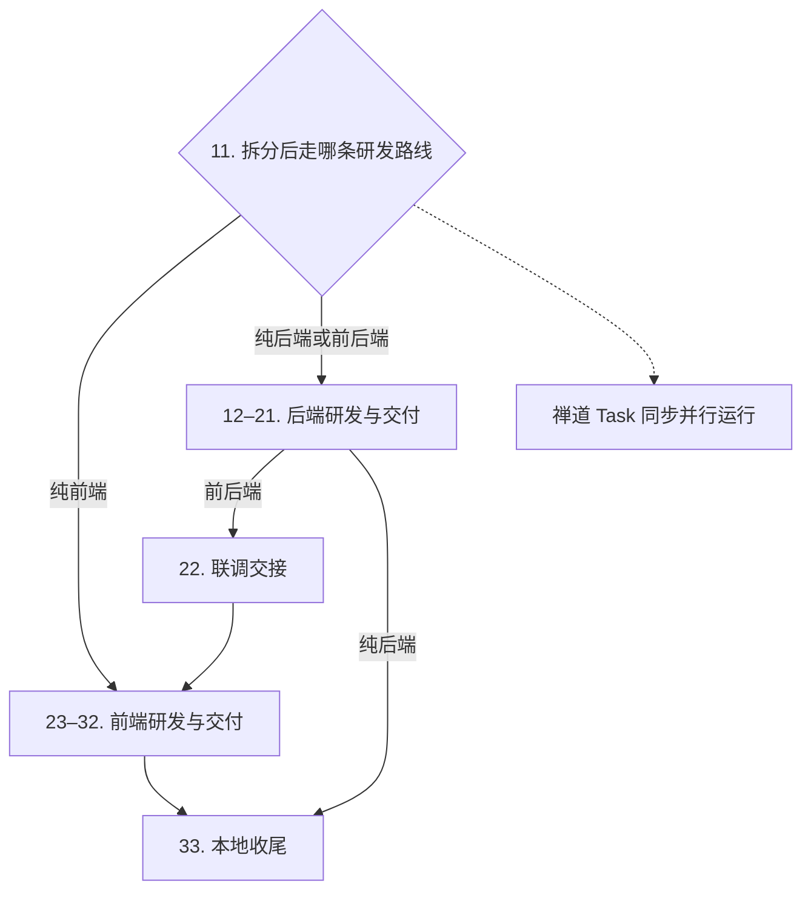

| 路线 | 拆分后的阶段顺序 |
| --- | --- |
| 纯前端 `frontend_only` | 第 23–32 步前端研发与交付 → 第 33 步收尾 |
| 纯后端 `backend_only` | 第 12–21 步后端研发与交付 → 第 33 步收尾 |
| 前后端 `fullstack` | 第 12–21 步后端研发与交付 → 第 22 步跨端交接 → 第 23–32 步前端研发、联合验收及交付 → 第 33 步收尾 |

各端按下表顺序执行。Git 推送、页面 E2E 和镜像部署是否进入路线由工单快照决定。每个阶段以账本的实际阶段、任务范围和前置证据为准。 [路线生成实现](../.agents/skills/zentao-autodelivery/scripts/delivery_scope.py)

### 12–21. 后端研发与交付

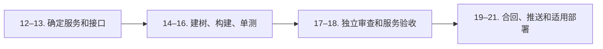

| 流程步骤 | 业务作用 | 由谁执行 | 本步建设 | 交给下一步的结果 |
| --- | --- | --- | --- | --- |
| 12. `backend.design` 设计 | 明确由哪个服务承担业务规则、哪些接口或数据受影响，帮助后端评估对现有调用方的影响。 | 后端开发 Agent | 建立后端设计产物，按服务 Controller、Service 和客户端调用定位业务契约及影响。通过 `backend_dependencies` 将可读和可写上游传给后端 Agent。 | `backend/design.md`，固定所用接口依据、改动范围和依赖。 |
| 13. `backend.plan` 计划 | 将已确认的后端范围转成可排程、可验收的工作，明确每条业务规则涉及哪些服务和验证入口。 | 后端开发 Agent | 按配置校验 `services`。按服务登记构建、单测、启动和验收入口，通过 `task_repositories` 把每项任务关联到全部涉及仓库。 | `backend/plan.md`、本单服务集合、涉及仓库和验证安排，供主工单 Agent 准备工作树。 |
| 14. `backend.branch_check` 分支核验 | 保证开发基于目标交付分支，并隔离不同工单的修改，减少合回时把其他需求带入本期的风险。 | 主工单 Agent | 实现 `branch_inspect`、`branch_prepare`、桌面建树回执对账和固定路径 Git worktree 备用路径。核对仓库根目录、目标分支、基线和工单分支，复用本轮已验证工作树。 | `repositories` 证据和可交给开发 Agent 的 worktree 路径。缺仓、缺分支或权限不足按实际原因记录。 |
| 15. `backend.coding` 编码与构建 | 把后端业务规则落实成可构建的候选服务，为独立验收和后续跨端联调提供实际实现。 | 后端开发 Agent | 用受控 CLI 在工单工作树开发。按服务执行 Maven、.NET 或 Python 等配置的构建命令。实际受控启动时为可执行任务记开工。 | 每个实际仓库的候选 `versions` 和构建结果。跨端单开始准备 `backend/handoff.md`。 |
| 16. `backend.unit_test` 单测 | 在进入服务验收前发现规则分支、边界数据和异常处理问题，降低对既有业务行为的回归风险。 | 后端开发 Agent | 建立按服务执行单测、按候选 SHA 记录结果的规则。账本核查 HEAD 与所登记的版本一致、属于原基线，并核对已跟踪和暂存改动。 | 命令、测试结果和对应候选 SHA，交后端测试 Agent。 |
| 17. `backend.code_review` 代码审查 | 独立核查业务规则是否落实、影响是否超出本期范围，决定哪些缺陷需要返工。 | 后端测试 Agent | 设置独立审查阶段，核对计划和候选 diff，将问题、严重度和触发返工的条件结构化登记。 | 受审 SHA、位置、结论和修复所需证据。 |
| 18. `backend.acceptance` 服务验收 | 从实际运行服务确认调用方能得到约定的结果，并核验适用的异常和持久化行为，给后续联调提供依据。 | 后端测试 Agent | 建立服务入口、实际运行版本核验和逐任务结果校验。服务在候选工作树受控启动，复用服务时另证实运行版本。 | 请求、响应或持久化验证，受验 SHA、`verified_tasks` 和 `task_results`，供合回和后续交接。 |
| 19. `backend.integration` 逐仓合回 | 把经验证的实现纳入团队目标分支。不同仓库有冲突时仍能区分已合回范围和待处理范围。 | 主工单 Agent | 核对目标分支实际包含候选，分别登记每仓已合回版本。合回树内容发生变化时记录复验，部分合回保留已核验的仓库。 | `merged_versions`、适用的最终内容复验和剩余冲突记录。 |
| 20. `backend.push` Git 交付 | 让团队和发布流程都能从远端取得同一批已合回版本，便于复核交付范围和重现构建。 | Windows 工单启动器、Git 推送执行器 | 建立合回后的独立推送阶段，按验收、实际合回和当前仓库授权筛选可推送仓库，回读 `origin`。 | 合回 SHA 与远端分支 SHA 的匹配回执，保留逐仓错误供续跑。 |
| 21. `backend.deploy` 后端部署 | 让通过验收的服务在指定环境可调用，提供前端联调入口，也让负责人能确认环境里实际运行的版本。 | Windows 工单启动器、后端发布执行器 | 建立按服务选择部署目标、从固定提交构建、推送 Harbor、更新 Rancher 并核验运行环境的链路。 | 镜像摘要、Pod、健康探针、联调入口和跳过服务。纯后端完成适用阶段后收尾，跨端进入交接。 |

任务确需修改上游时，后端开发 Agent 把可写依赖列入后端计划。当前配置与领取快照均允许写入同一依赖路径时，主工单 Agent 才可准备该依赖的工作树。Windows MXC 下，普通业务仓库的 Git 元数据权限按 `runtime.worker_git_write_repositories` 单独授予。

### 22. 跨端联调交接 `handoff`

**业务作用**　让前端和后端对接口行为、测试数据及当前可调用版本有同一份依据。前端据此判断哪些页面功能具备真实联调条件，后端也能从联合验收结果定位需要补齐的服务能力。

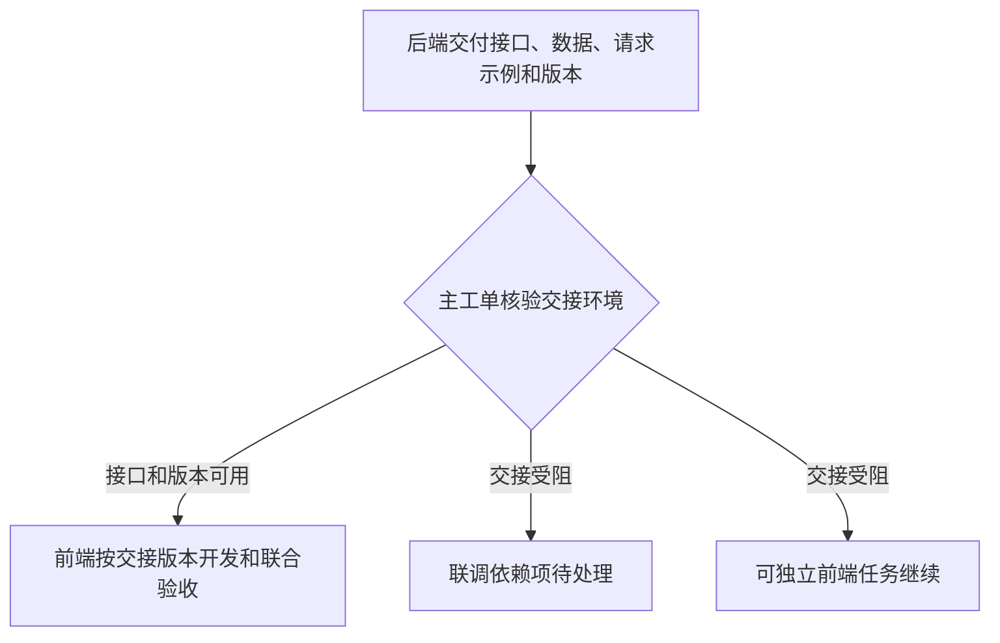

1. **后端开发 Agent 准备交接材料。** `backend/handoff.md` 记录关联任务、接口路径和字段、错误行为、测试数据准备、连接方式和已成功的请求与响应。后端测试 Agent 另交独立验收及实际受验版本。
2. **主工单 Agent 核验是否可交接。** 核实必需的后端任务、候选验收、实际合回和适用的远端回执，核对可调用环境与实际运行版本。有部署目标时同时检查部署回执、运行版本和联调网关。用 `document`、`backend_versions`、`environment` 及 `verification` 登记交接证据。
3. **前端开发和测试 Agent 接收同一份交接版本。** 开发按实际接口和数据条件完成实现。测试在执行联合场景前核对实际后端版本，并在逐项结果中同时记录前端候选与后端版本。交接受阻时，主工单 Agent 标出依赖该交接的任务，账本继续派发可独立执行的前端任务。

交接阶段增加了账本校验和联调版本绑定。交接文档须位于本单本轮目录，后端版本须匹配已合回、适用的已推送及已部署结果。多服务联调使用经核验的共同网关，前端验收执行器按交接回执检查后端实际运行版本。交接失败时，账本根据 `joint_acceptance` 和 `depends_on` 计算受影响范围，保留可独立推进的任务。 [交接证据规则](../.agents/skills/zentao-autodelivery/scripts/route_evidence.py) · [联调启动与版本检查](../.agents/skills/zentao-autodelivery/scripts/playwright_e2e.py)

### 23–32. 前端研发与交付

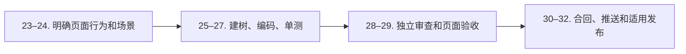

| 流程步骤 | 业务作用 | 由谁执行 | 本步建设 | 交给下一步的结果 |
| --- | --- | --- | --- | --- |
| 23. `frontend.design` 设计 | 将业务要求落到用户实际使用的入口、操作步骤和反馈，明确哪些页面或应用需要改动。 | 前端开发 Agent | 建立前端设计产物，按应用边界核对页面入口、交互、状态和接口。跨端任务引用主工单 Agent 核验的契约和版本。 | `frontend/design.md` 记录修改范围、适用接口及依据。 |
| 24. `frontend.plan` 计划 | 把页面工作和接口联调排进可执行顺序，让每条业务验收条件都有负责应用和检查场景。 | 前端开发 Agent | 建立应用键、任务和多仓映射，将页面及联合验收安排落到可执行的应用和场景。需页面联合验收的后端任务也登记涉及的前端仓库。 | `frontend/plan.md`、`applications`、`task_repositories` 以及单测和 E2E 安排。 |
| 25. `frontend.branch_check` 分支核验 | 锁定页面运行所涉及基座和子应用的修改基线，避免在错误版本上实现，或合回时漏掉配套改动。 | 主工单 Agent | 把基座、子应用及其他实际修改仓库纳入同一份分支核验回执。每个仓库从对应目标分支基线创建或复用工单 worktree。 | `repositories` 中的仓库根目录、基线、工单分支和工作树路径。 |
| 26. `frontend.coding` 编码 | 把确认的交互、状态和接口调用实现成可试用的候选页面，为测试方提供实际入口。 | 前端开发 Agent | 把受控 CLI 的工作范围绑定到工单工作树，开发时按应用登记实际候选 SHA，阶段运行器登记实际开工。 | `versions` 记录实际提交。可独立实施的前端任务也沿正常编码和验证阶段推进。 |
| 27. `frontend.unit_test` 单测 | 尽早检查交互状态、字段转换和异常分支，减少到完整页面验收时才发现的基础问题。 | 前端开发 Agent | 建立候选版本单测回执，绑定已核验的工作树 HEAD、测试命令及结果。 | 单测证据和候选运行入口，交前端测试 Agent。 |
| 28. `frontend.code_review` 代码审查 | 独立检查实现是否符合页面规则及影响范围，识别可能影响现有入口或用户操作的回归。 | 前端测试 Agent | 将独立审查接在单测之后，检查计划、候选 diff 和功能影响，严重缺陷可切换到返工分段。 | `versions`、`verification`、问题位置和严重度。 |
| 29. `frontend.e2e` 页面及联合验收 | 从用户操作出发确认能否完成业务目标。涉及接口和存储时，用明确的一组前后端版本核对保存、查询或错误反馈等适用场景。 | 前端测试 Agent | 建立独立 Playwright 浏览器、候选启动、登录、选工区、测试档案和业务场景脚本。跨端时从已核验的交接网关调用后端，并在验收前后核验部署版本。 | 用户操作、断言、写入回读及恢复证据，逐项记录 `verified_tasks` 和 `task_results`。跨端结果同时绑定 `backend_versions`。 |
| 30. `frontend.integration` 逐仓合回 | 把受验的页面及配套应用改动纳入目标分支，确认最终组合仍保有已验证的用户行为。 | 主工单 Agent | 对照真实受验版本和目标分支，逐仓读回合回结果。树内容变化时复验，部分合回保留已核验的仓库和受阻原因。 | `merged_versions` 及适用的复验结果，供后续推送逐仓准入。 |
| 31. `frontend.push` Git 交付 | 让前端发布和团队协作基于可复取的远端应用版本，便于核对本次有哪些应用可随包交付。 | Windows 工单启动器、Git 推送执行器 | 按逐仓准入结果把合回 SHA 推到配置目标分支，并读回远端。计划中的应用在镜像构建之前先建立可追溯的 Git 回执。 | 逐应用的远端结果，供前端发布、Task 判定及收尾。 |
| 32. `frontend.deploy` 前端发布 | 把本次通过验证的页面送到指定环境，为相关人员提供可访问的版本，并核实环境已加载本次镜像。 | Windows 工单启动器、前端部署 Agent | 建立前端整包发布准入、端口清理、隔离检出、目标底图局部替换及 Harbor、Rancher 读回流程。 | 镜像摘要和集群核验结果，交原会话收尾。 |

各端测试按实际候选版本记录通过、失败和待验证。合回树与受验候选树有差异时，记录最终版本的复验结果。启用 Task 同步时，逐项保留受影响任务及复验依据。验收材料应把业务规则连到可观察行为、AC 和可执行用例，写清真实链路、模拟覆盖或延期范围。 [E2E 编写与验收规范](E2E编写与验收规范.md)

[阶段与证据](../.agents/skills/zentao-autodelivery/references/stages.md) · [多仓工作树](../.agents/skills/zentao-autodelivery/references/branches.md) · [服务验收与联调](../.agents/skills/zentao-autodelivery/references/backend.md) · [任务依赖实现](../.agents/skills/zentao-autodelivery/scripts/route_execution.py)

## 五、Git 交付与镜像发布


第 20、21、31、32 步共用启动器交接和独立执行器。主会话到达 `backend.push`、`frontend.push`、`backend.deploy` 或 `frontend.deploy` 时结束当轮，把执行权交还 Windows 启动器。执行器从账本认领尝试，核对当前授权与快照，记录受控进程结果及回执后由启动器续接原会话。账本按仓库、镜像标签和部署工作负载等资源协调互斥执行。后端返工中的重新推送和部署沿用这套交接。

| 阶段 | 执行内容与完成条件 |
| --- | --- |
| `backend.push`、`frontend.push` | 逐仓核对计划、已验收版本、实际合回 SHA 和分支核验回执。要求 `origin` 的读取和推送端点唯一且一致。以普通推送更新目标分支，远端已包含合回 SHA 时直接记回执。部分交付只推送相关任务均已经验收并合回的仓库，仓库中仍有受阻任务时暂缓。分叉、权限或目标校验失败按仓记录，已确认的远端回执可供续跑复用。 |
| `backend.deploy` | 按已核验 Git 远端的合回 SHA，选出具有部署目标的服务。Smart-Geo 构建使用配置固定的 `tet-common-java` 和 `model-manage-srv` SDK 提交。构建并推送后，从 Harbor 读回镜像摘要，通过 Rancher MCP 更新 Deployment，核对模板、新 Ready Pod 和服务健康。跨端交接同时读回已部署版本和实际联调入口。 |
| `frontend.deploy` | 要求适用的前端验证及合回完成，且本次计划中的全部应用都有匹配的 Git 远端回执。执行器再确认远端包含合回 SHA，并检查发布所需本地端口。在隔离检出中用 `customized-release/bundle-build.cjs` 和 `zentao-ai-development` 配置构建，以目标当前 Harbor 镜像摘要为底图替换本次应用，推送并读回摘要，再通过 Rancher MCP 更新和核验模板及新 Ready Pod。旧快照沿用镜像发布阶段内的 Git 推送。 |

Git、Harbor 和 Rancher 分别保留合回 SHA 与远端分支回执、镜像摘要和集群核验。恢复时读回外部实际状态，复用已确认结果。镜像部署受阻时保留已合回和已推送的版本，以及已确认的镜像结果。依赖该部署版本的后续验收继续待验证。

[Git 推送执行器](../.agents/skills/zentao-autodelivery/scripts/git_delivery_runner.py) · [尝试与资源锁](../.agents/skills/zentao-autodelivery/scripts/deploy_control.py) · [推送与部署证据规则](../.agents/skills/zentao-autodelivery/scripts/route_evidence.py) · [后端部署](../.agents/skills/zentao-autodelivery/references/backend.md#后端自动部署) · [前端镜像发布](../.agents/skills/zentao-autodelivery/references/frontend-release.md) · [Rancher MCP 实施与验证记录](superpowers/plans/2026-11-22-Rancher-MCP-自动发布实施计划.md)

## 六、Task 同步、收尾与反馈

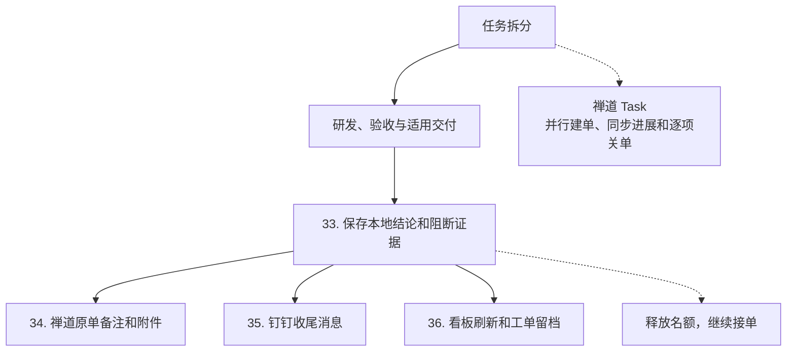

### 从第 11 步并行运行的禅道 Task 同步

**业务作用**　让项目负责人在禅道按任务管理范围和进度。建单明确迭代和责任归属，开工及阻断说明区分正在做和等待依赖的任务，关单与重开记录哪些验收条件已满足、哪些需要复验。

- **拆分 Task 与研发并行。** 同步器按稳定拆分编号创建 Task，关联原 Story 所在项目和迭代，初始指派给建单时原需求的指派账号。迭代待定时保留待建单，研发继续。监测轮次补办未确认的操作，也覆盖已本地收尾的工单。
- **同步实际进展。** 阶段运行器以受控编码启动证据登记本次可执行任务的开工。Task 同步器读回禅道并同步「进行中」。任务已登记工时不足时，保留待同步原因并追加开工备注。等待前置依赖的任务保持「未开始」。部署、依赖或联调验收受阻时，Task 同步器按任务追加原因与相关证据，随后读回禅道实际状态。
- **逐项核验和关闭。** 单个 Task 达到本单验收要求、涉及的仓库全部合回，并取得适用的 Git 远端回执后，才安排关闭。涉及已配置部署目标的后端任务还须核验部署，要求联合验收的任务须有匹配前后端版本的逐项结果。项目关闭前端页面验收时，按候选单测、代码审查、合回及适用的 Git 回执核验，并记录页面验收跳过。返工影响原验收条件时按原 Task ID 重开，复验后再关闭。

这条支线建立了任务证据判定和独立的同步进程。账本统一维护研发期望状态、禅道实际状态及待办。同步器负责写入并读回，`worker.py sync-tasks` 可继续处理本地已收尾的工单。 [Task 逐项交付判定](../.agents/skills/zentao-autodelivery/scripts/task_evidence.py) · [Task 同步实现](../.agents/skills/zentao-autodelivery/scripts/task_sync.py)

### 33. 本地收尾并释放名额

**业务作用**　形成一条可供项目负责人决策的本轮结论，明确已交付范围和待补材料、环境或验证，并让下一张满足条件的工单可以接续执行。

主工单 Agent 核对本单阶段故障、逐项验收、合回版本和适用的外部回执。有阻断时写 `blockers.md`，记录原因、影响、历次尝试、证据和恢复条件，然后调用 `record complete`。账本把结论、最终备注、适用的阻断附件和钉钉待办一起入账。执行资源已停止或有效隔离后释放名额，监测会话可继续处理队首新单。主动停跑由 `record stop` 核验停止证据后走收尾。

| 本地结论 | 账本记录的事实 |
| --- | --- |
| 已交付 | 本单按快照执行的必要阶段通过，并具备必需的验收、合回和交付回执。 |
| 待补材料 | 已确认需求文件或材料关键内容需要补齐，启用正式评审时按已核验的评审结果收尾。 |
| 待验证 | 适用的验收、远端推送或部署证据仍待核实，已确认的阶段及部分交付结果随单保留。 |
| 阻断 | 记录当前无法推进的阶段、受影响任务和恢复条件。 |
| 主动停跑 | 保存用户停跑时已经完成的阶段、后续跳过项和停止证据。 |

### 34. 回写禅道原单

**业务作用**　需求方在原工单就能追到各阶段结果和阻断依据，知道需要补什么、核实什么，以及本轮结论从何而来。

阶段完成时，在同一事务建立备注待办。工单会话或后续监测会话处理阶段备注、最终备注和阻断附件，备注注明实际起止时间、结论及重试或跳过原因。实现稳定操作标识、写入租约和一次性发送凭证。提交结果不明确时先读回，确认旧请求结束且目标未写入再补发。附件通过 REST v2 关联到原工单，核对下载内容并保存读回回执。当前实例已有 Story 备注和附件实测证据，Bug 回写仍待真实 Bug 验证。 [收尾实现](../.agents/skills/zentao-autodelivery/scripts/execution.py) · [原单回写实现](../.agents/skills/zentao-autodelivery/scripts/writeback.py)

### 钉钉群消息

**业务作用**　让关注工单进度的群成员在接单和收尾时收到提醒。看到待补材料、待验证或阻断时，可以按工单编号回到禅道查看具体事项。

**第 35 步，发送收尾通知。** 本步与第 6 步首次开工共用一套钉钉消息建设。接入群机器人加签、独立待发队列、本机 DPAPI 凭据和发送回执。账本按当前 `notifications.dingtalk.enabled` 生成通知，启用时随工单状态一起入账。发送器在事务提交后尝试发送，后续监测轮次也会处理待发送消息。禅道原单备注、Task 同步和钉钉发送分别记录结果，本地收尾后即可触发群消息。

| 消息 | 触发时机与去重 | 群内看到的内容 |
| --- | --- | --- |
| 首次接单 `started` | 主工单 Agent 的 `record start` 首次取得执行权时登记。按工单 `marker` 去重，原会话续跑沿用这条接单记录。 | `【已接单】`、禅道需求或缺陷编号、标题、执行机本地时间及 UTC 偏移。 |
| 本地收尾 `closed` | `record complete` 收尾成功时登记。主动停跑并完成收尾也走此路径。按 `marker` 和运行轮次去重，恢复后新一轮收尾可再发一条。 | 标题用实际结论「已交付」「待补材料」「待验证」「阻断」或「主动停跑」。有拆分任务汇总时附本地交付项数、禅道已关闭和待建、待关、待重开的数量。「待补材料」「待验证」「阻断」附查看原单相应内容的提示。 |

工单 #40 的本机账本保存了以下两条实际消息。

```text
【已接单】禅道需求 #40 REQ-035 解释结论管理（本期本地功能）
2026-11-22 16:13 +0800
```

```text
【待验证】禅道需求 #40 REQ-035 解释结论管理（本期本地功能）
2026-11-22 20:32 +0800
收尾时研发已验收并合回 3/16 项，禅道已关闭 3/16 张，待建单 0 张，待关闭 0 张，待重开 0 张。
请查看禅道原单中的待验证项。
```

#### 配置群机器人

在 `.agents/zentao-project.json` 设置 `notifications.dingtalk.enabled=true`。由运行工单的 Windows 用户在项目根目录交互式执行下表命令。`configure` 隐藏输入钉钉群机器人的 HTTPS Webhook 和加签密钥，通过 Windows DPAPI 写入 `.local/zentao-delivery/dingtalk.dpapi`。`test` 和 `deliver` 都可能向配置的群发送真实消息。

| 用途 | 命令与结果 |
| --- | --- |
| 配置或更换接收群 | `python -B .agents/skills/zentao-autodelivery/scripts/dingtalk_notify.py configure`。以目标群机器人的 Webhook 和加签密钥更新本机配置。 |
| 验证渠道 | `python -B .agents/skills/zentao-autodelivery/scripts/dingtalk_notify.py test`。通过本机凭据发一条「测试通知」，钉钉返回 `errcode=0` 时报告 `sent`。 |
| 手动处理待发送队列 | `python -B .agents/skills/zentao-autodelivery/scripts/dingtalk_notify.py deliver`。按当前开关处理已到发送时间的待办，每批最多 3 条，并输出各状态的条数。 |

#### 发送状态和重试

默认项目账本提交后，`workflow.py` 在接单和收尾回执中附 `dingtalk` 发送结果，监测的 `worker.py sync-tasks` 轮次也会扫队列。同一工单按入队顺序处理，已有 `pending` 或 `sending` 的消息时，同单后续消息等待。发送单次网络超时为 5 秒，发送进程调用上限为 18 秒。凭据缺失或无法读取时，发送器返回 `credentials_missing` 或 `credentials_invalid`，待办留在账本，修复后可由后续轮次继续发送。

| 账本状态 | 含义与后续处理 |
| --- | --- |
| `pending`、`sending` | 待发或已被发送器领取。明确限流、连接被拒或 DNS 解析失败时，延后 2 分钟进入可重试队列，首次发送加最多 3 次重试。实际重试由之后的发送轮次触发。 |
| `sent` | 钉钉机器人接口返回 `errcode=0`。 |
| `rejected` | 钉钉明确拒绝，或可重试错误已耗尽次数。 |
| `unknown` | 请求超时、返回无法判定，或 `sending` 到期仍无结果。状态保留供对账，发送器只领取 `pending`。可在钉钉群记录中核对实际消息。 |

在 `.local/zentao-delivery/workflow.sqlite3` 只读查询 `dingtalk_notifications`，用 `item_seq` 关联原工单。查看 `event_type`、`state`、`attempts`、`available_at` 和 `body` 可核对消息类型、结果、次数、可执行时间及正文。`available_at` 是队列调度时间，事件时间取正文第二行。 [通知入账与发送入口](../.agents/skills/zentao-autodelivery/scripts/workflow.py) · [钉钉发送实现](../.agents/skills/zentao-autodelivery/scripts/dingtalk_notify.py) · [监测补发入口](../.agents/skills/zentao-autodelivery/scripts/worker.py)

## 七、返工、超时与恢复

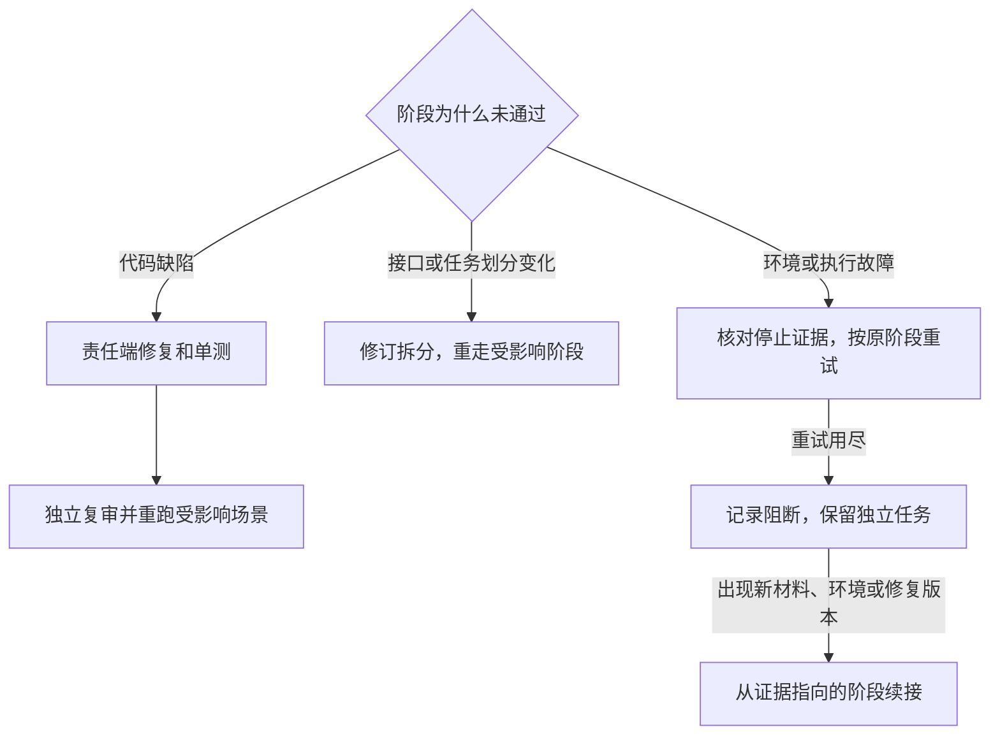

### 返工由谁接手

把验收失败交给对应的责任端，确认修复后的业务场景、接口约定和交付版本仍对应当前需求。独立任务继续推进，剩余风险保留到具体任务，便于项目负责人安排补验。

| 触发情形 | 负责人和处理顺序 |
| --- | --- |
| 本端代码审查发现需要修复的缺陷 | 测试 Agent 提交缺陷位置、受审 SHA 和影响范围。主工单 Agent 按账本派本端开发 Agent 修复及单测，再由本端测试 Agent 对新候选复审。 |
| 后端服务验收或前端页面验收发现本端缺陷 | 测试 Agent 提交失败场景、期望与实际结果、任务编号及版本。本端开发 Agent 修复并单测，本端测试 Agent 复审后重跑受影响的验收。环境故障按原阶段普通重试。 |
| 联合验收发现后端缺陷 | 前端测试 Agent 提交失败证据并指明后端责任。后端开发 Agent 修复及单测，后端测试 Agent 复审和服务复验，主工单 Agent 重新合回。启动器执行适用的 Git 推送和部署，主工单 Agent 更新并核验 `handoff`。需要前端跟随改动时，由前端开发 Agent 修改及单测、前端测试 Agent 复审，最后用新版本重跑联合验收。 |
| 合回冲突涉及业务逻辑 | 主工单 Agent 将冲突证据和已合回仓库交给责任端。开发 Agent 修复并单测，测试 Agent 复审并执行适用的本端验收，主工单 Agent 重新核对合回。 |
| 接口约定或任务划分需要变更 | 主工单 Agent 按账本派拆分 Agent 提交修订后的完整任务清单、契约及变更原因。账本接受路线修订后开启新轮次，从返回的设计阶段重走适用流程，并重新核验跨端交接。 |

普通返工占用原失败阶段的一次重试，各分段沿用同一个 `attempt_id`。成功的分段用 `repair_advance` 登记，最终用 `attempt_finish` 登记复审或复验结果。局部失败按任务编号写入 `evidence.task_blockers`，账本沿 `depends_on` 标出受影响任务。主工单 Agent 继续派发 `task_scope.active` 内可独立完成的工作。合回候选含受阻改动时，先隔离可交付内容并复验。前端独立任务的推送和发布仍按各自的证据门槛判断。

### 超时与续跑

把执行中断转成有证据、可续接的工单状态。材料补齐、环境恢复或修复版本就绪后，项目可从受影响的步骤继续验证，并沿用仍有效的交付结果。

每个受控阶段通过 `attempt_start` 取得当前阶段、角色、任务范围、尝试编号和绝对截止时间。账本凭工单键、会话、派发请求、轮次及尝试编号核对 `attempt_finish` 或 `repair_advance`，同一事件通过事件标识读回原结果。阶段运行器保存 `launch.json`、`result.json`、`stdout.log` 和 `stderr.log`，对账时可定位本次启动、退出或隔离的证据。

每次尝试都有独立编号和绝对截止时间。材料同步与评审共享单次 10 分钟时限。分支核验为 15 分钟，编码为 120 分钟，后端服务验收和前端 E2E 各 90 分钟，后端部署和前端发布各 60 分钟。设计、计划、单测、审查和合回各 45 分钟。拆分沿用计划时限，Git 推送和联调交接沿用合回时限。正式评审等待外部回执或激活时，由监测轮次继续对账。

Windows 阶段运行器用 Job Object 管理本次尝试拥有的进程。到期后，主工单 Agent 根据运行器证据核对 Agent 停止与进程退出，确认已停止或有效隔离后再安排重试或释放名额。重启时沿用账本中的原尝试、截止时间和重试计数。超时结果与迟到回执都关联原尝试。

恢复沿原会话及原工单继续，新的材料、环境恢复或新的待验修复版本可作为恢复依据。账本按恢复标识和证据去重。新版 Story 续跑时会读回已评审的 `intent.md` 并比较 SHA-256。材料变化、暂不可读或拆分存在阻断时，回到材料评审并重新判定范围。其余情况优先从最早失败或有任务阻断的阶段继续，再按未验证阶段或原阶段恢复。任务修订沿用仍适用的稳定编号，新增独立要求使用新编号。主动停跑的工单由用户决定是否另行处理。

[返工阶段映射](../.agents/skills/zentao-autodelivery/scripts/route_execution.py) · [阶段运行器](../.agents/skills/zentao-autodelivery/references/stage-runner.md) · [超时与恢复实现](../.agents/skills/zentao-autodelivery/scripts/execution.py) · [账本命令](../.agents/skills/zentao-autodelivery/references/workflow-cli.md)

## 八、查看进度与证据

**业务作用**　让项目负责人随时查看排队、实际开工和阻断位置，交付后也能按同一工单追到验收内容、运行版本及外部回执，便于交接和复核。

**第 36 步，刷新看板并留档。** 状态页是在执行机器上由 SQLite 生成的只读快照。默认账本的调度和阶段登记、Task 同步刷新页面，浏览器每 30 秒重新读取。看板展示最近扫描、队列、当前阶段、评审等待、逐项验收和禅道同步结果。工单资料用 `marker` 与 `round-<n>` 串起材料、拆分、设计、计划、验收和阻断，Git、部署、外部回执和通知也可按同一工单追溯。从接单到收尾均可查看已有进度。

| 要核对的内容 | 入口与判断方法 |
| --- | --- |
| 监测是否持续运行 | 在 Codex 桌面定时任务中查看项目监测会话和实际运行历史，再对照进度页的「最近一次完整扫描」。60 分钟是项目配置的期望间隔。 |
| 工单和拆分任务进度 | 在执行机器上打开 `.local/zentao-delivery/status.html`。页面每 30 秒重新加载最近生成的账本快照。「等待禅道评审」展示待对账、待激活或待续接工单。展开「拆分任务」可看逐项研发判定、禅道 Task 实际状态和最近同步结果。 |
| 需求方看到的反馈 | 在原禅道工单查看正式评审意见和操作历史、阶段备注、最终备注及附件。进度页仍有待回写时，对照本地结论与后续禅道回执。 |
| 钉钉接单和收尾通知 | 在目标钉钉群看实际消息，在本机 SQLite 的 `dingtalk_notifications` 表核对待发、发送结果和尝试次数。 |
| 工单交付材料 | `.local/zentao-delivery/items/<marker>/round-<n>/` 保存 `split.md`、各端 `design.md`、`plan.md`、后端 `handoff.md` 和需要时的 `blockers.md`。同一工单的 Git 推送和前端发布证据分别在 `git-delivery/attempts/` 和 `frontend-releases/`。 |
| 会话绑定、尝试与实际回执 | 使用只读方式查 `.local/zentao-delivery/workflow.sqlite3`。`workflow.py claim`、`workflow.py record` 是调度和登记入口。 |

[进度页实现](../.agents/skills/zentao-autodelivery/scripts/status_board.py) · [账本结构](../.agents/skills/zentao-autodelivery/scripts/ledger.py)

## 九、运行证据与待验证项

| 记录 | 实际结果 |
| --- | --- |
| 需求 #33，历史前端整链验收 | 2026 年 11 月 19 日在隔离账本和工作树验证旧前端流程。6 组候选浏览器场景通过，基座和 Shell Hub 两个仓库在本机合回，10 条禅道备注读回确认。目录读取使用测试响应。 |
| 需求 #37，单端交付与 Task 关闭 | 本机正式账本显示「已交付」，该单在当时快照下按前端单测、审查与合回完成研发，1 张拆分 Task 已读回为关闭。 |
| 需求 #40，跨端部分交付 | 本地结论为「待验证」，前端独立任务已发布，依赖后端部署的任务仍待验证。[分阶段执行结果](#跨端工单-40-的执行结果) |
| 钉钉群机器人通知 | 本次只读查询本机正式账本，#37、#38、#40 共 7 条通知，均一次发送并登记为 `sent`。#38 有两轮「阻断」收尾和一条首次接单记录。 |
| Rancher MCP 实机验证 | 实施记录显示，使用运行中镜像的等价摘要验证了 Smart-Geo 和前端目标的更新权限。从 Rancher 观察到新 Pod 为 Ready，镜像 ID 与 Harbor 摘要匹配，Smart-Geo 直连健康返回 `UP`。 |
| 正式评审，隔离禅道 22.6 实例 | 本机隔离账本已确认「有待明确」意见并收尾为「待补材料」，也已读回「通过」意见，Story 留在评审中等待其他意见。激活后续接有自动化测试覆盖。 |
| 公司知识库，Windows 运行环境 | 已核实阶段运行器监管的探针可调用搜索并读取指定版本。阶段 Agent 探针在首次工具调用前超时，真实工单的知识引用归档和检索失败后的继续拆分仍待验证。 |
| 当前代码基线回归 | `cb6ce64` 的整理记录包含 225 项工作流 Python 测试和 6 项 Playwright 辅助脚本 Node.js 测试，全部通过。覆盖材料同步、正式评审、实际开工与阻断同步、逐仓推送和部分交付等逻辑。 |

### 跨端工单 #40 的执行结果

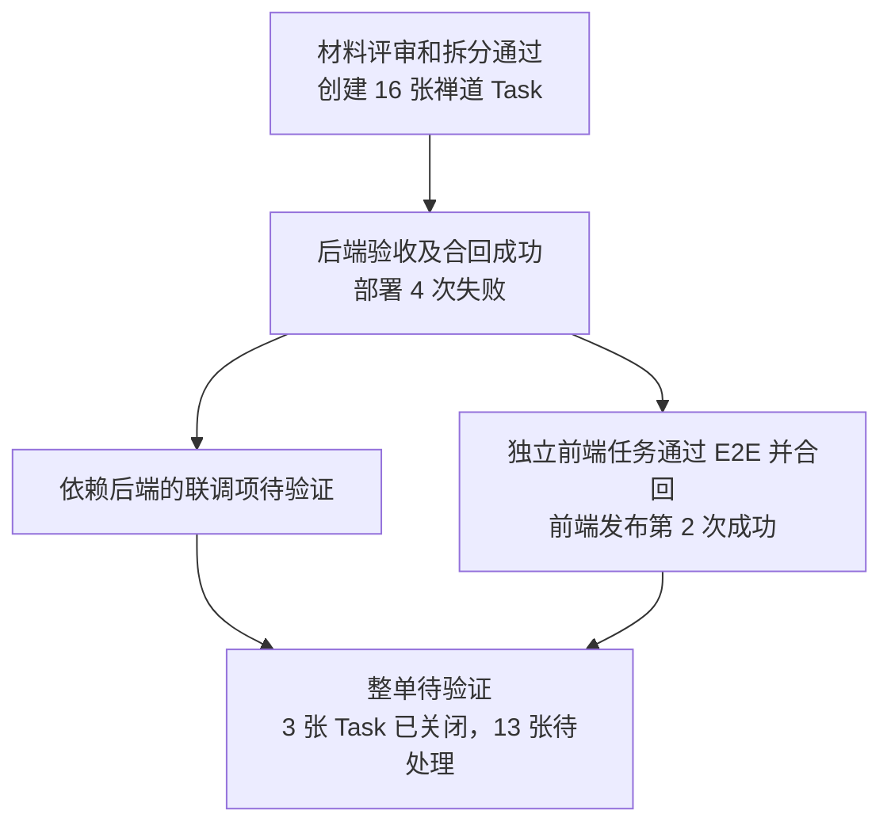

1. 材料评审和拆分成功，创建 16 张禅道 Task，接单钉钉消息已发送。
2. 后端设计、计划、建树、编码、单测、审查、服务验收及合回均有成功回执。后端部署经过 4 次尝试仍失败，依赖该版本的跨端验收留待处理。
3. 独立前端任务继续，审查失败后复审通过，实际候选通过页面验收并合回。前端发布第二次尝试成功，保留 Rancher 回执。
4. 本地以「待验证」收尾，3 张 Task 已关闭、13 张待处理。禅道读回 22 条备注和 1 个阻断附件，钉钉接单和收尾消息均有 `sent` 回执。

#37 和 #40 的结论来自本机正式 SQLite 账本，两单沿用早期快照。截至本次核对，正式账本尚无按当前快照串起材料同步、正式评审、Task 开工与阻断回写及独立 Git 推送的工单回执。Smart-Geo 补齐 SDK 构建依赖后的正式部署，以及 Bug 的实际回写，仍待对应工单验证。
[历史整链验收](禅道无人值守研发实施方案.md) · [Rancher 实机验证记录](superpowers/plans/2026-11-22-Rancher-MCP-自动发布实施计划.md) · [公司知识库验收记录](禅道自动化接入公司知识库需求与实现.md)

## 十、当前项目配置

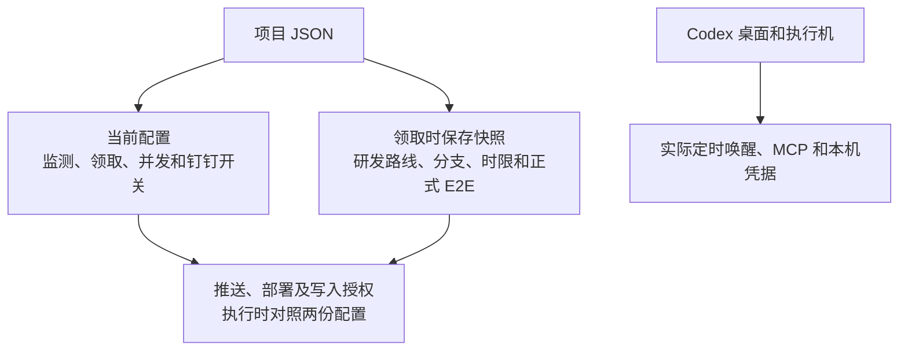

项目配置入口是 `.agents/zentao-project.json`。下表的「当前值」来自该文件，标有「缺省」的值由代码补齐。`_comments` 用于在配置文件内说明字段。监测、领取和并发读取当前配置。工单领取时保存快照，研发路线、分支、阶段时限、正式评审开关、Task 同步和正式 E2E 沿用该单快照。材料同步、上游写入、Git 元数据权限、Git 推送和镜像发布还会核对当前配置或授权。 [项目配置](../.agents/zentao-project.json) · [配置校验](../.agents/skills/zentao-autodelivery/scripts/ledger.py) · [启动器与权限](../.agents/skills/zentao-autodelivery/references/worker.md)

### 1. 禅道接收、排队和阶段时限

| 配置项 | 当前值 | 支持配置及生效方式 |
| --- | --- | --- |
| `zentao.base_url`、`zentao.project_name` | `http://127.0.0.1:8088`，海能发地质工程一体化 | 指定禅道实例和项目名称。监测还会核对实际项目 ID 和工单归属。 |
| `zentao.credential_ref` | `windows-dpapi:dotflow/zentao` | 引用本机禅道凭据。当前正式评审和 Task 同步执行器使用该引用对应的 Windows DPAPI 凭据。 |
| `zentao.assigned_to_accounts` | `DOt-hwc` | 支持账号列表，区分大小写。空列表暂停新单扫描和领取。 |
| `zentao.accepted_statuses.story`、`zentao.accepted_statuses.bug` | Story 为 `reviewing`、`active`，Bug 为 `active` | 分别设置两种工单的接收状态。状态列表为空时跳过该类型扫描。 |
| `monitor.enabled` | `true` | 启停新单扫描和领取。已有工单及待回写仍可按当前授权对账。 |
| `monitor.interval_minutes` | 60 分钟 | 项目期望间隔。实际唤醒频率在 Codex 桌面定时任务中设置。 |
| `development.allowed_requirement_types` | `frontend_only`、`backend_only`、`fullstack` | 支持仅纯前端、仅纯后端或三项都允许这三种配置。缺省为纯前端。三项都允许时，拆分按材料标记或实际范围选定一条路线。 |
| `development.max_concurrent_items` | 1 | 正整数，限制同时占用执行名额的工单数。评审等待交接完成后可释放名额。 |
| `development.max_retries_per_step` | 3 | `0` 至 `3`，表示每阶段首次执行之外的重试次数。 |
| `development.step_timeout_minutes` | `material_check` 10，`branch_check` 15，`coding` 120，`e2e` 90，`design`、`plan`、`unit_test`、`code_review`、`integration` 各 45，`backend.deploy` 为 60 | 各值为 `1` 至 `1440` 的整数。可用 `frontend.deploy`、`backend.acceptance`、`frontend.push` 等完整阶段名覆盖共用时限。未单独配置时，拆分沿用计划，服务验收沿用 E2E，推送和交接沿用合回，前端发布缺省 60 分钟。 |

### 2. 流程开关、会话权限和通知

| 配置项 | 当前值 | 支持配置及生效方式 |
| --- | --- | --- |
| `runtime.sync_requirement_before_review` | `true` | Story 每次材料评审前同步需求仓库到当前分支的远端上游。缺省关闭。 |
| `runtime.story_review_sync` | `true` | 启用禅道正式评审、回执读回和激活后续接。缺省关闭。 |
| `runtime.split_task_sync` | `true` | 为新 Story 同步拆分 Task 建单、关闭和重开。缺省关闭。 |
| `runtime.split_task_progress_sync` | `true` | 在拆分 Task 同步启用的基础上，增加实际开工和阻断备注。缺省关闭。 |
| `runtime.git_push_enabled` | `true` | 在已选研发端的合回后增加 Git 推送及远端核验，适用于有或无镜像部署的仓库。缺省关闭。 |
| `runtime.desktop_project_id` | 已登记本机项目 ID | 指定工单会话的桌面项目，领取和绑定须匹配。省略时，领取沿用队首记录的桌面项目。 |
| `runtime.require_unattended_approval` | `true` | 账本领取执行权时核对会话具备无人值守权限。正式启动器还会显式传入审批策略 `never`，评审、同步和发布执行器分别核验实际权限。 |
| `runtime.worker_cache_paths` | `~/.m2/repository`、`%LOCALAPPDATA%/npm-cache` | 额外提交给 Windows MXC 的可写缓存目录，支持 `~` 和系统环境变量。缺省为空列表。 |
| `runtime.worker_git_write_repositories` | 17 个前端应用及 5 个后端服务 | 按 `frontend:应用键`、`backend:服务键` 登记可写 Git 元数据的仓库。缺省为空列表。可写上游依赖走 `backend_dependencies` 授权。 |
| `runtime.dispatch_lease_seconds` | 缺省 300 秒 | 派发预占的租约时长，用于会话绑定和领取执行权。支持正整数。 |
| `runtime.writeback_lease_seconds` | 缺省 120 秒 | 原单回写、正式评审和 Task 等外部操作的写入租约。支持正整数，Task 同步从工单快照读取。 |
| `runtime.observation_max_age_seconds` | 缺省 300 秒 | 扫描和队首复核观测值的有效期。支持正整数。 |
| `notifications.dingtalk.enabled` | `true` | 开启首次接单及每轮本地收尾通知。缺省关闭。使用当前项目配置，群机器人凭据和发送状态见[钉钉群消息](#钉钉群消息)。 |

[调度与租约](../.agents/skills/zentao-autodelivery/scripts/claim.py) · [钉钉配置与发送](../.agents/skills/zentao-autodelivery/scripts/dingtalk_notify.py)

### 3. 工作区、应用、服务及上游依赖

| 配置位置 | 支持配置 | 当前登记 |
| --- | --- | --- |
| `workspaces.requirement`、`workspaces.frontend`、`workspaces.backend` | 分别指定材料、前端和后端目录。当前相对路径从配置文件所在的 `.agents/` 解析。 | `../req-demo`、`../aggregation-platform-4`、`../srv-workspace`。 |
| `development.frontend_bundle.name`、`development.frontend_bundle.applications.<应用键>` | 配置应用组名称和应用表。`repository` 相对于前端工作区，`.` 表示根仓库。`branch` 指定分支核验、合回和 Git 推送的目标分支。 | 组名 `micro-hnf-universal-subapp`。17 个应用均指向 `AI-development`。 |
| `development.backend_bundle.name`、`development.backend_bundle.services.<服务键>` | 配置服务组名称和服务表。每个服务配置 `repository`、`branch`、`build_command`、`test_command`、`acceptance_command`，以及 `start_command` 或 `service_url`。 | 组名 `srv-workspace`。`smart-geo`、`model-manage-srv`、`task-manage-grpc`、`tet-task-manager`、`model-python` 各自使用同名子仓及 `AI-development`。目前均登记启动命令，覆盖 Maven、.NET 和 Python。 |
| `backend_dependencies.<依赖键>` | `source_path` 指向依赖仓库，`api_source` 指向仓库内的源码或契约，`used_by` 声明消费方。`access` 支持 `read_only`（缺省）和 `writable`。可写依赖的 `delivery` 登记分支、构建、单测、验收和启动命令或服务地址。 | `datapool` 为 `writable`，供 `smart-geo` 使用。仓库为 `../tet-datapool`，接口入口 `DPWebApi/Controllers`，目标分支 `AI-development`，配置了 .NET 构建、单测及本地 `19085` 的 OpenAPI 验收入口。 |

当前前端应用映射如下。计划中的应用键、仓库路径和打包分支映射须对应同一应用。 [多仓工作树](../.agents/skills/zentao-autodelivery/references/branches.md) · [后端命令与依赖](../.agents/skills/zentao-autodelivery/references/backend.md) · [前端发布](../.agents/skills/zentao-autodelivery/references/frontend-release.md)

| 仓库位置 | 应用配置键 |
| --- | --- |
| `.` | `aggregation-platform` |
| `root/<同名目录>` | `simba`、`micro-data-pool`、`shell-hub`、`sso`、`cooperation` |
| `children/<同名目录>` | `fracturing-design`、`micro-dp-load-page`、`micro-double-sweet-spot`、`tet-smart-log`、`micro-pure-model-page`、`llm-web`、`micro-drilling-track`、`digital-twin`、`simulation-tracking` |
| `children/smart-logging-spark`、`children/dms-web` | `SmartLogging-SPARK`、`TetDMSWeb` |

### 4. 页面预检和正式 E2E

| 配置项 | 当前值 | 支持配置及生效方式 |
| --- | --- | --- |
| `e2e.enabled` | `true` | 缺省开启。关闭时跳过适用的页面预检及新单的前端页面验收，后端服务验收仍按路线执行。 |
| `e2e.workspace`、`e2e.start_command` | `frontend`，`npm run serve-shell-hub --gateway=http://10.10.4.140:31111/` | 指定工作区键和启动命令。跨端有已部署网关时，正式验收启动使用本单交接网关。 |
| `e2e.ready_url`、`e2e.platform_entry_path` | `null`，`/aggregation-platform/sso/home-page/platform` | 支持指定就绪地址或从启动输出及实际页面确认地址，同时设置登录后的平台入口。 |
| `e2e.playwright.channel` | `chrome` | 指定 Playwright 要使用的浏览器通道。 |
| `e2e.playwright.preflight_origin`、`preflight_entry_path` | `http://localhost:5000`，`/aggregation-platform/shell-hub/data-overview` | 设置预检本地源和页面路径。正式场景可传入候选地址和业务入口。 |
| `e2e.playwright.preflight_startup_ports`、`preflight_checks` | `5010`、`5150`、`30042`；检查「地图」「井列表」可见 | 设置新启动服务额外等待的端口，以及控件 `name`、精确 `text` 和 `action`。支持 `visible`（缺省）、`click`、`expand`，非空检查表须至少有一条可见断言。 |
| `e2e.login.path`、`username`、`credential_ref` | `/aggregation-platform/sso/login`，已登记的测试账号和 Windows 凭据引用 | 登录账号、路由和本机凭据可分别配置。凭据条目的用户名须与配置一致。 |
| `e2e.default_work_area.id`、`name` | 海能发陆上示范区工区，配置中登记对应 ID | 设置默认工区。独立 Playwright 按名称定位，既有页面流程需用到工区 ID。 |

工单可另传 `--profile` 指定业务入口、工区和控件检查，`--scenario` 执行本单业务场景，`--base-url` 与 `--marker` 关联候选地址和配置快照。跨端验收还可传 `--startup-log` 和 `--candidate-workspace` 记录或指定候选启动环境。 [E2E 配置与执行](../.agents/skills/zentao-autodelivery/references/e2e.md)

### 5. 前后端镜像发布

| 配置位置 | 支持配置 | 当前值 |
| --- | --- | --- |
| `development.frontend_bundle.deployment` | `enabled` 控制前端镜像阶段。`image_mode` 支持 `build`（缺省）和 `reuse`（复用已有可核验镜像回执）。可设置 `image_repository`、同仓库固定摘要的 `base_image`、`platform`（`linux/amd64` 或 `linux/arm64`）及发布前核查的 `local_ports`。 | 已启用，`build`，镜像为 `hzhub.tracyenergy.cn:6443/internalrd/tet-micro-data-pool-web-new`，已固定底图摘要，平台为 `linux/amd64`，登记 20 个端口。打包使用 `customized-release` 的 `zentao-ai-development` 配置。 |
| 前端部署下的 `rancher` | 按需填写 `mcp_url`、`cluster_id`、`namespace`、`deployment`、`container`。可选 `mcp_bearer_token_env`，要求 HTTPS。省略 `rancher` 时交付到 Harbor。 | 已配置 Rancher，集群 `c-m-wh2j6p2w`，目标 `internalrd/cnooced-suite-web`，容器 `cnooced-suite-web`。 |
| `development.backend_bundle.services.<服务键>.deployment` | 每个服务分别设 `enabled`、当前 `target`、可选目标集合 `targets`，以及模块名到固定 Git SHA 的 `build_dependencies`。 | 目前仅 `smart-geo` 启用，选择 `internalrd-test`，固定 `tet-common-java` 和 `model-manage-srv` 的构建依赖版本。 |
| 后端部署下的 `targets.<目标键>` | 公共字段为 `registry`、`image_repository`、`platform`、`cluster_id`、`namespace`、`deployment`、`container`、`gateway_url`。Rancher MCP 路线配置 `mcp_url`、`health_url`，可选 `mcp_bearer_token_env`。kubeconfig 路线配置 `kube_context`、`verification_path`，可选 `version_field`（缺省 `git.commit.id`），HTTPS 下可配 `http_username` 和 `http_credential_ref`。 | Smart-Geo 当前走 Rancher MCP，镜像为 `hzhub.tracyenergy.cn:6443/internalrd/smart-geo-srv`，`linux/amd64`，同一集群的 `internalrd/smart-geo-new`，容器 `smart-geo-new`，网关端口 `31111`，健康检查端口 `31191`。 |

新工单按领取快照选定发布目标。执行时核对当前环境及同一目标的授权。前端已有工单可在当前配置切换为 `reuse`，由执行器按原工单回执核验复用。 [前端发布配置](../.agents/skills/zentao-autodelivery/references/frontend-release.md#启用配置) · [后端部署配置](../.agents/skills/zentao-autodelivery/references/backend.md#后端自动部署) · [部署字段校验](../.agents/skills/zentao-autodelivery/scripts/deploy_state.py)

### 6. 项目 JSON 之外的运行设置

| 设置入口 | 可配置内容 |
| --- | --- |
| Codex 桌面定时任务 | 监测会话绑定、启停和实际运行时间。工单启动器使用本机已安装并登录的 Codex CLI。 |
| Codex MCP 与 Windows 用户环境 | 公司知识库连接名为 `company-knowledge`，连接地址与只读应用授权在 MCP 和知识库侧配置，`KNOWLEDGE_HUB_API_KEY` 由启动环境提供。 |
| 执行机凭据和工具 | 禅道及浏览器使用所引用的本机凭据，钉钉使用自己的 DPAPI 配置，Git 与 Harbor 使用执行机对应的登录凭据。使用后端 kubeconfig 路线时在执行机准备相应 context。 |
| 账本 CLI 参数 | `workflow.py claim` 和 `record` 可用 `--config`、`--database` 指定配置和 SQLite 文件，便于隔离验证。正式启动器按项目入口读取默认路径。 |

[Windows 启动器](../.agents/skills/zentao-autodelivery/references/worker.md) · [公司知识库接入配置](禅道自动化接入公司知识库需求与实现.md#接入配置) · [账本命令](../.agents/skills/zentao-autodelivery/references/workflow-cli.md)
