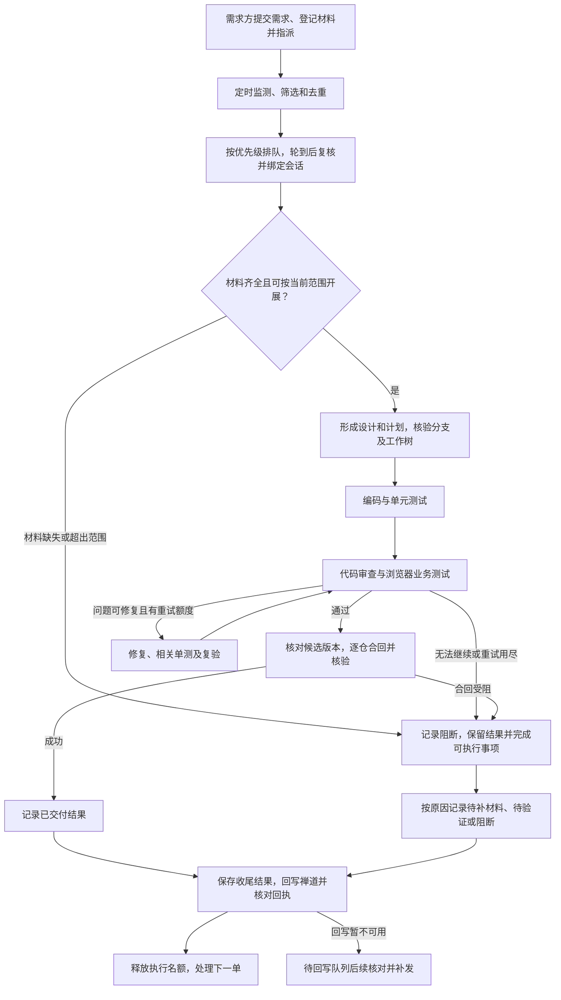
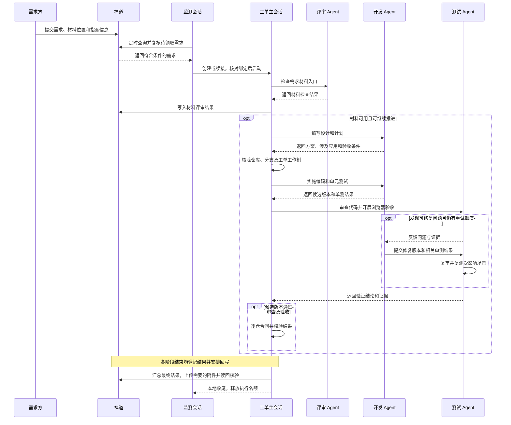
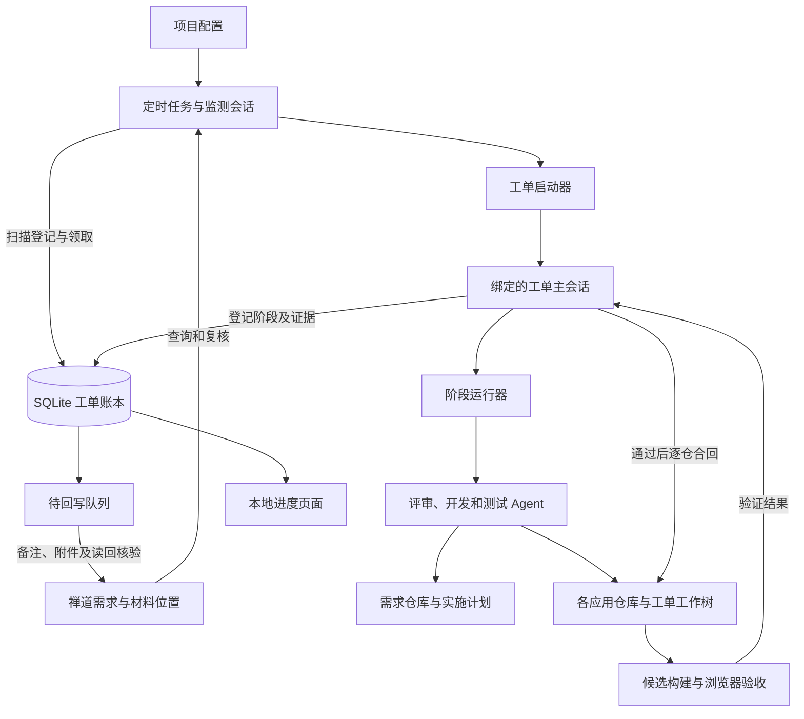

# 海能发地质工程一体化项目禅道无人值守研发建设与应用成效汇报

第一版 · 2026 年 11 月 19 日

## 一、建设背景与目标

需求从提出到交付，需要经过接收、材料核对、设计、开发、测试和结果反馈等环节。这些工作涉及需求方、开发人员和测试人员，也涉及禅道、需求仓库、多个应用代码仓库和测试环境。各环节之间需要持续查单、传递材料、确认进度和整理结果。

本项目围绕海能发地质工程一体化平台的前端研发，建设了以禅道需求为入口、由 Codex 定时监测和 Agent 协作执行的自动处理流程。需求方按照约定提交材料并指派需求后，系统负责发现新单、安排处理顺序、启动研发、组织验证，并将处理过程和结果反馈到原禅道需求。

建设目标包括三个方面。一是减少查单、转交、催办和整理反馈等重复工作，让需求按统一规则进入处理流程。二是让每个研发阶段都有明确的输入、完成条件和记录，能够追踪一条需求做到了哪一步、产出了什么。三是让系统具备异常处理能力，遇到材料缺失、测试失败和环境故障时，能够记录原因、控制重试、保留成果，并在满足条件后继续处理。

目前项目配置已开启前端需求监测，扫描间隔为 3 分钟，同一时间执行一单。项目已完成真实需求的隔离整链验收，以及阻断反馈、附件核验和执行超时等验证，为持续运行提供了实现基础和可核对的过程记录。[项目配置](../.agents/zentao-project.json) [实施与验收记录](禅道无人值守研发实施方案.md)

## 二、我们完成了哪些建设

围绕需求处理中的交接、执行和反馈，项目完成了以下建设。

| 完成的工作 | 具体做法 | 作用 |
| --- | --- | --- |
| 建立禅道自动接单入口 | 定时查询指定项目、账号和状态下的需求，完整扫描后登记新单，派发前再次核对需求状态。 | 将需求指派与后续处理衔接起来，减少人工查单和转交。 |
| 建立工单账本与处理队列 | 按工单唯一身份保存记录，按照优先级排队，控制同时执行的数量。 | 可以查清每条需求的去向，并对重复扫描、重复领取进行控制。 |
| 建立一单一主会话的协作方式 | 每条需求绑定一个工单主会话，由其组织评审、开发和测试 Agent，并保存本单的处理上下文。 | 将材料、设计、代码、测试和反馈关联到同一条需求。 |
| 建立研发阶段推进机制 | 将材料评审、设计、计划、分支核验、编码、单测、代码审查、浏览器验收和合回纳入统一流程。 | 每个阶段都有结果和后续推进依据。 |
| 建立多仓开发与版本核验机制 | 依据需求涉及的应用核对仓库和目标分支，创建独立工作树，记录基线、候选版本和合回结果。 | 让跨应用改动能够按仓库追踪，确认验证版本与交付版本对应。 |
| 建立异常处置与恢复机制 | 管理阶段时限、受控进程、重试次数和阻断记录，依据新材料或新验证证据恢复原工单。 | 限制异常任务持续占用资源，并保留后续继续处理的依据。 |
| 建立禅道回写与进度展示 | 将阶段结果、最终结论和附件写回原需求，读回核验，同时展示排队、执行、收尾和待回写状态。 | 需求方和项目负责人可以查看过程、结果及尚待处理的事项。 |

上述能力由项目配置、工作流脚本、执行器、研发操作指引和本地账本共同支撑。正常推进条件和异常处置规则已落实到工单处理过程，后续章节分别说明业务运行方式、技术实现及验证结果。[实现说明](../huibaocailiao/01-禅道无人值守研发设计与实施方案.md)

## 三、需求到禅道反馈的全过程

### 3.1 需求提交、监测与接单

需求方在禅道登记需要解决的问题、期望结果和验收条件，并填写需求材料在需求仓库中的位置。需求指派给约定接收账号后，进入系统的监测范围。

项目监测会话由定时任务唤醒，分页读取禅道需求，核对项目、指派人和接收状态。首次完整扫描建立历史基线，后续扫描识别新增工单。已登记需求沿用原记录，新需求按禅道优先级排队，同级按发现顺序处理。

有空闲执行名额时，系统重新检查队首需求是否仍符合接收条件，再创建或续接该需求的工单主会话。新会话先报告就绪，系统核对实际项目归属、需求编号和会话 ID 后发出启动指令。3 分钟是扫描间隔，实际开始处理还取决于队列顺序和执行名额。

### 3.2 需求评审与研发准备

评审 Agent 按登记路径检查需求材料目录及 `intent.md`。当前材料评审的通过依据是能够找到约定材料入口，材料缺失时记录具体路径，并以待补材料收尾。开发 Agent 随后依据材料分析实现范围，形成 `design.md` 和 `plan.md`，明确改动方案、涉及应用、单测安排和可执行的验收条件。若分析发现必须修改后端，则记录超出当前前端处理范围的原因。

工单主会话按照计划逐个核对应用仓库、目标分支和基线提交，为本单创建独立工作树。分支核验通过后，开发 Agent 才在对应工作树中实施改动。这样可以将需求材料、实施计划和实际代码位置对应起来。

### 3.3 研发、审查与测试

开发 Agent 完成编码及相关单元测试，保存执行结果和候选代码版本。测试 Agent 审查改动，发现影响核心验收条件或造成明显回归的问题时，交回原开发 Agent 修复，再复审相关改动。

代码审查通过后，测试 Agent 准备应用环境，从真实业务入口执行端到端测试，即通过浏览器验证需求中的业务操作和验收条件。测试过程包含应用启动检查、登录会话检查、工区选择和业务场景验证。已有可用服务、有效会话和当前工区可以复用，同时需要核对实际加载的应用版本。

测试发现代码问题时，进入修复、相关单测、复审和受影响场景复测。环境故障则按实际原因恢复环境后重试。测试记录保存场景、代码版本和结果，为合回提供依据。

### 3.4 合回、禅道反馈与收尾

工单主会话确认候选版本已经通过审查和浏览器验收后，逐仓核验目标状态并合回，保存实际提交记录。每个阶段结束时，系统向原禅道需求写入开始时间、结束时间和实际结果。最终备注汇总成功、失败和因阻断跳过的事项，遇到阻断时附上对应说明。

工单按实际情况以已交付、待补材料、待验证或阻断收尾。本地收尾并完成执行资源核对后释放名额，队列继续处理下一单。外部回写暂时失败时，待补事项进入独立队列，由后续轮次继续核对和补发。补齐材料、环境恢复或出现新的修复版本后，符合条件的原单可以重新排队，沿原会话继续。

上图集中展示主要推进路径。每个阶段均受完成条件和单次时限约束，阶段结果随执行过程写回禅道。工单的本地收尾与禅道回执分别记录，执行名额依据本地收尾结果释放。

## 四、系统的技术实现

### 4.1 配置与调度连接禅道入口

项目使用 `.agents/zentao-project.json` 集中配置禅道项目、指派账号、接收状态、需求仓库、前端应用及目标分支、执行时限和测试环境。监测会话每轮读取最新配置，决定哪些新单可以进入队列。工单领取时保存配置快照，后续执行依据该快照推进，使已接工单的目标分支、处理范围和时限具有明确依据。

Codex 定时任务负责唤醒固定监测会话。监测会话查询禅道并检查分页完整性，将有效扫描结果交给本地工作流入口。扫描不完整时保留已有队列，避免根据部分查询结果错误判断某条需求已消失。[项目配置](../.agents/zentao-project.json) [接单实现](../.agents/skills/zentao-autodelivery/scripts/claim.py)

### 4.2 工单账本管理队列和阶段

SQLite 账本以“禅道实例、实际项目 ID、工单类型、工单 ID”识别一条工单，保存其优先级、绑定会话、当前阶段、尝试记录、最终结果和回写回执。重复扫描更新同一条记录，领取操作在事务中核对队首与名额，并生成派发请求标识。

`workflow.py` 提供统一操作入口，`claim.py` 负责扫描与领取，`execution.py` 负责启动、阶段尝试和恢复，`ledger.py` 保存相关状态。工单能否进入下一阶段依据账本状态和提交的验证证据判断。派发请求、尝试编号和恢复轮次用于识别重复或迟到的结果，保持处理记录与实际执行对应。[工作流入口](../.agents/skills/zentao-autodelivery/scripts/workflow.py) [阶段执行实现](../.agents/skills/zentao-autodelivery/scripts/execution.py)

### 4.3 主会话组织 Agent 协作

`worker.py` 负责创建就绪会话和续接已有会话。派发分为准备与启动两步，先取得真实会话 ID 并核对项目归属，再启动业务处理。主会话组织评审、开发和测试，收集阶段产物并登记账本。

评审 Agent 核对材料，开发 Agent 编写设计、计划和代码并执行单测，测试 Agent 负责审查和业务场景验证。返工沿原开发上下文继续，恢复沿原工单会话继续，使已有判断、代码和证据能够衔接。[工单启动器](../.agents/skills/zentao-autodelivery/scripts/worker.py)

### 4.4 执行器控制时限与进程

每次阶段尝试登记独立编号、开始时间和绝对截止时间。`stage_runner.py` 使用相同截止时间启动执行，并通过 Windows Job 管理本次尝试拥有的进程。达到时限后，执行器终止对应进程并核对退出结果，再提交超时记录。

这项建设解决了 Agent 结束后子进程可能仍在运行的问题。系统需要确认上一尝试的执行资源已经停止，才可安全安排下一尝试。重启后读取原尝试状态、截止时间和累计次数，保持原有执行约束。[阶段运行器](../.agents/skills/zentao-autodelivery/scripts/stage_runner.py)

### 4.5 工作树与版本证据支撑多仓交付

平台由基座和多个子应用组成，单条需求可能涉及多个仓库。开发计划先明确涉及的应用配置键，`branch_check.py` 再逐项核对真实仓库根目录、目标分支、基线提交及工单工作树。实际改动在独立工作树中进行，相关测试和审查关联候选提交。

浏览器验收需要记录基座及相关应用实际加载的版本。合回前再次核对目标状态，逐仓保存合回提交，使需求、代码、测试与合回结果能够相互追溯。多个仓库逐个核验和合回，出现部分完成时保存每个仓库的实际结果，作为后续处理依据。[分支核验实现](../.agents/skills/zentao-autodelivery/scripts/branch_check.py)

### 4.6 回写队列与进度页展示结果

阶段结束和本地收尾时，账本同时登记需要写回禅道的事项。每条备注和附件都有对应操作标识，`writeback.py` 管理领取、发送许可、核对和确认。请求结果不明确时，先读回原需求的记录，已存在的登记回执，确认缺失且旧请求结束后再补发。

`status_board.py` 从账本生成进度页面，展示执行中、排队中、已收尾、当前阶段和待回写数量。页面每 30 秒重新读取，项目人员可以据此了解本地处理进度，再通过禅道回执核对外部反馈是否完成。[回写实现](../.agents/skills/zentao-autodelivery/scripts/writeback.py) [进度页实现](../.agents/skills/zentao-autodelivery/scripts/status_board.py)

### 4.7 在哪里查看进度和结果

项目提供三个查询入口，分别用于查看工单处理进度、需求反馈内容和定时监测运行情况。

| 想了解的情况 | 查看入口 | 可以看到的内容 |
| --- | --- | --- |
| 当前有哪些需求在处理、排队或已经收尾 | 在运行本项目的电脑上，用浏览器打开本地进度页。 | 接单开关状态、最近一次完整扫描时间、执行中和排队中的需求、已收尾需求、当前步骤、进行中尝试的次数及待回写数量。 |
| 某条需求完成了什么、遇到什么问题 | 点击进度页中的需求编号或标题进入禅道，查看原需求详情的备注、操作历史及附件。 | 各阶段的起止时间、实际结果、重试和跳过原因，最终处理结论，以及阻断说明等附件。 |
| 定时监测有没有按时执行 | 在 Codex 桌面端的定时任务界面，找到「海能发｜禅道需求自动接单」，查看运行历史及对应监测会话。 | 定时任务的执行记录，以及监测轮次记录的扫描、接单和异常情况。 |

**本地进度页的完整路径为** `E:\RealtimeMonitoringandMultiwarehouseCollaboration\.local\zentao-delivery\status.html`。可在文件资源管理器中定位该文件后用浏览器打开，也可以将完整路径粘贴到浏览器地址栏。支持打开本地文件的文档阅读器可通过以下链接访问。[打开需求进度页](../.local/zentao-delivery/status.html)

进度页由正式接单和步骤记录操作更新，浏览器每 30 秒重新加载页面。查看时先关注“最近一次完整扫描”时间，再查看对应需求的状态和当前步骤。页面刷新显示的是最近生成的账本快照，扫描时间可以帮助判断监测是否持续产生新记录。

“待回写”表示尚未确认写入禅道的事项数量。某单已经本地收尾且待回写数量仍大于零时，可以先查看本地结论，再关注禅道备注及附件补发结果。最终交付情况应结合原需求的最终备注、测试记录和合回结果确认。[进度页实现](../.agents/skills/zentao-autodelivery/scripts/status_board.py) [禅道结果查看说明](../huibaocailiao/02-禅道无人值守业务流程说明.md)

## 五、一条需求怎样自动完成

2026 年 11 月 19 日，项目选取禅道需求 #33，对应需求材料 REQ-021，开展一次性整链验收。该次验证使用隔离账本和工单工作树，覆盖基座与 Shell Hub 两个仓库，当时正式定时监测处于关闭状态。案例用于展示单条需求进入执行流程后的实际处理经过。

| 过程 | 实际完成的工作 |
| --- | --- |
| 领取与材料确认 | 领取已有需求，核对固定版本的需求材料，并绑定当前项目会话。 |
| 研发准备 | 完成设计、计划和分支核验。桌面创建工作树的请求回执缺失后，核对现有 Git 工作树清单，从配置目标提交创建本单工作树，并完成桌面挂载核验。 |
| 编码与单测 | 完成基座和 Shell Hub 改动。基座探针单测通过，Shell Hub 的 26 项相关测试通过。全量测试中的 5 项失败在同一基线也能复现，记录了相应核验结果。 |
| 代码审查与返工 | 审查发现实际卸载取证问题，开发阶段补充关签及悬停相关修正，经过两次返工后通过审查。 |
| 候选版本验收 | 两份候选从固定提交重新构建。首次浏览器测试因验收服务缺少所需静态资源而失败，补挂候选构建中的资源后复验，通过 6 组场景。 |
| 合回与反馈 | 两个已验证候选提交快进合回本机目标分支，逐阶段备注和最终备注共读回 10 条。账本记录已交付，释放执行名额。 |

浏览器场景包含关签卸载、重新进入及提示收起等行为，目录读取接口使用规格允许的测试响应。验收结束后，浏览器和专用服务均已关闭。该案例留下了设计、计划、尝试记录、候选版本、浏览器结果、逐仓合回记录及禅道回执，能够按需求编号追溯全过程。[需求 #33 验收回执](../.local/zentao-delivery/items/HNF-2b9e385aaf8f0529070e/validation-receipt.json) [浏览器验收结果](../.local/zentao-delivery/acceptance-33/candidate-e2e/e2e.json) [逐仓合回记录](../.local/zentao-delivery/acceptance-33/integration.json)

## 六、无人值守怎样持续运行

无人值守需要同时处理正常任务和异常情况。项目将常见异常纳入工单状态和执行规则，使每种情况都有处置结果及后续依据。

| 运行中遇到的问题 | 系统处理方式 | 作用 |
| --- | --- | --- |
| 同一需求被多轮扫描发现 | 按唯一工单身份更新原记录，领取时再次检查队首和名额。 | 避免重复登记和重复开工。 |
| 创建会话的回执不明确 | 根据原派发请求、会话标记和运行状态查找并核对。 | 使需求与实际执行会话保持一致。 |
| 需求材料缺失 | 记录缺失路径和原因，收尾为待补材料。 | 让需求方明确补充内容，并使执行名额可供后续工单使用。 |
| 单次执行达到时限 | 执行器结束本次受控进程，核验停止结果，登记超时后按额度重试。 | 限制任务持续占用资源，保留失败依据。 |
| 审查或测试发现严重问题 | 原开发 Agent 修复，执行相关单测，再进行复审和复测。 | 让缺陷修复与验证形成完整记录。 |
| 重试仍失败或确认无法继续 | 保留成功步骤，记录阻断原因，逐项说明后续跳过事项，完成可独立执行的收尾工作。 | 明确交付状态和剩余问题。 |
| 机器或应用中断 | 核对原尝试及其执行资源，恢复时沿用原会话、计数和证据。 | 使恢复过程承接已有进展。 |
| 禅道暂时不可用或请求超时 | 保存待回写事项，后续先读回核对，再补发确认缺失的内容。 | 支撑反馈补齐，并控制重复备注或附件。 |

当前每步首次尝试后最多自动重试 3 次。代码审查或浏览器验收的一轮修复加复验，计入对应阶段的一次重试。材料评审单次上限为 10 分钟，分支核验为 15 分钟，编码为 120 分钟，浏览器验收为 90 分钟，设计、计划、单测、审查和合回各为 45 分钟。提前完成立即进入下一环节，排队时间单独记录。

恢复需要新的依据，例如材料已补齐、环境检查已确认恢复，或者产生了新的待验证修复版本。系统保存恢复证据并沿原单继续，每份证据只触发一次恢复。工单状态持续符合接收条件时，仍由原记录管理其执行进度。[项目配置](../.agents/zentao-project.json) [阶段与恢复实现](../.agents/skills/zentao-autodelivery/scripts/execution.py)

## 七、实际应用与验证效果

现有证据覆盖完整研发过程、阻断处理和超时控制三个方面，能够说明项目已完成的建设如何作用于实际任务。

| 验证事项 | 已有结果 | 能够说明的效果 |
| --- | --- | --- |
| 需求 #33 整链验收 | 9 个阶段形成记录，6 组候选浏览器场景通过，2 个仓库完成本机合回，10 条禅道备注读回确认。 | 单条真实需求能够贯穿研发、返工、验证、合回和结果反馈，各环节有对应产物。 |
| 需求 #27 阻断处理 | 发现目标子仓缺失并记录待验证结果，完成可独立开展的材料核验、设计和计划，反馈阻断原因。 | 受阻任务可以保留已有成果，明确剩余条件和后续处理依据。 |
| 需求附件核验 | 需求 #27 的阻断报告上传后核对了关联对象，下载内容与本地报告的 SHA-256 一致。 | 阻断说明能够准确关联至原需求，附件内容可核验。 |
| Windows 超时执行 | 真实 Codex CLI 探针达到截止时间后，本次受控活动进程由 8 个降至 0，并确认测试子进程退出。 | 执行器能够结束到期尝试及其受控进程，为重试和释放资源提供证据。 |
| 正式监测接入 | 实施记录显示，11 月 19 日启用 3 分钟定时任务，首轮正式扫描于北京时间 11:08:10 写入账本，当时队列为空。 | 定时扫描已与项目账本接通，可继续积累实际接单运行记录。 |

从使用角度看，需求方可以通过禅道的原需求查看处理结果及待补事项。项目负责人可以通过账本进度了解正在执行和等待处理的需求。研发和测试过程留下与版本对应的结果，便于复核交付内容及返工原因。系统承担的查单、排队、阶段衔接和反馈工作，为减少重复协调提供了具体支撑。[实施与试单记录](禅道无人值守研发实施方案.md) [超时验证结果](../.local/zentao-delivery/runner-probes/windows-codex-fbc946122ceb/verify/result.json)

上述整链案例采用隔离验收环境，其中目录读取使用了测试响应，合回范围为本机目标分支。持续定时环境中的发现到领取耗时、连续处理能力、人工介入次数和平均交付耗时，还需要通过实际运行逐步统计。后续可据此衡量节省的协调时间和研发效率变化。

## 八、当前应用范围与后续工作

当前配置接收指定项目中指派给白名单账号、状态为评审中或激活的前端需求，每 3 分钟扫描一次，同一时间执行一单。现有应用映射覆盖平台基座及相关子应用，单条需求按实际影响范围选择仓库。Bug 接入、后端研发以及远程发布上线属于后续扩展和验证事项。

下一阶段围绕正式运行开展以下工作。

1. **积累连续运行证据。** 在正式定时环境中验证成功交付、可恢复阻断及受阻收尾后接下一单，记录从发现到领取、各阶段执行和最终反馈的时间。
2. **补齐复杂场景验证。** 继续验证登录和工区恢复、多仓部分合回后的处置，以及禅道写回超时后的核对与补发。
3. **形成效果统计。** 统计处理数量、完成率、阻断原因、重试次数和人工介入情况，为评估运行质量和投入效果提供依据。
4. **按验证结果扩展范围。** 根据前端需求的运行情况完善规则，再逐项验证 Bug 的接收、复现、研发及备注附件回写，逐步扩大可自动处理的业务范围。

