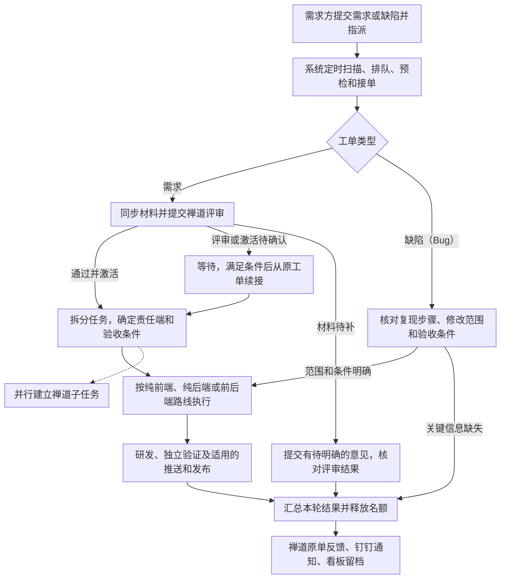
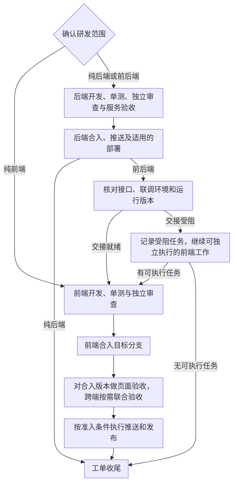
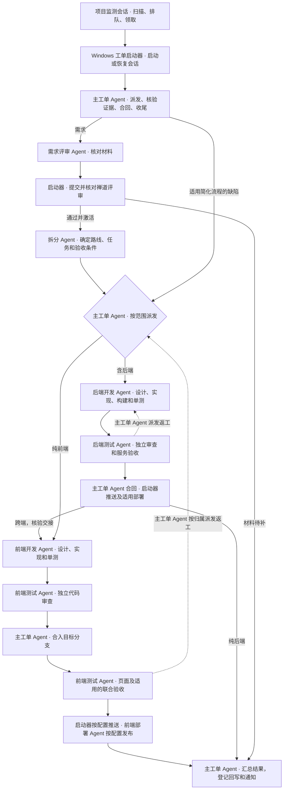

# 海能发地质工程一体化项目自动化研发建设进展

## 一、整体流程

**需求方在禅道提交和指派工单，系统自动接单，按范围组织研发、独立验收和发布，并把结果写回禅道原工单。** 项目负责人可以在看板查看当前阶段、已交付范围、待验证事项和恢复条件。

### 1.1 从提交到收尾

| 环节          | 谁负责                           | 做什么                                                                                                                   | 留下什么结果                                                           |
| ------------- | -------------------------------- | ------------------------------------------------------------------------------------------------------------------------ | ---------------------------------------------------------------------- |
| 1. 提交工单   | 需求方                           | 需求方将业务范围和验收条件写入需求仓库的 `intent.md`，提交后在禅道填写材料目录并指派。缺陷说明复现步骤、预期和实际结果。 | 禅道原工单及研发所需材料。                                             |
| 2. 接单开工   | 项目监测与工单启动器             | 按禅道优先级排队，同级按发现顺序。领取前复核项目归属、指派人、状态、适用的预检和空闲名额，并为每张单绑定专属会话。       | 首次实际开工后发钉钉通知，后续处理沿用同一工单会话。                   |
| 3. 确认范围   | 评审、拆分与工单主会话           | 需求同步材料、进行正式评审，通过并激活后拆分任务。新缺陷由主会话确认复现、目标应用或服务和验收条件，直接进入分支准备。   | 确认研发路线、任务依赖和验收标准。缺少关键信息时记录缺项和受影响范围。 |
| 4. 开发与审查 | 前后端开发与独立测试角色         | 需求按范围制定设计和实施计划。各端隔离开发、运行单测，再由独立角色审查代码。                                             | 记录改动版本、测试结果和需返工的问题。                                 |
| 5. 验收与合入 | 独立测试角色、工单主会话与执行器 | 后端先完成服务验收，再合入目标分支。前端先合入目标分支，再对合入版本做页面验收。跨端任务同时核对实际运行的后端版本。     | 按任务记录验收结果，并关联受验版本和实际合入版本。                     |
| 6. 推送与发布 | Git 推送及发布执行器             | 逐仓核对并推送代码，确认远端版本。对配置了发布目标的应用或服务，按准入条件发布镜像并核验环境。                           | 远端版本、镜像及部署核验结果。代码推送、环境发布和业务验收分别记录。   |
| 7. 反馈与留档 | 工单主会话与同步程序             | 汇总已交付、待验证和阻断项。确认执行资源停止或隔离后释放名额，回写禅道原工单，发送钉钉收尾通知并刷新看板。               | 原单可查处理结论和证据，看板保留每项任务进展及回写状态。               |

首次完整扫描建立历史基线，后续按工单去重。扫描不完整时保留已登记队列。预检不通过或名额不足时，工单留在队列等待下轮复核。领取时保存工单配置快照。

[需求与验收材料编写规范](禅道自动化需求与E2E编写规范.md)

#### 需求与 Bug 的处理区别

| 环节           | 需求（Story）                                                                                                                                     | 缺陷（Bug）                                                                                                                                             |
| -------------- | ------------------------------------------------------------------------------------------------------------------------------------------------- | ------------------------------------------------------------------------------------------------------------------------------------------------------- |
| 提交与接收     | 在禅道登记需求材料目录，材料包含业务范围和验收条件。当前接收评审中或已激活的需求。                                                                | 在原 Bug 写清复现步骤、预期结果和实际结果。当前接收已激活的 Bug。                                                                                       |
| 开工与任务拆分 | 同步需求材料，由评审 Agent 审查。正式评审通过且需求激活后，由拆分 Agent 明确任务和验收条件，再按范围开展设计与计划。按配置同步拆分后的禅道 Task。 | 当前启用简化接单。主工单 Agent 直接核对原单复现信息、受影响的应用或服务及验收条件，随后进入分支准备。跳过独立材料评审、正式需求评审、拆分、设计和计划。 |
| 验收与反馈     | 按拆分任务验证业务规则和验收条件，记录交付情况及适用的 Task 状态。                                                                                | 开发记录根因和影响范围，测试依据原复现步骤和预期结果独立复验。Bug 的实际回写仍待真实工单验证。                                                          |

两类工单共用编码、单测、独立审查、验收、合回及适用的发布流程。跨端工单均按实际依赖组织联调。

### 1.2 三条研发路线

| 路线   | 验收重点                                                                             | 交付依据                                                   |
| ------ | ------------------------------------------------------------------------------------ | ---------------------------------------------------------- |
| 纯前端 | 在实际合入版本上验证用户操作、页面反馈及业务场景。                                   | 页面验收结果、代码远端版本及适用的发布核验。               |
| 纯后端 | 验证业务接口、错误处理及适用的数据写入和回读。                                       | 服务验收结果、代码远端版本及适用的部署核验。               |
| 前后端 | 后端先交付可核对的接口、测试数据、联调地址和运行版本。前端使用同一套环境做联合验收。 | 实际使用的前后端版本、逐项验收结果及适用的远端和环境核验。 |

跨端联合验收以可核对的后端接口、联调环境和实际运行版本为前提。交接受阻时，依赖该版本的任务保留为待验证，可独立执行的前端任务继续推进。

[研发阶段与证据](../.agents/skills/zentao-autodelivery/references/stages.md) · [后端服务验收与联调](../.agents/skills/zentao-autodelivery/references/backend.md)

### 1.3 Agent 协作与职责

| Agent 或会话   | 主要职责                                                                                                                                                  | 交接结果                                                                      |
| -------------- | --------------------------------------------------------------------------------------------------------------------------------------------------------- | ----------------------------------------------------------------------------- |
| 项目监测会话   | 定时扫描禅道、复核接收条件、按优先级排队领取，并核对已有工单的待同步事项。                                                                                | 向启动器交付领取记录。                                                        |
| 主工单 Agent   | 统筹单张工单，派发阶段任务，核验分支、工作树和验收证据，逐仓合回，核对联调交接，并汇总交付范围及阻断原因。适用简化流程的 Bug 由主会话核对复现与验收条件。 | 向阶段 Agent 提供任务范围和版本，向启动器登记交付请求，收尾时登记回写和通知。 |
| 需求评审 Agent | 核对需求材料版本、业务范围和验收条件，列出缺件及待明确事项。                                                                                              | 提供材料结论和依据，由启动器办理禅道正式评审并读回。                          |
| 拆分 Agent     | 确定纯前端、纯后端或跨端路线，明确任务边界、依赖和逐项验收条件，按需引用知识库。                                                                          | 提交拆分文档和结构化任务清单，供研发派发及禅道 Task 同步。                    |
| 后端开发 Agent | 负责后端设计、计划、编码、构建、单测及返工，跨端时编写接口与联调交接文档。                                                                                | 提供后端候选版本、构建和单测证据，以及适用的联调文档。                        |
| 后端测试 Agent | 独立审查后端代码，在可核对版本的服务上逐项验收，复核修复结果。                                                                                            | 提供受验版本、接口验证结果及缺陷证据。                                        |
| 前端开发 Agent | 负责页面和交互设计、计划、编码、单测及返工，跨端时按已核验契约实现。                                                                                      | 提供前端候选版本、运行入口和单测证据。                                        |
| 前端测试 Agent | 独立审查前端代码，核对合入版本并执行页面验收，跨端时验证联合场景并记录前后端实际版本。                                                                    | 提供逐项验收结果、受验版本、失败场景和责任端判断。                            |
| 前端部署 Agent | 按适用的项目配置打包和发布前端，核对镜像仓库与运行环境。                                                                                                  | 提供镜像摘要、部署状态及集群核验结果。                                        |

Windows 工单启动器负责会话恢复和受控执行。阶段运行器负责超时和进程清理。Git 推送执行器、后端部署执行器及 Task 同步器分别负责远端版本核验、后端发布核验和禅道子任务状态同步。

[现行工作流规则](../.agents/skills/zentao-autodelivery/SKILL.md)

### 1.4 异常处理与结果跟踪

每轮收尾都会给出明确结论：已交付、待补材料、待验证、阻断或主动停跑。原禅道工单记录本轮已交付、待验证和受阻范围。钉钉在首次实际开工和每轮收尾时发送通知。

| 遇到的情况                   | 流程怎么处理                                                                                                                                                       | 在哪里看结果                                                 |
| ---------------------------- | ------------------------------------------------------------------------------------------------------------------------------------------------------------------ | ------------------------------------------------------------ |
| 材料不全，或正式评审尚未完成 | 材料确实不足时，在禅道提交「有待明确」的评审意见并记录缺项，确认评审结果后以「待补材料」收尾。评审待确认或需求未激活时等待对账，具备条件和执行名额后沿原工单续接。 | 禅道原单的评审意见和缺项，看板的评审等待状态。               |
| 代码缺陷、执行超时或环境故障 | 代码问题交责任端修复，由测试角色复审并重跑受影响的验收。执行故障按阶段重试，仍无法完成时记录原因，继续推进可独立完成的事项。                                       | 看板的受阻任务和恢复条件，禅道原单的阶段结果。               |
| 联调或验收只完成了一部分     | 按任务区分已完成、待验证和受阻范围。合入、推送或发布成功分别留证，有未通过或缺失的业务验收时继续保留待验证项。                                                     | 看板的逐项结果和禅道原单的本轮结论。                         |
| 需求拆分后跟踪子任务         | 同步程序并行办理禅道子任务的建立、开工和阻断备注。逐项达到验收及适用交付条件后关单，返工影响原验收时重开。                                                         | 禅道子任务的实际状态和看板的同步结果。                       |
| 回写或通知尚待确认           | 本地保存本轮结论。后续监测核对已写入结果并补办未完成事项，接单队列继续推进。                                                                                       | 禅道看详细结论，钉钉看首次开工和本轮收尾，看板看待同步事项。 |

本章按工作区基线 `3adbce9` 和项目配置整理。 [现行工作流规则](../.agents/skills/zentao-autodelivery/SKILL.md) · [现行项目配置](../.agents/zentao-project.json)

等待正式评审时释放研发名额。评审通过后，需求已激活且有可用名额，才从原工单会话继续拆分。评审版本、轮次或账号发生变化时，需重新评审。

[材料同步实现](../.agents/skills/zentao-autodelivery/scripts/material_sync.py) · [禅道正式评审指引](../.agents/skills/zentao-autodelivery/references/stages.md#禅道正式评审) · [正式评审读回与续接](../.agents/skills/zentao-autodelivery/scripts/story_review_sync.py)

[任务同步、收尾及回写命令](../.agents/skills/zentao-autodelivery/references/workflow-cli.md) · [钉钉通知实现](../.agents/skills/zentao-autodelivery/scripts/dingtalk_notify.py)

### 1.5 项目支持的配置

| 管理场景           | 支持配置的内容                                                                                                                   | 配置入口与生效时机                                                           |
| ------------------ | -------------------------------------------------------------------------------------------------------------------------------- | ---------------------------------------------------------------------------- |
| 工单接收范围       | 禅道实例、项目、指派账号，以及需求和 Bug 各自可接收的状态。某类工单的状态列表留空可暂停接收该类型。                              | 项目配置的禅道设置，下轮扫描和领取时读取。                                   |
| 定时监测与研发容量 | 是否开启新单监测、期望监测间隔、同时处理的工单数。桌面定时任务可设置实际运行频率及启停。                                         | 监测和并发读取当前项目配置。实际唤醒由 Codex 桌面定时任务控制。              |
| 研发路线与执行时限 | 可限定纯前端、纯后端，或允许纯前端、纯后端和跨端三条路线。支持设置阶段超时和重试次数。                                           | 项目配置的研发设置，新工单领取时保存配置快照。                               |
| 需求评审与缺陷接单 | 可开关评审前同步需求仓库、禅道正式评审和 Bug 简化接单。                                                                          | 项目配置的流程设置，按工单快照及执行时的适用权限办理。                       |
| 禅道子任务同步     | 可开关需求拆分后的子任务同步，并单独设置是否同步实际开工和阻断备注。                                                             | 项目配置的流程设置，新工单按领取时保存的设置执行。                           |
| 仓库与开发环境     | 可指定需求、前端和后端工作区，配置各应用或服务的仓库、目标分支，以及后端构建、单测、启动和验收命令。支持设置上游依赖和读写授权。 | 项目配置的工作区、应用、服务及依赖设置。涉及写入时还需核对执行机的实际权限。 |
| 页面预检与正式验收 | 可开关页面验收、设置是否在接单前强制预检、是否在合入后验收，以及浏览器、运行入口、登录配置、默认工区和预检项。                   | 项目配置的 E2E 设置。预检在领取前执行，正式验收按工单快照执行。              |
| 代码推送与镜像发布 | 可开关 Git 推送和前端发布，并为每个后端服务单独启用部署。支持配置镜像仓库、平台、部署目标及后端构建依赖版本。                    | 项目配置的交付设置。执行时核对工单快照、当前配置及目标权限。                 |
| 钉钉通知与运行权限 | 可开关首次接单和每轮收尾通知，配置桌面项目、无人值守权限要求、可写缓存与仓库范围。                                               | 项目配置与执行机环境。定时任务、应用连接和凭据由桌面或执行机管理。           |

项目配置以当前文件为准。 [当前项目配置](../.agents/zentao-project.json)

### 1.6 查看进度与证据

**业务作用**　让项目负责人随时查看排队、实际开工和阻断位置，交付后也能按同一工单追到验收内容、运行版本及外部回执，便于交接和复核。

**第 36 步，刷新看板并留档。** 状态页是在执行机器上由 SQLite 生成的只读快照。默认账本的调度和阶段登记、Task 同步刷新页面，浏览器每 30 秒重新读取。看板展示最近扫描、队列、当前阶段、评审等待、逐项验收和禅道同步结果。工单资料用 `marker` 与 `round-<n>` 串起材料、拆分、设计、计划、验收和阻断，Git、部署、外部回执和通知也可按同一工单追溯。从接单到收尾均可查看已有进度。

| 要核对的内容             | 入口与判断方法                                                                                                                                                                                                                          |
| ------------------------ | --------------------------------------------------------------------------------------------------------------------------------------------------------------------------------------------------------------------------------------- |
| 监测是否持续运行         | 在 Codex 桌面定时任务中查看项目监测会话和实际运行历史，再对照进度页的「最近一次完整扫描」。60 分钟是项目配置的期望间隔。                                                                                                                |
| 工单和拆分任务进度       | 在执行机器上打开 `.local/zentao-delivery/status.html`。页面每 30 秒重新加载最近生成的账本快照。「等待禅道评审」展示待对账、待激活或待续接工单。展开「拆分任务」可看逐项研发判定、禅道 Task 实际状态和最近同步结果。                     |
| 需求方看到的反馈         | 在原禅道工单查看正式评审意见和操作历史、阶段备注、最终备注及附件。进度页仍有待回写时，对照本地结论与后续禅道回执。                                                                                                                      |
| 钉钉接单和收尾通知       | 在目标钉钉群看实际消息，在本机 SQLite 的 `dingtalk_notifications` 表核对待发、发送结果和尝试次数。                                                                                                                                      |
| 工单交付材料             | `.local/zentao-delivery/items/<marker>/round-<n>/` 保存 `split.md`、各端 `design.md`、`plan.md`、后端 `handoff.md` 和需要时的 `blockers.md`。同一工单的 Git 推送和前端发布证据分别在 `git-delivery/attempts/` 和 `frontend-releases/`。 |
| 会话绑定、尝试与实际回执 | 使用只读方式查 `.local/zentao-delivery/workflow.sqlite3`。`workflow.py claim`、`workflow.py record` 是调度和登记入口。                                                                                                                  |

[进度页实现](../.agents/skills/zentao-autodelivery/scripts/status_board.py) · [账本结构](../.agents/skills/zentao-autodelivery/scripts/ledger.py)

## 二、后续能力建设

### 2.1 项目目录与业务定位

- **登记应用和服务**。示例：以地质工程一体化等项目为单位，分别登记相关多个微前端应用和后端服务的名称、职责、仓库及目标分支。
- **建立业务索引**。使用业务人员熟悉的名称和别名，串起「业务名称或别名 → 系统或菜单 → 微前端应用或后端服务 → 仓库、目标分支与代码入口」。新增功能时依据职责判断归属，修改现有功能时从菜单定位相关的前后端代码。
- **统一分支操作**。提供统一的 npm 命令，按项目切换并核对相关仓库的目标分支，在联调或部署前发现分支不匹配的问题。

原因：微前端应用和后端服务的职责、业务归属以及代码位置主要靠开发人员记忆，AI开发的话没有给AI提供标准。现在微前端一个项目设计大量仓库，新加一个菜单业务需求描述如果对代码仓库没有概念。AI无法准确知道应该写在那个仓库。修改没有问题。

### 2.2 仓库说明与代码注释

- **项目级 `AGENTS.md`**。作为仓库导航，说明业务边界、主要目录、已有工具、常用命令，以及样式、组件和接口规范的入口，帮助开发人员和 AI 找到可复用的工具函数与接口调用。
- **菜单级 `AGENTS.md`**。放在对应菜单的目录下，说明代码入口、支持的操作、业务规则及改动可能影响的功能，并给出典型用法。
- **代码注释**。解释权限判断、业务约束、历史兼容和特殊处理背后的原因，降低后续修改时误删已有逻辑的风险。

### 2.3 公司组件库

建设公司级组件库，供各项目复用基础交互和常见图形。

弹窗、二次确认、表格、分页、气泡浮层（Popover）、进度条，曲线图、交汇图、箱线图、频率分布图，加载中、请求成功但无数据、无权限、服务失败等组件。

作用：统一组件的样式，不用每次开发都出现样式细节错误，数据位数不对等问题，放在知识库里面方便AI复用，比如交汇图，箱线图AI能快速知道开发要开发成什么样，数据应该什么样等。

### 2.4 设计规范

在 `design.md` 中记录按钮样式、图标尺寸、文字字号等界面规范，作为前端开发前必读，只写统一的，字体，图标，按钮，边框，配色。

### 2.5 后端接口消息统一

| 建设事项   | 约定内容                                                                                                                       |
| ---------- | ------------------------------------------------------------------------------------------------------------------------------ |
| 接口与数据 | 明确状态码、错误码与界面状态的对应关系，统一字段含义、空值、单位、分页和权限错误的返回方式。                                   |
| 消息机制   | 统一后端消息机制及前端接收的数据结构。同一字段在各业务中保持相同含义，优先通过扩展现有字段的枚举值表达业务差异，减少新增字段。 |
| 单位处理   | 明确由前端还是后端负责单位处理，具体分工待确认。                                                                               |

### 2.6 联调环境与统一部署

- **独立联调环境**。为 AI 自动更新镜像、前后端联调和部署后测试提供专用环境，与开发人员的日常环境隔离，使测试可以在相同条件下重跑。
- **统一部署流程**。梳理目前的三种部署方式，包括通过 Git 标签触发部署、在本地构建并推送镜像后部署，以及使用独立的本地镜像构建项目。梳理完成后，确定各项目统一使用的部署流程。
- **Nginx 配置随镜像交付**。构建时将 Nginx 配置文件打包进镜像，部署时直接使用镜像内的配置。
- **统一微前端依赖**。梳理 20 多个微前端项目的依赖，统一管理公共依赖及其版本，减少重复安装和版本不一致带来的问题。

### 2.7 知识库

沿用公司知识库现有的 MCP 接入。让 AI 能用业务名称、菜单路径或工单原话找到对应的功能、组件和接口，并拿到可核对的使用或开发入口。

- **登记前端业务能力**。记录功能名称与常用别名、菜单路径、方便AI去对对应的位置抄代码。
- **登记组件和样式规范**。录入表格、分页、弹窗和图表容器，交汇图、曲线图、箱线图和频率分布图等图形。组件卡记录包名或源码入口、兼容版本、参数与事件、适用场景、最小可运行示例和实际使用页面。主题、字号和间距等样式规则关联到 `design.md` 的对应章节。
- **记录微前端接入方式**。说明可嵌入微前端页面以及如何嵌入。
- **按应用配置可用能力**。建议在「应用接入」中选择应用可检索的知识空间、对应的黑名单白名单、可见的功能或组件，以及可调用的动作。多个应用关联同一知识库，按各自的权限使用，减少重复建项目和重复维护。接入页可提供 MCP 配置和一条自检问题，便于新应用确认访问范围。

### 2.8 优化知识库AI定位能力

知识库按业务人员的提问方式维护检索索引。

示例

| 用户想做什么                 | 优先命中   | 条目应提供                                               |
| ---------------------------- | ---------- | -------------------------------------------------------- |
| 给井列表加筛选               | 业务功能   | 菜单和别名、适用项目、仓库与目标分支、代码入口、关联接口 |
| 给新页面接一个表格           | 可复用组件 | 包名或导入路径、兼容版本、参数和事件、实际使用示例       |
| 在助手里打开某口井的三维轨迹 | 可执行动作 | 适用宿主、工区与井参数、当前调用状态、成功和失败回执     |

## 三、微前端 vs 组件

比较将相关能力封装为组件与继续采用微前端两种方式。

| 方案           | 优势                                                                                                                                                                                                                                                                                                                                                            | 缺点与成本                                                                                                                                                                                                                                                                                                                                                  |
| -------------- | --------------------------------------------------------------------------------------------------------------------------------------------------------------------------------------------------------------------------------------------------------------------------------------------------------------------------------------------------------------- | ----------------------------------------------------------------------------------------------------------------------------------------------------------------------------------------------------------------------------------------------------------------------------------------------------------------------------------------------------------- |
| 封装为组件     | 1. **按版本引用**。项目可以固定组件版本，按自己的节奏升级。 2. **按需加载**。只引入需要的三维、二维、测井或地图能力。 3. **减少初始化开销**。少启动一层独立应用，预期可缩短渲染等待并降低内存占用。 4. **减少嵌套样式问题**。少一层微前端容器，可降低样式和滚动冲突的风险。 5. **便于跨项目复用**。通过统一参数和事件，将同一能力嵌入不同业务页面。 | 1. **拆分成本**。需要把现有功能与菜单路由、项目状态和权限逻辑解耦。 2. **接入成本**。宿主项目需要接好工区、井、数据源等业务上下文。 3. **版本维护成本**。组件改动后可能需要频繁发版，使用方还要升级和回归。 4. **兼容成本**。需要验证不同宿主的框架、依赖和样式兼容性。 5. **效果待验证**。实际渲染速度、内存占用和稳定性需要实测。             |
| 继续采用微前端 | 1. **现有体系成熟**。接入和运行方式已有实践。 2. **菜单组合灵活**。可以将不同项目的多个菜单快速组合成新应用。 3. **复用完整业务页面**。页面及其内部交互可以整体接入。 4. **应用可独立维护**。各应用可以按自己的周期修改、构建和发布。 5. **短期改造量较小**。可沿用现有应用边界和接入方式。                                                         | 1. **单功能加载较重**。引用一个菜单也可能需要初始化整个子应用，增加渲染等待。 2. **多应用占用内存**。同时启动多个子应用时，内存开销较高。 3. **打包耗时**。各项目分别安装依赖和构建，拉长整体打包时间。 4. **样式容易受嵌套影响**。既往出现过样式丢失和页面无法滚动。 5. **嵌套交互需要额外验证**。既往出现过下拉选项无法展开、复选框无法勾选。 |
