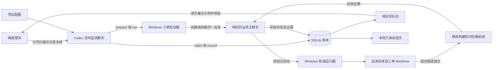
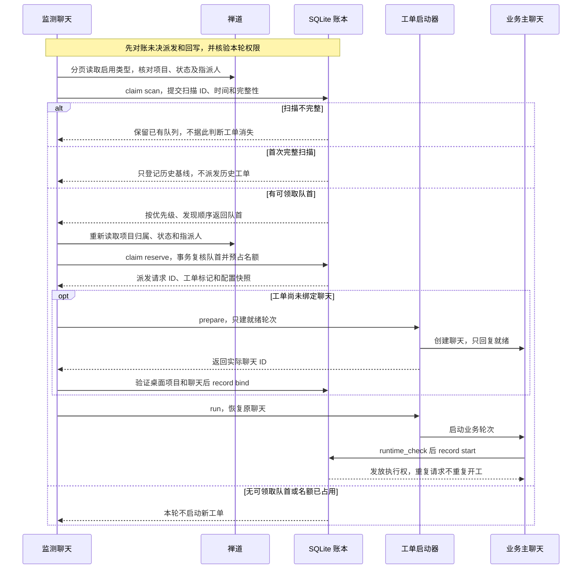
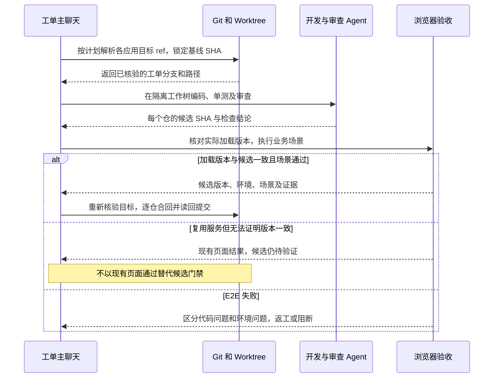
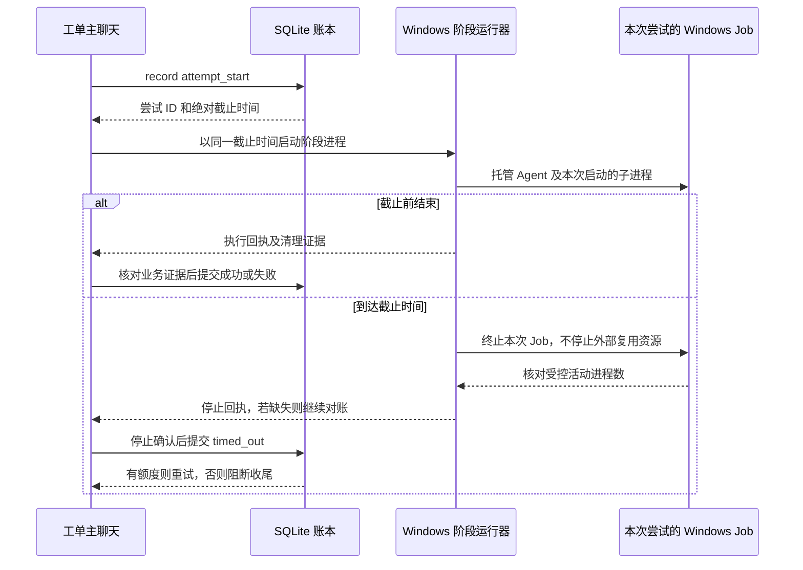
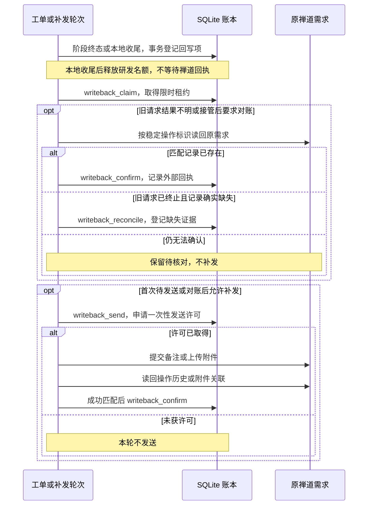

# 海能发地质工程一体化｜禅道无人值守研发设计与实施方案

> 版本日期：2026 年 11 月 19 日（北京时间）　|　适用对象：研发评审与运行维护　|　[业务流程说明](02-禅道无人值守业务流程说明.md)

## 一、汇报摘要

项目把指派到禅道的前端需求，串成一条有证据可追溯的交付链：定时发现、单工单领取、隔离开发、候选版本验证、目标分支合回、禅道结果回写。**SQLite 决定工单推进到哪一步，Windows 执行器负责进程启停，Git 与浏览器证据决定能否合回。** 三者各负其责，避免把「Agent 回复完成」「本地已收尾」「禅道已收到」当成同一件事。

当前配置为 **每 3 分钟扫描、最多 1 单执行**：扫描时按禅道项目、指派账号白名单和 `reviewing`、`active` 状态筛选需求；材料和设计阶段再判断能否按 `frontend_only` 范围交付。Bug 接收列表为空。

## 二、系统分工与数据流

| 层次 | 职责与边界 |
| --- | --- |
| 监测与接入 | 读当前配置、查分页完整性、复核队首、领取名额并核验实际桌面项目归属；监测轮次权限未验证时不执行外部操作。 |
| 工单与账本 | 每单绑定一个业务主聊天，按接单快照推进。账本保存扫描、工单、派发、尝试、幂等事件、恢复与回写记录，不负责终止进程，也不直接发送禅道请求。 |
| 执行与验证 | `worker.py` 管理就绪与原会话恢复；`stage_runner.py` 约束单次尝试拥有的进程。执行方采集分支、测试与版本证据，不以退出码替代业务验收。 |
| 回写与可见性 | 阶段终态、收尾与相应待回写项由账本事务落地。外部确认独立记录；进度页显示本地状态，不作为禅道交付回执。 |

### 配置、命令与产物

以下路径以项目根目录为起点；脚本均在 `.agents/skills/zentao-autodelivery/scripts/` 下。

| 入口 | 实施约定 |
| --- | --- |
| `.agents/zentao-project.json` | `monitor` 配置调度范围及开关；`development` 配置应用映射、并发和阶段时限；`e2e` 配置入口、登录引用和默认工区。 |
| `workflow.py claim` / `workflow.py record` | 从标准输入读取 JSON。`claim` 执行 `scan`、`reserve`；`record` 执行权限检查、绑定、阶段、收尾与回写，数据库状态不直接改表。 |
| `worker.py prepare` / `worker.py run` | 用 `--ask-for-approval never` 创建就绪会话或恢复原会话；实际的监测和工单权限分别核验，不能以启动参数替代权限核验。 |
| `branch_check.py` / `stage_runner.py` | 前者核验实际 Git 根、目标和工作树；后者以绝对截止时间管理单次尝试拥有的 Windows 进程。 |
| `.local/zentao-delivery/` | `workflow.sqlite3` 是正式账本，排障使用只读连接；`items/<marker>/` 保存工单与各轮证据；`status.html` 展示账本状态，每 30 秒重新读取。 |

接口细节见[账本命令契约](../.agents/skills/zentao-autodelivery/references/workflow-cli.md)、[工单启动器](../.agents/skills/zentao-autodelivery/references/worker.md)和[阶段运行器](../.agents/skills/zentao-autodelivery/references/stage-runner.md)。

## 三、接单与唯一执行权

- **唯一性**：工单键为「实例、禅道实际项目 ID、工单类型、工单 ID」；不按标题匹配。领取在事务中检查队首和名额，派发标识用于处理重复、过期和迟到回执。
- **未知不当失败**：建聊回执缺失时先查原派发记录、聊天及进程；找到原聊天就绑定，不能确认未创建且启动器已停止时，不另开聊天。已取得执行权的工单不因派发租约到期自动释放。
- **配置边界**：当前配置决定新单接入，原配置快照约束已领取工单的范围、目标分支和阶段时限。`monitor.enabled` 关闭意味着停止新单接入，不等价于中断执行中的工单。

## 四、研发证据链与跨仓合回

| 阶段 | 单次上限 | 通过依据 |
| --- | ---: | --- |
| 材料评审 `material_check` | 10 分钟 | 按工单登记的材料相对路径核实需求材料和 `intent.md`，记录入口；缺失则待补材料。 |
| 设计 `design` / 计划 `plan` | 各 45 分钟 | `design.md` 划定影响范围，`plan.md` 明确应用配置键、实施、单测与验收；涉及后端变更则超出当前范围。 |
| 分支核验 `branch_check` | 15 分钟 | 逐应用核验实际 Git 根、目标 ref、基线提交、工单分支和 worktree；编码前读回。 |
| 编码 `coding` / 单测 `unit_test` | 120 / 45 分钟 | 仅在已核验 worktree 变更；保存候选版本、测试命令与结果，并把基线既有失败与新增失败区分开。 |
| Code Review `code_review` | 45 分钟 | 记录对应版本、问题严重度和复审结论；需修复的问题不能直接放行。 |
| 浏览器验收 `e2e` | 90 分钟 | 从真实应用入口执行验收条件，记录基座和相关子应用实际版本、会话／工区及场景结果；环境准备计入同一上限。 |
| 合回 `integration` | 45 分钟 | 只合回通过核验的候选版本；逐仓确认目标状态、记录合回提交，不将本地合回等同于推送或上线。 |

工作树按计划涉及的应用建立，不为只在浏览器中加载的依赖无差别建树。目标 ref 优先用本地同名分支，其次用已有 `origin` 跟踪分支；仍缺失时按授权核对远端并只抓取目标 ref。优先采用桌面 worktree；回执不明先核对桌面附件和 Git 清单，在满足回退条件后用固定路径建树，同单同轮可复用。父仓和子仓分别记录基线与候选 SHA；有父仓 gitlink 变更时单独核对其指向。**当前未证明跨仓合回具有原子性**，出现部分合回应保留逐仓结果并核对实际目标，不自动覆盖或回滚他人改动，不能报作全量交付。

E2E 优先复用可用的服务、配置账号会话及已有工区；没有可用服务再从本单工作区启动，只有未选工区时才选配置默认工区。深层路由以实际浏览器验证为准，辅助 HTTP 探测使用 `Accept: text/html`。入口 `200` 只说明能打开，不能证明业务场景或候选版本通过。

## 五、时限、隔离与恢复

- 每步首次尝试后最多重试 **3 次**，不是总共 3 次；进程重启先读回原尝试及截止时间，不重置次数。旧尝试的迟到结果不能推进当前阶段。
- 审查或 E2E 的代码问题按一轮返工记为该阶段一次重试；编码、单测、E2E 返工所需的复审以及最终复验分别使用相应阶段时限。单纯环境故障重试环境，不强制启动代码返工。
- 阶段最终失败时账本进入 `closing`，保留成功结果，后续依赖阶段逐项标为跳过。仍可独立执行的核查记入证据，不用局部结果绕过门禁。落为待补材料、待验证或阻断后可凭**新的恢复证据**重新排队，沿原聊天从阻断处继续；已交付和主动停跑不走此自动恢复路径。
- 无法确认 Agent 与自有进程已停止时，不并行启动下一尝试。工单本地收尾后才释放已执行名额；已收尾不保证外部回写已确认。

## 六、禅道回写与日常处置

阶段终态备注包含实际起止时间、结果及重试次数；最终备注逐项汇总成功、失败和跳过。操作 ID 按工单标记、恢复轮次和事项区分。阻断附件优先走已验证的需求 REST v2 上传路径，核对文件 ID、实际关联对象与下载内容；上传受阻时在最终备注保留摘要，注明已核验的共享位置或待补发。需求回写已验证，Bug 通道仍未验收。

| 现象 | 处置 |
| --- | --- |
| 长时间无完整扫描 | 查 Codex 调度历史与账本时间，区分未调度、权限不满足、分页不全和确实无单；部分结果不能覆盖原队列。 |
| 会话或合回回执不明 | 分别读回原聊天、派发与运行状态，或实际 Git 状态和合回 SHA；不依据回执缺失直接重做。 |
| 尝试超时但停机状态不明确 | 按原尝试核对 Windows Job 和自有进程退出；无法确认时保留名额及证据，不开下一次尝试。 |
| 回写积压或响应不明 | 先核对租约、外部记录和旧请求状态；确认缺失后再补发，已确认的只补本地回执。 |
| 需要暂停 | 关闭接入只停止新单。主动停跑要核对原聊天空闲、自有进程为零且无活动尝试，再执行 `record stop`；该工单不自动恢复。 |

## 七、验收证据与待验证项

| 场景 | 证据及边界 |
| --- | --- |
| 工作流控制 | 最近一次本地回归 **32 项通过**，覆盖并发领取、重放防护、工作树回退、受控停止、返工、收尾及回写接管；这不等于完成正式定时端到端验收。 |
| 受控超时 | [Windows 超时探针](../.local/zentao-delivery/runner-probes/windows-codex-fbc946122ceb/verify/result.json)记录真实 Codex CLI 的受控活动进程由 **8 降为 0**，并核对测试子进程退出。 |
| 阻断与附件 | 受控需求试单验证材料入口、复用页面场景和附件关联读回；缺目标子仓时未合回，现有页面结果不计作候选验收通过。 |
| 跨仓整链 | [隔离验收回执](../.local/zentao-delivery/items/HNF-2b9e385aaf8f0529070e/validation-receipt.json)、[候选 E2E](../.local/zentao-delivery/acceptance-33/candidate-e2e/e2e.json)及[逐仓合回记录](../.local/zentao-delivery/acceptance-33/integration.json)覆盖 **9 个阶段、6 组浏览器场景、10 条备注读回**。基座和 Shell Hub 以固定候选提交快进合回本机目标；目录读接口使用允许的测试响应，没有验证远程推送或部署。 |

本地回归命令：`python -B -m unittest discover -s .agents/skills/zentao-autodelivery/tests -v`。

后续验证建议：在正式定时环境分别验证成功交付、可恢复阻断以及阻断后接下一单；补测登录和工区场景、跨仓部分合回处置、禅道回写接管。记录发现到领取、阶段超时和回写确认的耗时，再设告警阈值。若要扩展 Bug 接入，先单独验证真实 Bug 的接单、复现和备注附件读回。

## 八、安全与实施范围

- 已验证的自动回写范围是需求备注和需求附件；Bug 接单、Bug 回写、后端开发、远程推送及上线不作为本期已交付能力。
- 凭据从本机凭据存储读取，配置快照只记引用；汇报、截图和日志不包含密码、会话凭据或不相关的业务数据。无人值守不扩大 Git、禅道或 Codex 权限。
- 当前实时性是**定时扫描 + 账本更新 + 进度页刷新**，不是禅道实时推送，不承诺 3 分钟内完成领取或开始开发。用观察窗口和实测延迟描述运行效果。

**依据**：原始[研发设计](../docs/禅道无人值守研发设计.md)和[实施方案](../docs/禅道无人值守研发实施方案.md)；当前[项目配置](../.agents/zentao-project.json)、[项目 Skill](../.agents/skills/zentao-autodelivery/SKILL.md)、[阶段与证据](../.agents/skills/zentao-autodelivery/references/stages.md)、[分支与工作树](../.agents/skills/zentao-autodelivery/references/branches.md)、[E2E 指引](../.agents/skills/zentao-autodelivery/references/e2e.md)。
