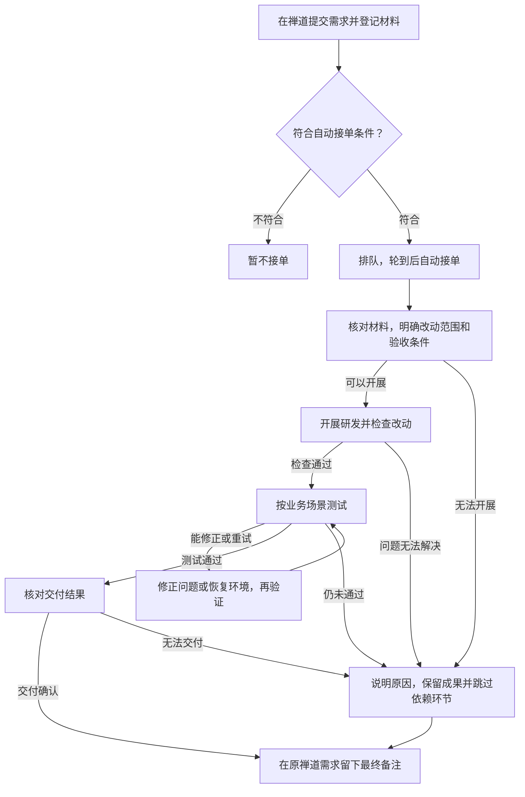

# 海能发地质工程一体化｜禅道无人值守业务流程说明

> 适用对象：需求提出人、项目负责人和验收人员。本文说明目前已运行的前端需求处理流程。

## 一、需求方要做什么

在禅道提交需求，写明要解决的问题、期望效果和如何判断是否满足要求，并登记需求材料的位置。需求需属于本项目、指派给约定的接收人，且处于「评审中」或「激活」状态。当前自动流程只处理可以通过前端页面或交互调整完成的需求，不接收 Bug；如果评审发现必须同时改动后端，会说明不在本流程处理范围内并收尾。

符合条件后，系统每 3 分钟检查一次。有其他需求正在处理时，新单先排队，按禅道优先级处理；同优先级按发现先后处理。正式接单前会再次检查项目归属、指派人和状态。同一需求不会因为重复发现而重复开工；首次启用时，已登记为历史记录的需求不会自动开工。**3 分钟是检查间隔，不是开工或完成承诺。**

## 二、从提交需求到收尾

| 环节 | 实际怎么走 | 需求方能看到什么 |
| --- | --- | --- |
| 接单与材料检查 | 轮到后自动接单，先核对需求中登记的材料。找不到材料或材料不齐，就停在材料检查，不直接开工。 | 材料评审备注说明是否找到；缺少时说明需要补什么。 |
| 明确范围与验收条件 | 依据需求材料整理要改的功能、影响范围、实施顺序和测试条件。能在当前范围内完成的，继续推进。 | 设计和计划阶段分别记录结论；超出范围时说明不能继续的原因。 |
| 研发与检查 | 完成改动后先检查改动是否正确、是否影响已有功能。有必须修正的问题，修正后再检查。 | 研发和检查阶段记录结果；仍无法解决的问题会注明原因，不交给下一环节当作已通过。 |
| 业务场景测试 | 按验收条件从实际业务页面验证，例如操作能否完成、页面反馈是否正确、原有功能是否正常。能修正的问题修正后复验；环境暂不可用时先尝试恢复。 | 测试备注说明实际验证了什么、结果如何。已有页面能打开或部分场景通过，不代表本次改动已通过。 |
| 交付与收尾 | 通过规定的检查和业务测试，且交付核对完成后，才记为「已交付」。不能继续时保留已完成结果，跳过依赖受阻环节的工作。 | 原需求下的最终备注汇总已完成、失败和跳过的事项，并说明本单结论。**「已交付」不等于已上线。** |

正常流程不需要需求方逐步确认。确有缺项时，需求方按原单备注补材料或协助解决阻断，不必另开一条相同需求。

## 三、阻断后怎么处理

| 收尾结论 | 含义 | 接下来怎么办 |
| --- | --- | --- |
| 已交付 | 检查、业务测试和交付核对都已完成。 | 查看最终备注确认交付内容和验收结果。 |
| 待补材料 | 需求材料缺失，暂不能继续。 | 按备注补齐材料并更新原需求中的材料位置。 |
| 待验证 | 已完成部分工作，但本次改动未能完成业务验证。 | 确认验证环境恢复，或待验证的改动已就绪，再继续验证，不直接认定交付。 |
| 阻断 | 超出现有处理范围，或遇到其他当前无法解决的问题。 | 按备注明确原因；原因消除且有新依据时，可按原需求恢复。 |

能重试的问题会先重试；确认无法继续后，才记录阻断及哪些后续步骤因此跳过。材料补齐、环境恢复或有可重新验证的结果时，符合接单条件的原需求可重新排队，从受阻处继续，之前的记录保留。无法继续的需求完成收尾后，不会一直占着名额，下一单可以继续处理。

## 四、怎样在禅道查看进度和结果

在**原需求详情的备注或操作历史**里查看，不需要另找一条交付单。

- **阶段备注**：记录做了什么、实际开始和结束时间、通过或未通过；有重试会说明次数，跳过会说明受哪个环节影响。处理中以最新已记录的阶段结果为准。
- **最终备注**：汇总已完成、失败和跳过的环节，给出「已交付」「待补材料」「待验证」或「阻断」等本次处理结论。这是处理结果，不是禅道需求状态自动变更的承诺。
- **阻断说明**：有阻断时优先附上完整说明；附件暂时无法提供时，先给出关键原因和可查看的位置，或注明待补发。
- **备注暂未出现**：禅道暂时不可用时，备注或附件可能晚于实际收尾。恢复后会先核对原需求，缺失的才补写，避免重复备注。

例如，业务测试因环境不可用而无法完成，最终备注会说明「研发和检查已完成，业务测试待验证，交付环节未执行」，不会只写一个笼统的「已完成」。
